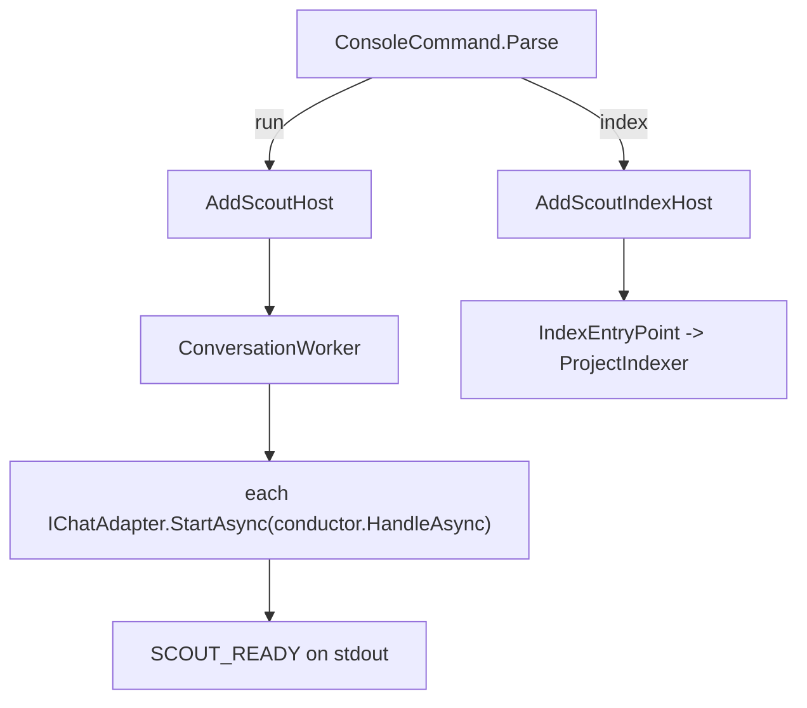

# Host.Console

> The process the desktop app launches and supervises: it starts whichever adapters are configured and answers until stopped.

## To change here, read

- [[pages/invariants/pluggable-boundaries]]
- [[pages/invariants/secrets-never-in-source]]
- [[pages/invariants/local-first-default]]
- [[pages/invariants/no-executive-writes]]
- [[pages/decisions/0028-local-quick-ask-assistant]] - stdin and stdout as the quick-ask transport
- [[pages/conventions/testing]]

## Responsibility

Owns composition, the conversation worker, the readiness marker, the parent watchdog and the `index` command. Does not own behaviour of any piece it wires.

## Public contract

- **Entry point:** `src/Scout.Host.Console/Program.cs`. `ConsoleCommand.Parse` selects run or `index <project>` (`src/Scout.Host.Console/ConsoleCommand.cs:22`); the index path builds a minimal graph (`src/Scout.Host.Console/Program.cs:14`).
- **Composition:** `AddScoutHost` (`src/Scout.Host.Console/HostComposition.cs:33`) registers in order: readiness signal (`:40`), pairing signal (`:41`), LLM (`:43`), skills (`:47`), conversation (`:48`), knowledge (`:49`), Whisper transcription when `Scout:Transcription:ModelPath` exists (`:52`, [[pages/services/transcription-whisper]]), the local adapter when `Scout:Adapters:Local:Enabled` is true, first so stdin has a reader before any network adapter starts (`:56`, [[pages/services/adapter-local]]), three chat adapters (`:57` to `:59`), GitHub plugin (`:62`), Kubernetes plugin (`:63`), YouTube plugin (`:64`, [[pages/services/plugin-youtube]]), the write gate (`:65`), the YouTube channel operator (`:66`, [[pages/services/operator]]), worker (`:68`), watchdog (`:72`). The operator is composed only when the YouTube plugin registered its client (`:106`), the same self-gating as the plugin; it gets `GrpcOperatorControlPlane` when the write gate is open (`:113`) and `ClosedOperatorControlPlane` otherwise (`:117`). `AddScoutIndexHost` (`:159`) registers LLM and knowledge only, and no write gate, because it composes no plugin. A publish target keeps the target platform's Whisper native libraries as loose files beside the single-file binary (`src/Scout.Host.Console/Scout.Host.Console.csproj:39`). The Kubernetes plugin builds its clients on the first call, so composing it reads no kubeconfig (`tests/Scout.Host.Console.Tests/HostCompositionSmokeTests.cs:159`); the YouTube plugin, configured with a dummy key, lands on the kernel without a call to YouTube (`tests/Scout.Host.Console.Tests/HostCompositionSmokeTests.cs:208`).
- **Runtime types:** `ConversationWorker` (`src/Scout.Host.Console/ConversationWorker.cs:14`), `IReadinessSignal` printing the `SCOUT_READY` marker on stdout (`src/Scout.Host.Console/IReadinessSignal.cs:18`), `StdoutPairingSignal`, the `IPairingSignal` of owner pairing, printing `SCOUT_PAIRED=<id>` when a user pairs and `SCOUT_PAIRING_BURNED` when the code is burned (`src/Scout.Host.Console/StdoutPairingSignal.cs:10`, [[pages/decisions/0021-allowed-users]]), `ParentWatchdogService` (`src/Scout.Host.Console/ParentWatchdogService.cs:13`) with a stdin-EOF probe (`src/Scout.Host.Console/IParentLivenessProbe.cs:23`), or, when the local adapter is registered, a probe that waits on that adapter's `InputClosed`, so stdin has one reader (`src/Scout.Host.Console/IParentLivenessProbe.cs:65`, chosen at `src/Scout.Host.Console/ParentWatchdogRegistration.cs:29`; `AddLocalAdapter` must run before `AddParentWatchdog`, as it does in `AddScoutHost`), `IndexEntryPoint` (`src/Scout.Host.Console/IndexEntryPoint.cs:12`), and the two `IWriteGate` implementations of [[pages/services/llm]]'s write gate: `GrpcWriteGate` (`src/Scout.Host.Console/GrpcWriteGate.cs:14`), registered as itself and as the `IWriteGate` when both the socket path and the token are set (`src/Scout.Host.Console/HostComposition.cs:95`), and `ClosedWriteGate` (`src/Scout.Host.Console/ClosedWriteGate.cs:9`) otherwise, which refuses every write with "Writes are off: Scout Desktop's control plane is not available." The two `IOperatorControlPlane` implementations of [[pages/services/operator]]: `GrpcOperatorControlPlane` (`src/Scout.Host.Console/GrpcOperatorControlPlane.cs:13`), which calls `WorkerGate` on the `GrpcWriteGate`'s own client, token header and deadline (`src/Scout.Host.Console/GrpcWriteGate.cs:52`), so there is one channel and one token; and `ClosedOperatorControlPlane` (`src/Scout.Host.Console/ClosedOperatorControlPlane.cs:9`), whose every call fails with "Scout Desktop's control plane is not available, so the video operator is off."
- **Configuration keys read here:** `Scout:Adapters:Discord:BotToken`, `Scout:Adapters:Slack:BotToken`, `Scout:Adapters:Teams:AppId`, `Scout:Adapters:Local:Enabled` (startup marker only, `src/Scout.Host.Console/Program.cs:47`, `:59`); everything else is read by the wired projects. `Scout:WorkerGate:SocketPath` and `Scout:WorkerGate:Token`, which the desktop sets as `SCOUT__WORKERGATE__SOCKETPATH` and `SCOUT__WORKERGATE__TOKEN` (empty when there is no control plane) and which are read through configuration binding only; the token goes on each call as `authorization: Bearer <token>` and is never logged. Right after composition reads the two values, it removes from the process environment every variable that configuration reads as the token, in any casing or ':' spelling and with or without the `DOTNET_` or `ASPNETCORE_` prefix, whether or not the gate is opened (`src/Scout.Host.Console/HostComposition.cs:88`, `:128`), so a process the worker starts, such as a kubeconfig exec credential plugin, does not inherit it; `GrpcWriteGate` keeps the value it was given. On Unix the removal changes .NET's own environment block, which `Process.Start` hands to children; native code that reads the C `environ` still sees the original. The `index` command never composes the write gate and so never removes the token. Environment variable `SCOUT__PARENT_WATCHDOG` enables the watchdog when set to `1` (`src/Scout.Host.Console/ParentWatchdogRegistration.cs:14`). Configuration root is the binary directory (`src/Scout.Host.Console/Program.cs:17`, `:32`).
- **External boundaries:** stdout carries only the readiness and pairing markers and the local adapter's `SCOUT_LOCAL` reply lines; stdin carries the desktop's quick-ask requests to the local adapter; all logs go to stderr (`src/Scout.Host.Console/Program.cs:38`). Network boundaries belong to the wired projects, except one: `GrpcWriteGate` calls the control plane's `WorkerGate` service (`RequestWrite`, `RecordWrite`, [[pages/services/control-plane-contracts]]) over the Unix socket the desktop passes, through a `SocketsHttpHandler` whose `ConnectCallback` opens a `UnixDomainSocketEndPoint`, with a 10 s deadline per call (`src/Scout.Host.Console/GrpcWriteGate.cs:49`). Only `allowed` and `queued` are read as such; an empty, unknown or differently cased decision is a refusal (`src/Scout.Host.Console/GrpcWriteGate.cs:74`). A call that fails or misses the deadline throws, and the write gate filter then refuses the write. `GrpcOperatorControlPlane` calls `GetOperatorMandate`, `SaveOperatorProject`, `NextQueuedProject`, `GetOperatorProject` and `ListOperatorProjects` the same way and maps the messages to the operator's records field by field, setting an optional field only when it has a value; a refusal the control plane words (`PERMISSION_DENIED`, `FAILED_PRECONDITION`, `INVALID_ARGUMENT`, `NOT_FOUND`) keeps its words, and any other failure, a missing socket included, becomes "Scout could not reach its control plane." (`src/Scout.Host.Console/GrpcOperatorControlPlane.cs:86`), so no transport text reaches the chat or the desktop.

## How it works

With no adapter registered the worker writes a hint to stderr and stops the application (`src/Scout.Host.Console/ConversationWorker.cs:25`); a failing adapter start does the same (`:52`). Readiness is signalled only after every adapter has started (`:66`).

## Invariants

- [[pages/invariants/pluggable-boundaries]]: wires every adapter and plugin at compile time and lets configuration pick (`src/Scout.Host.Console/Scout.Host.Console.csproj:16`).
- [[pages/invariants/secrets-never-in-source]]: ships `appsettings.json` with empty credentials (`src/Scout.Host.Console/appsettings.json:31`, committed content) and a user-secrets id (`src/Scout.Host.Console/Scout.Host.Console.csproj:7`).
- [[pages/invariants/local-first-default]]: committed provider is Ollama (`src/Scout.Host.Console/appsettings.json:10`).
- [[pages/invariants/no-executive-writes]]: composes every plugin the model can call, and the write gate every declared write asks; without the desktop's socket and token that gate refuses every write.
- [[pages/invariants/secrets-never-in-source]]: the worker gate token arrives only through configuration binding (`src/Scout.Host.Console/HostComposition.cs:87`), travels only in the call metadata, and leaves the process environment once read (`tests/Scout.Host.Console.Tests/WorkerGateTokenEnvironmentTests.cs:26`).

## Hot spots

- `src/Scout.Host.Console/HostComposition.cs:47`: registration order matters; skills must precede conversation.
- `src/Scout.Host.Console/HostComposition.cs:65`: the operator is composed after the write gate and the YouTube plugin, because it needs the gate's `GrpcWriteGate` and checks for the YouTube client.
- `src/Scout.Host.Console/ConversationWorker.cs:45`: adapters start sequentially, one failure aborts the host.

## Testing footprint

`tests/Scout.Host.Console.Tests` (58 test attributes, 77 cases on 2026-11-03, 16 files): command parsing, worker behaviour, the local adapter registered only when enabled and ahead of the network adapters, a host with Local as its only adapter, the watchdog waiting on the local adapter's input when both are on and reading stdin itself otherwise, and the composed host answering a local-owner voice message although no chat user is allowed (`HostLocalCompositionTests.cs`), the composed host answering a voice message with the no-model text or handing it to the transcriber (`HostVoiceCompositionTests.cs`), full-graph and index-graph smoke tests with a throwing HTTP handler to prove no network on resolve (`HostCompositionSmokeTests.cs`, `IndexHostCompositionSmokeTests.cs`), and watchdog registration and service. `GrpcWriteGateTests.cs` runs `GrpcWriteGate` against an in-test `WorkerGate` server on a temporary Unix socket: the decision mapping including the refusal of an unknown decision (`tests/Scout.Host.Console.Tests/GrpcWriteGateTests.cs:29`), the write and the bearer token reaching the server (`:58`), a declared write that never runs and the unreachable text when the socket does not exist (`:86`) or the server misses the deadline (`:99`), a record the server refuses with `FAILED_PRECONDITION` leaving the write's result and one Warning (`:117`), the closed gate (`:141`), and the host choosing the gRPC gate only when both values are set (`:156`). `GrpcOperatorControlPlaneTests.cs` runs `GrpcOperatorControlPlane` against the same in-test server: a saved project with its origin and the bearer token (`tests/Scout.Host.Console.Tests/GrpcOperatorControlPlaneTests.cs:41`), a queued project and an empty reply (`:60`), a project read back with the owner's claim decision and the list's limit (`:84`), the mandate (`:112`), worded refusals kept and other failures read as unreachable (`:132`), `youtube_make_video` with the socket missing starting no project and failing with a sentence that says why (`:146`), the closed control plane (`:167`), and the operator composed only with YouTube, on the gate's own `GrpcWriteGate` (`:187`). `WriteDeclarationCatalogTests.cs` composes the host with every plugin and asserts each declared write names a `Write` or `IrreversibleWrite` row of its feature in the control plane's catalog, exactly (`tests/Scout.Host.Console.Tests/WriteDeclarationCatalogTests.cs:13`). `HostOperatorTurnTests.cs` drives a `ConversationConductor` turn with an origin reference through the composed host and a scripted model that calls `youtube_make_video`, and asserts the gate was asked, the saved project carries the turn's reference and the write is recorded as succeeded (`tests/Scout.Host.Console.Tests/HostOperatorTurnTests.cs:48`); when the control plane refuses the save, the real `WriteGateFilter` records the write as `failed: ...`, never `succeeded`, and the model reads the refusal (`:70`). `OperatorContractTests.cs` holds Scout.Operator to the control plane it talks to: every project status and the claim status the operator sends pass `OperatorService`'s worker validation, and the operator's `DataFolderScope` is the text of the catalog's YouTube `Write` row (`tests/Scout.Host.Console.Tests/OperatorContractTests.cs:44`, `:67`). The full-graph smoke test also resolves the operator's plugin and worker without a cycle (`tests/Scout.Host.Console.Tests/HostCompositionSmokeTests.cs:218`). `WorkerGateTokenEnvironmentTests.cs`, in a collection that runs alone because every composition edits the process environment, sets the token under five spellings, composes the host, and asserts that none is left in the process environment or in the environment a child process would get, that the socket path is untouched, and that the gate still sends the token (`tests/Scout.Host.Console.Tests/WorkerGateTokenEnvironmentTests.cs:26`).

## Related

Direct project references: [[pages/services/llm]], [[pages/services/control-plane-contracts]] (the `WorkerGate` client stubs; its `Grpc.AspNetCore` package brings the ASP.NET Core shared framework into the worker), [[pages/services/conversation]], [[pages/services/knowledge]], [[pages/services/transcription-whisper]], [[pages/services/adapter-discord]], [[pages/services/adapter-slack]], [[pages/services/adapter-teams]], [[pages/services/adapter-local]], [[pages/services/plugin-github]], [[pages/services/plugin-kubernetes]], [[pages/services/plugin-youtube]], [[pages/services/operator]]. Skills arrives through Conversation. The test project also references [[pages/services/control-plane]], for the catalog the declared writes are checked against. Map: [[pages/architecture/project-map]].
