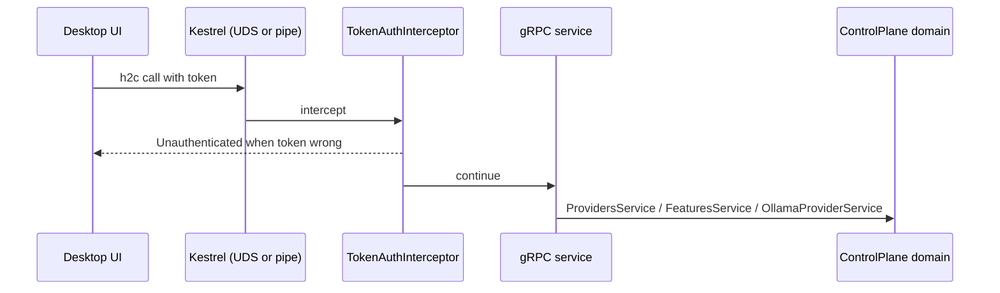

# Host.ControlPlane

> The local door the desktop app knocks on: gRPC over a user-only socket, with a token.

## To change here, read

- [[pages/invariants/no-executive-writes]]
- [[pages/invariants/secrets-never-in-source]]
- [[pages/services/control-plane]]
- [[pages/services/control-plane-contracts]]
- [[pages/conventions/testing]]

## Responsibility

Owns the transport, authentication and gRPC adapters over [[pages/services/control-plane]]. Does not listen on TCP and does not run the chat loop ([[pages/services/host-console]]).

## Public contract

- **Entry points:** `AddControlPlaneHost` (`src/Scout.Host.ControlPlane/ControlPlaneServiceRegistration.cs:17`) and `MapControlPlaneServices` (`:38`); process entry `src/Scout.Host.ControlPlane/Program.cs:8`.
- **gRPC services:** `ProvidersGrpcService` (`src/Scout.Host.ControlPlane/Services/ProvidersGrpcService.cs:14`), `ModelsGrpcService` (`src/Scout.Host.ControlPlane/Services/ModelsGrpcService.cs:13`), `FeaturesGrpcService` (`src/Scout.Host.ControlPlane/Services/FeaturesGrpcService.cs:13`); mapping helpers `FeatureMapping` and `ProviderMapping`.
- **Security:** `SessionToken` (`src/Scout.Host.ControlPlane/Security/SessionToken.cs:11`) read from or minted at startup; `TokenAuthInterceptor` (`src/Scout.Host.ControlPlane/Security/TokenAuthInterceptor.cs:12`) accepts the token in an `authorization` bearer header or `x-scout-token` and compares in constant time (`src/Scout.Host.ControlPlane/Security/SessionToken.cs:62`).
- **Configuration and environment:** `Scout:ControlPlane:SocketPath` (`src/Scout.Host.ControlPlane/Program.cs:25`); environment variable `SCOUT_CONTROLPLANE_TOKEN` (`src/Scout.Host.ControlPlane/Security/SessionToken.cs:14`); `XDG_RUNTIME_DIR` for the socket directory (`src/Scout.Host.ControlPlane/Transport/ControlPlaneEndpoint.cs:28`); the domain keys listed on [[pages/services/control-plane]].
- **External boundaries:** Unix domain socket `controlplane.sock` on Linux and macOS, named pipe `scout-controlplane` on Windows (`src/Scout.Host.ControlPlane/Transport/ControlPlaneEndpoint.cs:12,15`); filesystem permissions on the socket and its directory (`:41`, `:95`).

## How it works

Startup refuses to run on Unix when the native `stat` self-test fails, because the socket anti-hijack pre-flight depends on it (`src/Scout.Host.ControlPlane/Program.cs:35`). After Kestrel binds, the socket mode is tightened to owner read and write (`src/Scout.Host.ControlPlane/Program.cs:58`, `src/Scout.Host.ControlPlane/Transport/ControlPlaneEndpoint.cs:100`). On Windows the pipe is restricted to the current user (`src/Scout.Host.ControlPlane/Program.cs:17`).

## Invariants

- [[pages/invariants/no-executive-writes]]: `PullModel` and `DeleteModel` (`src/Scout.Host.ControlPlane/Services/ModelsGrpcService.cs:22,59`) and the start and stop calls are reachable by any holder of the token.
- [[pages/invariants/secrets-never-in-source]]: the session token is minted or read from the environment, never from a file in the repository.

## Hot spots

- `src/Scout.Host.ControlPlane/Transport/NativeUnix.cs:15`: native `stat` interop for socket ownership checks.
- `src/Scout.Host.ControlPlane/Transport/ControlPlaneEndpoint.cs:54`: pre-flight on an existing socket path.
- `src/Scout.Host.ControlPlane/Security/TokenAuthInterceptor.cs:25`: the interceptor covers unary and streaming handlers; a new RPC kind must be added here.

## Testing footprint

Covered by `tests/Scout.ControlPlane.Tests` (59 test attributes in total, 9 files): `Security/SessionTokenTests.cs`, `Security/TokenAuthInterceptorTests.cs`, and `Integration/` tests that start the host on a Unix socket (`ControlPlaneUdsIntegrationTests.cs`) and check the gRPC boundary (`ControlPlaneBoundaryTests.cs`). The `Transport/` test folder is empty.

## Consumers

The desktop main process is the one client, and in this phase it only proves the transport: nothing in `ui/packages/main/src/main.ts` calls it yet, and no IPC channel or renderer surface reaches it.

- **Launcher.** `launchControlPlane` (`ui/packages/main/src/control-plane/launcher.ts:68`) spawns the host and sets two environment variables on the child: `Scout__ControlPlane__SocketPath`, a per-process socket `controlplane-<pid>.sock` under `$XDG_RUNTIME_DIR/scout` or a per-uid `scout-<uid>` folder under the temp directory (`ui/packages/main/src/control-plane/launcher.ts:58`, `:98`), and `SCOUT_CONTROLPLANE_TOKEN`, a fresh 64-hex-character token (`ui/packages/main/src/control-plane/launcher.ts:99`). The token travels only in the child's environment and in call metadata; the launcher never logs it. Because the explicit socket path makes the host skip its own directory setup, the launcher secures the socket directory itself before it mints the token or spawns: it refuses a symbolic link, a non-directory or a directory owned by another uid, and tightens a directory open to group or others to `0700` (`ui/packages/main/src/control-plane/launcher.ts:38`). It has no restart policy and no parent-death watchdog yet (`ui/packages/main/src/control-plane/launcher.ts:93`).
- **Binary.** `resolveControlPlaneBinary` (`ui/packages/main/src/worker/resolve-binary.ts:51`) honours `SCOUT_CONTROLPLANE_BIN`, then the packaged `worker/<rid>/` folder beside the console worker, then `src/Scout.Host.ControlPlane/bin/Release/net10.0/` and `bin/Debug/net10.0/` under the repository root.
- **Client.** `createControlPlaneClient` (`ui/packages/main/src/control-plane/client.ts:62`) dials `unix:<absolute path>` with `@grpc/grpc-js` and insecure channel credentials, waits for the channel before each call under the same deadline (`ui/packages/main/src/control-plane/client.ts:104`), and sends the token as `x-scout-token` metadata on every call (`ui/packages/main/src/control-plane/client.ts:106`). It maps `UNAVAILABLE`, `DEADLINE_EXCEEDED` and a channel that never becomes ready to `ControlPlaneUnavailableError`, and `UNAUTHENTICATED` to `ControlPlaneUnauthenticatedError` (`ui/packages/main/src/control-plane/client.ts:44`). It loads `providers.proto` at runtime with `@grpc/proto-loader` from the source tree and exposes `listProviders` only.
- **Tests.** `ui/packages/main/test/control-plane-integration.test.ts` launches the real host binary and round-trips `ListProviders`, which returns `OLLAMA` then `LM_STUDIO` whether or not an Ollama daemon runs, and checks that a wrong token is rejected as `UNAUTHENTICATED`. CI builds the host before the UI tests (`.github/workflows/ui-ci.yml:100`).
- **Windows.** The host listens on the named pipe `scout-controlplane` on Windows. The launcher returns `unsupported` on `win32` and spawns nothing (`ui/packages/main/src/control-plane/launcher.ts:73`). The client refuses as well: on `win32` `createControlPlaneClient` throws `ControlPlaneUnavailableError` naming named pipes before it creates any channel (`ui/packages/main/src/control-plane/client.ts:65`). `@grpc/grpc-js` documents no named-pipe target. Its `unix:` resolver passes the path to Node's `net.connect`, which accepts `\\.\pipe\` names on Windows, so a pipe target may work, but nobody has run it on Windows. The choice between dialling the pipe through the `unix:` target, a named-pipe shim and a stdio fallback is pending.

## Related

Direct project references: [[pages/services/control-plane-contracts]], [[pages/services/control-plane]]. Map: [[pages/architecture/project-map]]. Consumer: the desktop launcher and client in the Consumers section above, phase 1 of [[pages/roadmap/control-plane-client]]; see [[pages/services/desktop-ui]].
