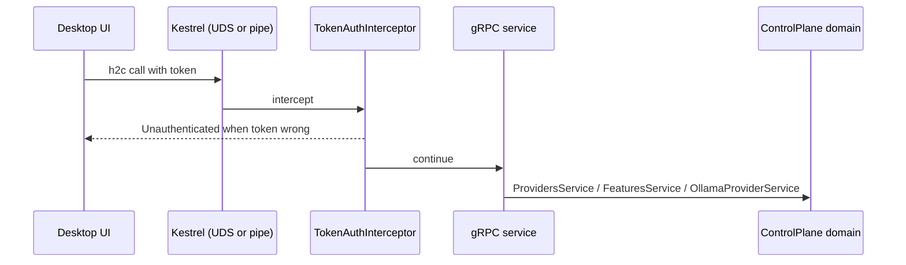

# Host.ControlPlane

> The local door the desktop app knocks on: gRPC over a user-only socket, with a token.

## To change here, read

- [[pages/invariants/no-executive-writes]]
- [[pages/invariants/secrets-never-in-source]]
- [[pages/services/control-plane]]
- [[pages/services/control-plane-contracts]]
- [[pages/conventions/testing]]

## Responsibility

Owns the transport, authentication and gRPC adapters over [[pages/services/control-plane]]. Does not listen on TCP and does not run the chat loop ([[pages/services/host-console]]).

## Public contract

- **Entry points:** `AddControlPlaneHost` (`src/Scout.Host.ControlPlane/ControlPlaneServiceRegistration.cs:17`) and `MapControlPlaneServices` (`:38`); process entry `src/Scout.Host.ControlPlane/Program.cs:8`.
- **gRPC services:** `ProvidersGrpcService` (`src/Scout.Host.ControlPlane/Services/ProvidersGrpcService.cs:14`), `ModelsGrpcService` (`src/Scout.Host.ControlPlane/Services/ModelsGrpcService.cs:13`), `FeaturesGrpcService` (`src/Scout.Host.ControlPlane/Services/FeaturesGrpcService.cs:13`); mapping helpers `FeatureMapping` and `ProviderMapping`.
- **Security:** `SessionToken` (`src/Scout.Host.ControlPlane/Security/SessionToken.cs:11`) read from or minted at startup; `TokenAuthInterceptor` (`src/Scout.Host.ControlPlane/Security/TokenAuthInterceptor.cs:12`) accepts the token in an `authorization` bearer header or `x-scout-token` and compares in constant time (`src/Scout.Host.ControlPlane/Security/SessionToken.cs:62`).
- **Configuration and environment:** `Scout:ControlPlane:SocketPath` (`src/Scout.Host.ControlPlane/Program.cs:25`); environment variable `SCOUT_CONTROLPLANE_TOKEN` (`src/Scout.Host.ControlPlane/Security/SessionToken.cs:14`); `XDG_RUNTIME_DIR` for the socket directory (`src/Scout.Host.ControlPlane/Transport/ControlPlaneEndpoint.cs:28`); the domain keys listed on [[pages/services/control-plane]]. The host overrides none of the domain defaults (`src/Scout.Host.ControlPlane/ControlPlaneServiceRegistration.cs:33` only calls `AddControlPlaneDomain`), so credential saves fail closed there.
- **External boundaries:** Unix domain socket `controlplane.sock` on Linux and macOS, named pipe `scout-controlplane` on Windows (`src/Scout.Host.ControlPlane/Transport/ControlPlaneEndpoint.cs:12,15`); filesystem permissions on the socket and its directory (`:41`, `:95`).

## How it works

Startup refuses to run on Unix when the native `stat` self-test fails, because the socket anti-hijack pre-flight depends on it (`src/Scout.Host.ControlPlane/Program.cs:35`). After Kestrel binds, the socket mode is tightened to owner read and write (`src/Scout.Host.ControlPlane/Program.cs:58`, `src/Scout.Host.ControlPlane/Transport/ControlPlaneEndpoint.cs:100`). On Windows the pipe is restricted to the current user (`src/Scout.Host.ControlPlane/Program.cs:17`).

## Invariants

- [[pages/invariants/no-executive-writes]]: `PullModel` and `DeleteModel` (`src/Scout.Host.ControlPlane/Services/ModelsGrpcService.cs:22,59`) and the start and stop calls are reachable by any holder of the token.
- [[pages/invariants/secrets-never-in-source]]: the session token is minted or read from the environment, never from a file in the repository.

## Hot spots

- `src/Scout.Host.ControlPlane/Transport/NativeUnix.cs:15`: native `stat` interop for socket ownership checks.
- `src/Scout.Host.ControlPlane/Transport/ControlPlaneEndpoint.cs:54`: pre-flight on an existing socket path.
- `src/Scout.Host.ControlPlane/Security/TokenAuthInterceptor.cs:25`: the interceptor covers unary and streaming handlers; a new RPC kind must be added here.

## Testing footprint

Covered by `tests/Scout.ControlPlane.Tests` (66 test attributes in total, 10 files): `Security/SessionTokenTests.cs`, `Security/TokenAuthInterceptorTests.cs`, `Transport/ControlPlaneEndpointTests.cs`, `Transport/NativeUnixTests.cs`, and `Integration/` tests that start the host on a Unix socket (`ControlPlaneUdsIntegrationTests.cs`) and check the gRPC boundary (`ControlPlaneBoundaryTests.cs`).

## Related

Direct project references: [[pages/services/control-plane-contracts]], [[pages/services/control-plane]]. Map: [[pages/architecture/project-map]].
