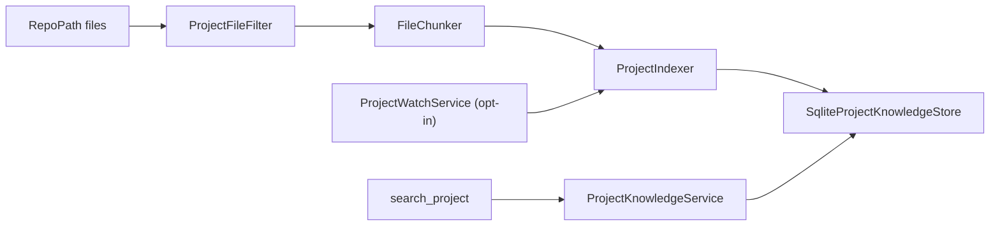

# Knowledge

> Reads configured repositories, indexes their text and, when the provider has embeddings, their vectors, and lets the model search them; never writes to them.

## To change here, read

- [[pages/invariants/no-executive-writes]]
- [[pages/invariants/secrets-never-in-source]]
- [[pages/invariants/pluggable-boundaries]]
- [[pages/services/llm]]
- [[pages/conventions/testing]]

## Responsibility

Owns discovery, chunking, indexing, the vector store, the optional file watcher, and the Project Expert agent persona. Does not own the embedding model ([[pages/services/llm]]) or the chat flow ([[pages/services/conversation]]).

## Public contract

- **Entry point:** `AddProjectKnowledge(IServiceCollection, IConfiguration)` at `src/Scout.Knowledge/KnowledgeServiceCollectionExtensions.cs:30`.
- **Abstractions:** `IProjectKnowledgeStore` (`src/Scout.Knowledge/IProjectKnowledgeStore.cs:4`) implemented by `SqliteProjectKnowledgeStore` (`src/Scout.Knowledge/SqliteProjectKnowledgeStore.cs:14`); `IChunker` (`src/Scout.Knowledge/IChunker.cs:4`) implemented by `FileChunker`, a Roslyn chunker for C# with a line-window fallback (`src/Scout.Knowledge/FileChunker.cs:7`); `ProjectIndexer.IndexAsync` (`src/Scout.Knowledge/ProjectIndexer.cs:21`); `ProjectKnowledgeService` (`src/Scout.Knowledge/ProjectKnowledgeService.cs:16`); `ProjectResolutionService` (`src/Scout.Knowledge/ProjectResolutionService.cs:13`); `ProjectDiscoveryService` (`src/Scout.Knowledge/ProjectDiscoveryService.cs:12`).
- **Model tools:** plugin `ProjectKnowledge` with `search_project`, `find_symbol`, `list_projects` (`src/Scout.Knowledge/ProjectKnowledgePlugin.cs:26,41,53`), always on the kernel since ADR 0039 (`src/Scout.Knowledge/KnowledgeServiceCollectionExtensions.cs:72`), because a project may arrive at run time: `ProjectResolutionService.Register` (`src/Scout.Knowledge/ProjectResolutionService.cs:83`) adds or replaces an entry and marks it stale, so `ResolveAsync` indexes it on its next use even when the store already holds that name (`:123`); the GitHub snapshot registers `owner/repo` this way through the host ([[pages/services/host-console]], [[pages/decisions/0039-repository-snapshot-under-the-data-folder]]).
- **Store:** one SQLite file holds two indexes of the same chunks. The SqliteVec collection `project_chunks` keeps only the chunks that carry a vector (`src/Scout.Knowledge/SqliteProjectKnowledgeStore.cs:207`); the FTS5 table `chunk_fts` (`:23`, tokenizer `unicode61`, the bundled `e_sqlite3` has FTS5) keeps every chunk, is created on every open of the connection, and is rewritten in one transaction by `ReplaceProjectAsync` and `ReplaceFileAsync` (`:142`), after the vector write, so a failed vector write leaves no text rows and `HasProjectAsync` false, and the project is indexed again on its next use. Existence (`HasProjectAsync`, `src/Scout.Knowledge/SqliteProjectKnowledgeStore.cs:59`) and symbol lookup (`FindSymbolAsync`, `:121`) read the text table, so a project indexed without embeddings exists and its symbols are found; a symbol matches exactly (case-insensitive, first) or when it contains the name (`symbol LIKE` with `%`, `_` and `\` escaped, `:128`; case-insensitive for ASCII only, SQLite's `LIKE`), so `Async` finds `SearchAsync`. `SearchTextAsync` (`:97`) keeps the question's words of two characters or more, at most twelve, quotes each so no operator reaches FTS5, joins them with `OR`, and orders by `bm25` (`:113`).
- **Without embeddings:** when the chosen provider has no embedding generator (any provider; today the ChatGPT plan, [[pages/roadmap/chatgpt-plan-provider]]) the indexer stores every chunk without a vector, asks the embedder no more for the rest of the process, and logs once per indexed project that it did so (`src/Scout.Knowledge/ProjectIndexer.cs:51`, the catch at `:123`); `search_project` answers from `SearchTextAsync` instead of the vector search (`src/Scout.Knowledge/ProjectKnowledgeService.cs:62`, the catch at `:146`), and with no match it says "No content in project '<name>' matches the question." rather than asking for a re-index (`:64`); `find_symbol` answers as it does with embeddings. With embeddings the vector search comes first and is unchanged; when it finds nothing, as on a project indexed before the provider had embeddings, the text search answers (`:71`); there is no hybrid ranking. The file watcher re-indexes a changed file the same way, without a vector. A database from before G3 has an empty `chunk_fts`, so each project is indexed once more on its first use after the upgrade (accepted by the owner on 2026-11-07).
- **Agent:** `ProjectExpertAgentFactory.Create` (`src/Scout.Knowledge/ProjectExpertAgentFactory.cs:57`).
- **Configuration keys:** `Scout:Projects` with `Items` (`Name`, `RepoPath`), `Roots`, and `Watch` (`Enabled`, `DebounceMilliseconds`) (`src/Scout.Knowledge/ProjectsOptions.cs:7`).
- **External boundaries:** filesystem read of repository files (`src/Scout.Knowledge/ProjectIndexer.cs:75`) and a `FileSystemWatcher` when enabled (`src/Scout.Knowledge/ProjectWatchService.cs:83`); filesystem write of `project-knowledge.db` under the user's local application data, folder `Scout` (`src/Scout.Knowledge/KnowledgeServiceCollectionExtensions.cs:100`); embedding calls through `IEmbeddingGenerator`.

## How it works

Indexing runs from the host command `index <project>` ([[pages/services/host-console]]) or from the watcher. The agent is skipped when no project is configured; the plugin stays, and with nothing registered its functions answer that no project is indexed (`src/Scout.Knowledge/KnowledgeServiceCollectionExtensions.cs:64`). The watcher is registered only when enabled and at least one item exists (`:92`). Option validation warns and never throws (`src/Scout.Knowledge/ProjectsOptionsValidator.cs:38`).

## Invariants

- [[pages/invariants/no-executive-writes]]: the three tools read the index; the only write is Scout's own database.
- [[pages/invariants/secrets-never-in-source]]: the filter indexes `.json`, `.yml`, `.yaml`, `.toml` and `.xml` among the configuration formats (`src/Scout.Knowledge/ProjectFileFilter.cs:50`), so a secret written into a committed configuration file is embedded and searchable; since 2026-11-06 it refuses the files that hold credentials by convention, `.env*`, `secrets.json`, `.pem`, `.key`, `.pfx`, `.p12`, `.jks`, `.keystore`, `.crt`, `.cer` (`:83`, `tests/Scout.Knowledge.Tests/ProjectFileFilterTests.cs:55`).
- [[pages/invariants/pluggable-boundaries]]: the store sits behind `IProjectKnowledgeStore`; `Microsoft.Data.Sqlite` and the SqliteVec connector stay inside this project.

## Hot spots

- `src/Scout.Knowledge/ProjectFileFilter.cs:50`: the only allow-list for what enters the index: the source of the 24 languages the bundled skills cover, the manifests (`*.csproj`, `go.mod` by extension, `Cargo.toml`, `pom.xml`, `build.gradle`), the extensionless build files (`Dockerfile`, `Makefile`, `Jenkinsfile`, `Gemfile`, `Rakefile`, `Procfile`, `CMakeLists.txt`), `.md`, `.txt`, `.rst` and `.adoc` as docs; skipped: `bin`, `obj`, `.git`, `node_modules`, `dist`, `.vs`, `vendor`, `.idea`, `__pycache__`, `.venv`, `venv`, and `target/` at the repository root only (a nested `target/` or `build/` is as likely source as output: Scout's own `ui/build/` holds the packaging configuration). A committed `.env.example`, `.env.sample` or `.env.template` is indexed; `.env` and `.env.<stage>` are not. Anything that is not C# is chunked by a 100-line window.
- `src/Scout.Knowledge/ProjectExpertAgentFactory.cs:82`: OpenAI-typed execution settings in a provider-neutral project.
- `src/Scout.Knowledge/ProjectWatchService.cs:19`: debounce and re-index on file events.
- The SqliteVec connector holds the whole Semantic Kernel family at 1.78.0 ([[pages/roadmap/followups]]).

## Testing footprint

`tests/Scout.Knowledge.Tests` (209 tests on 2026-11-07, 14 files): without embeddings `search_project` answers the text hits with citations, says that nothing matches without asking for a re-index, and `find_symbol` answers the symbol hits, end to end over a real SQLite file; with embeddings, a project indexed without vectors still answers through the text search (`tests/Scout.Knowledge.Tests/ProjectKnowledgeServiceTests.cs:252`, `:264`, `:309`, `:276`); a database that cannot be opened answers "Could not search project" with one warning (`:289`), the indexer stores every chunk without a vector (`tests/Scout.Knowledge.Tests/ProjectIndexerTests.cs:125`), the FTS5 table exists after `InitializeAsync`, a project indexed without vectors exists, a vectorless chunk never reaches the vector collection, the question's words rank their chunk first, another project's chunks never answer and operator text never throws, a symbol is found by a part of its name, `%`, `_` and `\` in a name match literally, and a failed vector write leaves no text rows (`tests/Scout.Knowledge.Tests/SqliteProjectKnowledgeStoreTests.cs:448`, `:463`, `:479`, `:537`, `:560`, `:592`, `:611`, `:635`, `:501`, `:516`), so the project is indexed again on its next use (`tests/Scout.Knowledge.Tests/ProjectResolutionServiceTests.cs:166`); a project registered at run time and indexed again after it is replaced (`tests/Scout.Knowledge.Tests/ProjectResolutionServiceTests.cs:209`), the plugin present with no project configured; chunker, filter, indexer, SQLite store against a real file, watcher, option validation, discovery, resolution, plugin output, agent persona, DI gating (`KnowledgeServiceCollectionExtensions` tests), and a retrieval acceptance test (`DeadLetterRetrievalAcceptanceTests.cs`).

## Related

Direct project references: none. Referenced by [[pages/services/host-console]]. Map: [[pages/architecture/project-map]].
