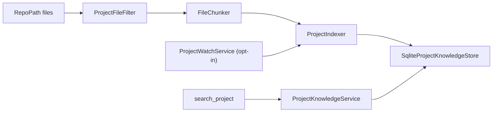

# Knowledge

> Reads configured repositories, embeds them, and lets the model search them; never writes to them.

## To change here, read

- [[pages/invariants/no-executive-writes]]
- [[pages/invariants/secrets-never-in-source]]
- [[pages/invariants/pluggable-boundaries]]
- [[pages/services/llm]]
- [[pages/conventions/testing]]

## Responsibility

Owns discovery, chunking, indexing, the vector store, the optional file watcher, and the Project Expert agent persona. Does not own the embedding model ([[pages/services/llm]]) or the chat flow ([[pages/services/conversation]]).

## Public contract

- **Entry point:** `AddProjectKnowledge(IServiceCollection, IConfiguration)` at `src/Scout.Knowledge/KnowledgeServiceCollectionExtensions.cs:32`.
- **Abstractions:** `IProjectKnowledgeStore` (`src/Scout.Knowledge/IProjectKnowledgeStore.cs:4`) implemented by `SqliteProjectKnowledgeStore` (`src/Scout.Knowledge/SqliteProjectKnowledgeStore.cs:7`); `IChunker` (`src/Scout.Knowledge/IChunker.cs:4`) implemented by `FileChunker`, a Roslyn chunker for C# with a line-window fallback (`src/Scout.Knowledge/FileChunker.cs:7`); `ProjectIndexer.IndexAsync` (`src/Scout.Knowledge/ProjectIndexer.cs:16`); `ProjectKnowledgeService` (`src/Scout.Knowledge/ProjectKnowledgeService.cs:9`); `ProjectResolutionService` (`src/Scout.Knowledge/ProjectResolutionService.cs:13`); `ProjectDiscoveryService` (`src/Scout.Knowledge/ProjectDiscoveryService.cs:11`).
- **Model tools:** plugin `ProjectKnowledge` with `search_project`, `find_symbol`, `list_projects` (`src/Scout.Knowledge/ProjectKnowledgePlugin.cs:26,41,53`), registered only when a project or root is configured (`src/Scout.Knowledge/KnowledgeServiceCollectionExtensions.cs:74`).
- **Agent:** `ProjectExpertAgentFactory.Create` (`src/Scout.Knowledge/ProjectExpertAgentFactory.cs:57`).
- **Configuration keys:** `Scout:Projects` with `Items` (`Name`, `RepoPath`), `Roots`, and `Watch` (`Enabled`, `DebounceMilliseconds`) (`src/Scout.Knowledge/ProjectsOptions.cs:7`).
- **External boundaries:** filesystem read of repository files (`src/Scout.Knowledge/ProjectIndexer.cs:63`) and a `FileSystemWatcher` when enabled (`src/Scout.Knowledge/ProjectWatchService.cs:92`); filesystem write of `project-knowledge.db` under the user's local application data, folder `Scout` (`src/Scout.Knowledge/KnowledgeServiceCollectionExtensions.cs:102`); embedding calls through `IEmbeddingGenerator`.

## How it works

Indexing runs from the host command `index <project>` ([[pages/services/host-console]]) or from the watcher. The agent and the plugin are skipped when no project is configured, so the model never sees a tool that would return nothing (`src/Scout.Knowledge/KnowledgeServiceCollectionExtensions.cs:66`). The watcher is registered only when enabled and at least one item exists (`:94`). Option validation warns and never throws (`src/Scout.Knowledge/ProjectsOptionsValidator.cs:38`).

## Invariants

- [[pages/invariants/no-executive-writes]]: the three tools read the index; the only write is Scout's own database.
- [[pages/invariants/secrets-never-in-source]]: the filter indexes `.json`, `.yml` and `.yaml` (`src/Scout.Knowledge/ProjectFileFilter.cs:12`), so secrets inside an indexed repository are embedded and searchable.
- [[pages/invariants/pluggable-boundaries]]: the store sits behind `IProjectKnowledgeStore`.

## Hot spots

- `src/Scout.Knowledge/ProjectFileFilter.cs:27`: the only allow-list for what enters the index; no secret-file exclusion.
- `src/Scout.Knowledge/ProjectExpertAgentFactory.cs:82`: OpenAI-typed execution settings in a provider-neutral project.
- `src/Scout.Knowledge/ProjectWatchService.cs:14`: debounce and re-index on file events.
- The SqliteVec connector holds the whole Semantic Kernel family at 1.78.0 ([[pages/roadmap/followups]]).

## Testing footprint

`tests/Scout.Knowledge.Tests` (107 test attributes, 14 files): chunker, filter, indexer, SQLite store against a real file, watcher, option validation, discovery, resolution, plugin output, agent persona, DI gating (`KnowledgeServiceCollectionExtensions` tests), and a retrieval acceptance test (`DeadLetterRetrievalAcceptanceTests.cs`).

## Related

Direct project references: none. Referenced by [[pages/services/host-console]]. Map: [[pages/architecture/project-map]].
