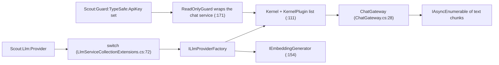

# Llm

> The single door to a language model: one provider, one shared kernel, one streaming gateway.

## To change here, read

- [[pages/invariants/pluggable-boundaries]]
- [[pages/invariants/local-first-default]]
- [[pages/invariants/secrets-never-in-source]]
- [[pages/invariants/no-executive-writes]]
- [[pages/decisions/0032-per-feature-write-permissions]]
- [[pages/conventions/testing]]

## Responsibility

Owns provider selection, the shared `Kernel` (chat completion, embeddings, every registered plugin) and automatic function calling. Does not own prompts or history ([[pages/services/conversation]]) nor the plugins themselves ([[pages/services/plugin-github]], [[pages/services/skills]], [[pages/services/knowledge]]).

## Public contract

- **Entry point:** `AddScoutLlm(IServiceCollection, IConfiguration)` at `src/Scout.Llm/LlmServiceCollectionExtensions.cs:48`.
- **Consumer abstraction:** `IChatGateway` with `StreamAsync` and `CompleteAsync` (`src/Scout.Llm/Abstractions/IChatGateway.cs:8`); request record `ChatRequest` (`src/Scout.Llm/Abstractions/ChatRequest.cs:9`); history turn `ConversationTurn` (`src/Scout.Llm/Abstractions/ConversationTurn.cs:22`); rate-limit signal `LlmRateLimitException` (`src/Scout.Llm/Abstractions/LlmRateLimitException.cs:9`); quota or billing signal `LlmQuotaExceededException` with the provider's `Code` (`src/Scout.Llm/Abstractions/LlmQuotaExceededException.cs:9`).
- **Provider seam:** `ILlmProviderFactory` (`src/Scout.Llm/Abstractions/ILlmProviderFactory.cs:17`) with `AddToKernel` and `CreateEmbeddingGenerator`. Ten factories live under `src/Scout.Llm/Providers/`: Ollama (`src/Scout.Llm/Providers/Ollama/OllamaLlmProviderFactory.cs:103` name), OpenAI, OpenRouter, AzureOpenAI, Mistral, HuggingFace, AzureAIInference, Gemini, None, ChatGptPlan (the Responses API with the owner's ChatGPT plan token read from a file, `src/Scout.Llm/Providers/ChatGptPlan/ChatGptPlanLlmProviderFactory.cs:21`, [[pages/decisions/0018-chatgpt-plan-sign-in]]). It invokes the model's function calls through Semantic Kernel's `UseKernelFunctionInvocation` (`src/Scout.Llm/Providers/ChatGptPlan/ChatGptPlanLlmProviderFactory.cs:103`), so every call passes the kernel's function filters and the write gate. It asks for encrypted reasoning so tool round trips work with `store: false` (`src/Scout.Llm/Providers/ChatGptPlan/ChatGptPlanChatClient.cs:56`), retries a transient error up to twice but never a 429 (`src/Scout.Llm/Providers/ChatGptPlan/ChatGptPlanLlmProviderFactory.cs:125`), keeps using an unexpired cached token when the file is briefly locked during replacement (`src/Scout.Llm/Providers/ChatGptPlan/ChatGptPlanTokenPolicy.cs:84`), and has no embedding generator (it fails at once with `NotSupportedException`, and skills and knowledge turn their embedding features off quietly), and turns a missing or expired sign-in into `LlmSignInRequiredException` (`src/Scout.Llm/Abstractions/LlmSignInRequiredException.cs:9`); each has an `Add<Name>LlmProvider` extension.
- **Provider `None`:** `src/Scout.Llm/Providers/None/NoneLlmProviderFactory.cs:15`, selected at `src/Scout.Llm/LlmServiceCollectionExtensions.cs:101`. The desktop app writes it when no AI provider is connected ([[pages/decisions/0017-provider-connect-disconnect]]). It needs no settings; every chat request streams the one assistant message "No AI provider is connected. Connect one on the AI Sources screen in Scout." and no model or network is called; the embedding generator throws `InvalidOperationException("No AI provider is connected.")`, so skill and project indexing fail the way they do when a provider is unreachable. A blank or absent provider still means Ollama.
- **Write gate seam:** `IWriteGate` with `RequestAsync` and `RecordAsync` (`src/Scout.Llm/Abstractions/IWriteGate.cs:8`), its answer `WriteGateDecision` (allowed, queued or refused, a reason, an action id; `src/Scout.Llm/Abstractions/IWriteGate.cs:58`), and `WriteFunctionDeclaration` (plugin, function, feature id, catalog scope row; `src/Scout.Llm/Abstractions/IWriteGate.cs:69`), registered with `AddWriteFunction` (`src/Scout.Llm/LlmServiceCollectionExtensions.cs:205`). No gRPC or vendor type crosses this seam; the host supplies the implementation ([[pages/services/host-console]]).
- **Configuration keys:** `Scout:Llm:Provider`; one block per provider under `Scout:Llm:<Provider>` with `ApiKey`, `Endpoint`, `Chat:Model`, `Embeddings:Model` (AzureOpenAI uses `Chat:Deployment` and `Embeddings:Deployment`); Ollama also reads `Embeddings:MaxBatchSize`, `Embeddings:ExpectedDimensions`, `Embeddings:HttpTimeoutSeconds`. Options types: `src/Scout.Llm/Configuration/LlmOptions.cs:13`. The read-only guard reads `Scout:Guard:TypeSafe` with `ApiKey` (empty: guard off), `Model` (`jev-latest`), `Endpoint` (`https://api.typesafe.ai`) and `Threshold` (0.5) (`src/Scout.Llm/Configuration/TypeSafeGuardOptions.cs:7`), and `Scout:Features:GrantedWrites`, a comma-separated list of the feature ids whose write grant the owner turned on, which the desktop sets as `SCOUT__FEATURES__GRANTEDWRITES` when it starts the worker (`src/Scout.Llm/Configuration/FeatureGrantsOptions.cs:8`, bound at `src/Scout.Llm/LlmServiceCollectionExtensions.cs:68`).
- **External boundaries:** the chosen provider's HTTP API (Ollama on localhost by default, `src/Scout.Llm/Configuration/LlmOptions.cs:224`; hosted APIs otherwise), and, only when a TypeSafe key is set, `POST /v1/systemone` on TypeSafe (`src/Scout.Llm/Guard/TypeSafeClient.cs:25`), which receives the latest user message and up to 12 messages before it, including Scout's own replies.

## How it works

The kernel adds every `KernelPlugin` from DI (`src/Scout.Llm/LlmServiceCollectionExtensions.cs:124`). The gateway streams through the Project Expert agent when one is registered (`src/Scout.Llm/ChatGateway.cs:90`) and through plain chat otherwise (`:101`). Both stream loops hand a provider error to one helper (`:166`, `:243`, helper at `:261`) that turns HTTP 429 into a domain exception, whether the connector raised the OpenAI SDK's `ClientResultException` (the streaming OpenAI connector, which Ollama and OpenRouter also use) or Semantic Kernel's `HttpOperationException`. A 429 whose OpenAI-shaped body carries a billing code (`credit_balance_exhausted`, `organization_spend_limit_exceeded`, `project_spend_limit_exceeded`, `organization_usage_limit_exceeded`) or the type `insufficient_quota` becomes `LlmQuotaExceededException` (`:282`); any other 429, including an unreadable body, becomes `LlmRateLimitException`; any other status (401, 500) still propagates as the raw SDK exception. The domain exceptions keep the SDK exception as `InnerException`, typed only as `Exception`. The embedding generator is built from the factory, not from the kernel, to avoid a construction cycle (`src/Scout.Llm/LlmServiceCollectionExtensions.cs:154`).

**Read-only guard** ([[pages/decisions/0016-jev-read-only-guard]]), a pre-filter on the request; writes are enforced by the write gate below. When `Scout:Guard:TypeSafe:ApiKey` is set, `AddReadOnlyGuard` (`src/Scout.Llm/LlmServiceCollectionExtensions.cs:171`) removes the provider's single chat-service registration from the kernel builder, registers `ReadOnlyGuardChatCompletionService` around it, and removes the connector's separate `ITextGenerationService`; it throws at startup if the kernel holds anything other than one unkeyed, factory-registered chat service. Since [[pages/decisions/0032-per-feature-write-permissions]], the guard refuses a write intent only while no feature holds a write grant: when `Scout:Features:GrantedWrites` names at least one feature, every request goes to the model unjudged and TypeSafe is not called (`src/Scout.Llm/Guard/ReadOnlyGuardChatCompletionService.cs:92`). The first feature that writes, the channel operator's `youtube_make_video` ([[pages/services/operator]]), did not change this: with any one grant every request still goes to the model unjudged, the guard does not match the intent to the granted feature, and the write gate below, which asks the control plane at the call of every declared function, is the enforcement. Deferred: matching the intent to the granted feature. The list is read once when the worker starts, so a grant the owner changes reaches the guard only when the desktop restarts the worker with the new variable. With nothing granted, the guard (`src/Scout.Llm/Guard/ReadOnlyGuardChatCompletionService.cs:89`) sends Jev a structured state, `recent_turns` (up to 12 user and assistant messages (six exchanges, the default conversation memory) before the latest user message, oldest first, each cut to its last 1000 characters; tool messages never; system messages never) and `latest_user_message` (its last 4000 characters), so a short "ok, do it" after a proposed change is judged in context; at p >= threshold it returns the fixed refusal "Scout can act only through features the owner turned on. No feature with write permission is on; the owner enables one on the Features screen of the Scout app." (`src/Scout.Llm/Guard/ReadOnlyGuardChatCompletionService.cs:25`) without calling the model, below it delegates with the same history, settings and kernel, and on a TypeSafe failure it logs a Warning and delegates (fail-open). Both gateway paths, direct chat and the Project Expert agent, resolve the chat service from the kernel and so pass through the guard. Tool calls made inside a model turn are not judged. With provider `None` no model answers, so no guard is registered and TypeSafe is never called (`src/Scout.Llm/LlmServiceCollectionExtensions.cs:63`, `tests/Scout.Llm.Tests/Guard/ReadOnlyGuardCompositionTests.cs:60`); ChatGptPlan registers its chat service through a factory (`src/Scout.Llm/Providers/ChatGptPlan/ChatGptPlanLlmProviderFactory.cs:75`) so the guard can wrap it like the others.

**Write gate** ([[pages/decisions/0032-per-feature-write-permissions]]). The enforcement point for writes is the moment a function runs, not the request. When at least one `WriteFunctionDeclaration` is registered, the kernel factory adds `WriteGateFilter` to the kernel builder's services as an `IFunctionInvocationFilter` (`src/Scout.Llm/LlmServiceCollectionExtensions.cs:129`) and resolves the registered `IWriteGate`, so the kernel fails to build when a write is declared and no gate exists (`tests/Scout.Llm.Tests/Guard/WriteGateCompositionTests.cs:74`). Semantic Kernel 1.78.0 reads `IFunctionInvocationFilter` services when the kernel is built (`Kernel.AddFilters`), and every `KernelFunction` invocation on that kernel passes through them: the OpenAI connector's auto-invocation (which Ollama and OpenRouter use) calls the function after its auto-invocation filters, so does the Google connector (Gemini), and so does an `IChatClient` built with `UseKernelFunctionInvocation` (`KernelFunctionInvokingChatClient`). Microsoft.Extensions.AI's own `UseFunctionInvocation` does not: it invokes the function as an `AIFunction` outside the kernel's filters, so a declared write would run without asking the gate; the ChatGptPlan provider therefore builds with `UseKernelFunctionInvocation`, and `tests/Scout.Llm.Tests/Guard/WriteGateProviderPathTests.cs:59` fails with the other builder. `IFunctionInvocationFilter` is used instead of `IAutoFunctionInvocationFilter` because it is the one point every invocation path shares. A function declares only its feature and catalog scope row, never its own access. For a declared function the filter (`src/Scout.Llm/Guard/WriteGateFilter.cs:33`) asks `RequestAsync` with the target `Plugin.function` and a summary of the function name and its arguments built from an allow-list: only an argument the declaration names in `SummaryArguments` (`src/Scout.Llm/Abstractions/IWriteGate.cs:75`, empty by default, set through `AddWriteFunction`'s `summaryArguments`) shows its value, cut to 200 characters, and every other argument shows its name only, so a credential under any name (`authorization`, `body`, `headers`) never reaches `actions.json` or the Review screen (`src/Scout.Llm/Guard/WriteGateFilter.cs:112`, `tests/Scout.Llm.Tests/Guard/WriteGateFilterTests.cs:133`, `:148`). Allowed runs the function and records `succeeded` or `failed: <exception type>`; a record that fails leaves the function's result and logs one Warning naming the function and the exception type, never an argument (`:67`, `:100`, `:104`; `tests/Scout.Llm.Tests/Guard/WriteGateFilterTests.cs:169`, and over the real gRPC client with a `FAILED_PRECONDITION` reply at `tests/Scout.Host.Console.Tests/GrpcWriteGateTests.cs:117`); queued never runs it and returns "Queued for the owner's approval on the Review screen of Scout Desktop (action <id>)." (`:70`); refused never runs it and returns the control plane's reason (`:73`); a gate that throws or does not answer never runs it, returns "Scout could not reach its control plane, so this write was not performed." and logs a Warning naming the function and the exception type, never the arguments (`:56`). A cancelled request still cancels. Undeclared functions run unchanged (`:42`). The model reads the returned text as the tool result, on the direct chat path and on the Project Expert agent path alike (`tests/Scout.Llm.Tests/Guard/WriteGateCompositionTests.cs:55`). Deferred to phase 5 of [[pages/roadmap/youtube-channel-operator]]: executing an action the owner approved on the Review screen; until then a queued write is only recorded by the control plane. One function is declared today, `YouTubeOperator.youtube_make_video` on feature `youtube`, row "Scout's data folder", with `topic` as its only summary argument (`src/Scout.Operator/OperatorServiceCollectionExtensions.cs:37`), registered only when YouTube is configured, so the production kernel carries the write filter exactly then.

**Media capability matrix** ([[pages/decisions/0033-channel-operator-architecture]]). Narration and images for the channel operator come only from Semantic Kernel services of the provider the owner connected. In the installed Semantic Kernel 1.78 packages:

| Provider | Text to audio | Text to image |
|---|---|---|
| OpenAI | `AddOpenAITextToAudio` | `AddOpenAITextToImage` |
| AzureOpenAI | `AddAzureOpenAITextToAudio` | `AddAzureOpenAITextToImage` |
| Gemini (Google connector) | none | none |
| Ollama, OpenRouter (OpenAI connector over another endpoint), Mistral, HuggingFace, AzureAIInference | none registered | none registered |
| ChatGptPlan | none | none |
| None | none | none |

Phase 2 registers no media service; phase 3 registers the two services for OpenAI and Azure OpenAI with the owner's credential and configured models, and the operator falls back to local media for every other provider. OpenRouter and Ollama reach the OpenAI connector for chat only, and their endpoints are not assumed to serve speech or images.

## Invariants

- [[pages/invariants/pluggable-boundaries]]: the provider switch is the swap point; the list is closed.
- [[pages/invariants/local-first-default]]: blank provider resolves to Ollama (`src/Scout.Llm/LlmServiceCollectionExtensions.cs:58`); `None` is only ever an explicit value.
- [[pages/invariants/secrets-never-in-source]]: every `ApiKey` defaults to empty (`src/Scout.Llm/Configuration/LlmOptions.cs:68`).
- [[pages/invariants/no-executive-writes]]: the gateway offers all kernel functions with `FunctionChoiceBehavior.Auto()` (`src/Scout.Llm/ChatGateway.cs:345`); the optional read-only guard judges the request, and a function declared as a write is gated at the call by the control plane (`src/Scout.Llm/Guard/WriteGateFilter.cs:33`). An undeclared function is not gated.
- [[pages/decisions/0032-per-feature-write-permissions]]: without a granted write feature a write intent is refused naming the Features screen (`tests/Scout.Llm.Tests/Guard/ReadOnlyGuardChatCompletionServiceTests.cs:277`); with one the request passes (`tests/Scout.Llm.Tests/Guard/ReadOnlyGuardChatCompletionServiceTests.cs:292`), and the grant binds from `Scout:Features:GrantedWrites` (`tests/Scout.Llm.Tests/Guard/ReadOnlyGuardCompositionTests.cs:148`). The one write function is the operator's `youtube_make_video`, which saves a project in the control plane's own state; every other plugin is GET-only. A declared write runs only on the control plane's `allowed` (`tests/Scout.Llm.Tests/Guard/WriteGateFilterTests.cs:58`), never on `queued` or `refused` (`:80`, `:92`) or when the gate fails (`:105`).

## Hot spots

- `src/Scout.Llm/ChatGateway.cs:341` builds `OpenAIPromptExecutionSettings` for every provider.
- `src/Scout.Llm/ChatGateway.cs:60` builds the request log label per provider (Ollama, OpenAI, Gemini; `unknown` fields for the others) and never reads an API key.
- `src/Scout.Llm/LlmServiceCollectionExtensions.cs:72` is the closed provider switch.
- `src/Scout.Llm/LlmServiceCollectionExtensions.cs:129` adds the write gate filter only when a write function is declared; a new connector that invokes functions without passing through `KernelFunction.InvokeAsync` on the shared kernel would bypass it. The OpenAI connector path (Ollama), the Gemini connector and the ChatGptPlan `IChatClient` path each have a composition test (`tests/Scout.Llm.Tests/Guard/WriteGateCompositionTests.cs:55`, `tests/Scout.Llm.Tests/Guard/WriteGateProviderPathTests.cs:28`, `:59`); Mistral, HuggingFace, AzureAIInference and AzureOpenAI do not.
- `src/Scout.Llm/Providers/ChatGptPlan/ChatGptPlanLlmProviderFactory.cs:103`: replacing `UseKernelFunctionInvocation` with Microsoft.Extensions.AI's `UseFunctionInvocation` keeps tool calls working and silently bypasses the write gate.
- `src/Scout.Llm/LlmServiceCollectionExtensions.cs:171` depends on each connector registering exactly one unkeyed, factory-built `IChatCompletionService`; a Semantic Kernel upgrade that changes that shape fails startup when a guard key is set, and `tests/Scout.Llm.Tests/LlmServiceCollectionExtensionsTests.cs:260` catches it for all nine providers with a model (every one but `None`).

## Testing footprint

`tests/Scout.Llm.Tests` (234 test attributes, 337 cases on 2026-11-03, 37 files): composition and unknown-provider behaviour (`LlmServiceCollectionExtensionsTests.cs`), gateway streaming, agent path, function calling and rate limit (`ChatGateway*Tests.cs`; `ChatGatewayRateLimitTests.cs` drives the real OpenAI connector against a stubbed HTTP handler for the quota and throttling 429s), a regression for the kernel and embedder construction cycle (`CompositionCycleRegressionTests.cs`), and a registration and a validation test file per provider. `OllamaHttpBoundaryFailureTests.cs` covers HTTP failure on the Ollama boundary. `Guard/` covers the TypeSafe client (request shape, and 422, 500, 401, timeout and reset without the key), the guard's refuse, pass-through and fail-open behaviour, the pass-through under a granted write feature, the composed gateway refusing on both the direct and the agent path and answering once `Scout:Features:GrantedWrites` names a feature, the write gate filter's allowed, queued, refused and unreachable outcomes, its allow-listed summary, a failing record that leaves the result, and the untouched read function (`WriteGateFilterTests.cs`), a model-initiated call to a declared write gated on both gateway paths (`WriteGateCompositionTests.cs`, through the OpenAI connector), and the same call gated on the Gemini connector and on the ChatGptPlan `IChatClient` path, each composed through `AddScoutLlm` over a fake transport (`WriteGateProviderPathTests.cs`). `NoneLlmProviderTests.cs` covers the None provider (fixed reply, no HTTP request through a counting handler, embeddings throw) and locks a blank or absent provider to Ollama.

## Related

Direct project references: none. Dated changes: [[pages/history/llm]]. Referenced by [[pages/services/conversation]], [[pages/services/host-console]]. Map: [[pages/architecture/project-map]].
