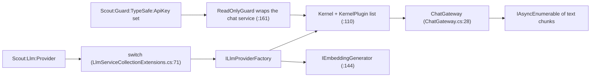

# Llm

> The single door to a language model: one provider, one shared kernel, one streaming gateway.

## To change here, read

- [[pages/invariants/pluggable-boundaries]]
- [[pages/invariants/local-first-default]]
- [[pages/invariants/secrets-never-in-source]]
- [[pages/invariants/no-executive-writes]]
- [[pages/conventions/testing]]

## Responsibility

Owns provider selection, the shared `Kernel` (chat completion, embeddings, every registered plugin) and automatic function calling. Does not own prompts or history ([[pages/services/conversation]]) nor the plugins themselves ([[pages/services/plugin-github]], [[pages/services/skills]], [[pages/services/knowledge]]).

## Public contract

- **Entry point:** `AddScoutLlm(IServiceCollection, IConfiguration)` at `src/Scout.Llm/LlmServiceCollectionExtensions.cs:48`.
- **Consumer abstraction:** `IChatGateway` with `StreamAsync` and `CompleteAsync` (`src/Scout.Llm/Abstractions/IChatGateway.cs:8`); request record `ChatRequest` (`src/Scout.Llm/Abstractions/ChatRequest.cs:9`); history turn `ConversationTurn` (`src/Scout.Llm/Abstractions/ConversationTurn.cs:22`); rate-limit signal `LlmRateLimitException` (`src/Scout.Llm/Abstractions/LlmRateLimitException.cs:9`); quota or billing signal `LlmQuotaExceededException` with the provider's `Code` (`src/Scout.Llm/Abstractions/LlmQuotaExceededException.cs:9`).
- **Provider seam:** `ILlmProviderFactory` (`src/Scout.Llm/Abstractions/ILlmProviderFactory.cs:17`) with `AddToKernel` and `CreateEmbeddingGenerator`. Ten factories live under `src/Scout.Llm/Providers/`: Ollama (`src/Scout.Llm/Providers/Ollama/OllamaLlmProviderFactory.cs:103` name), OpenAI, OpenRouter, AzureOpenAI, Mistral, HuggingFace, AzureAIInference, Gemini, None, ChatGptPlan (the Responses API with the owner's ChatGPT plan token read from a file, `src/Scout.Llm/Providers/ChatGptPlan/ChatGptPlanLlmProviderFactory.cs:21`, [[pages/decisions/0018-chatgpt-plan-sign-in]]). It asks for encrypted reasoning so tool round trips work with `store: false` (`src/Scout.Llm/Providers/ChatGptPlan/ChatGptPlanChatClient.cs:56`), retries a transient error up to twice but never a 429 (`src/Scout.Llm/Providers/ChatGptPlan/ChatGptPlanLlmProviderFactory.cs:125`), keeps using an unexpired cached token when the file is briefly locked during replacement (`src/Scout.Llm/Providers/ChatGptPlan/ChatGptPlanTokenPolicy.cs:84`), and has no embedding generator (it fails at once with `NotSupportedException`, and skills and knowledge turn their embedding features off quietly), and turns a missing or expired sign-in into `LlmSignInRequiredException` (`src/Scout.Llm/Abstractions/LlmSignInRequiredException.cs:9`); each has an `Add<Name>LlmProvider` extension.
- **Provider `None`:** `src/Scout.Llm/Providers/None/NoneLlmProviderFactory.cs:15`, selected at `src/Scout.Llm/LlmServiceCollectionExtensions.cs:100`. The desktop app writes it when no AI provider is connected ([[pages/decisions/0017-provider-connect-disconnect]]). It needs no settings; every chat request streams the one assistant message "No AI provider is connected. Connect one on the AI Sources screen in Scout." and no model or network is called; the embedding generator throws `InvalidOperationException("No AI provider is connected.")`, so skill and project indexing fail the way they do when a provider is unreachable. A blank or absent provider still means Ollama.
- **Configuration keys:** `Scout:Llm:Provider`; one block per provider under `Scout:Llm:<Provider>` with `ApiKey`, `Endpoint`, `Chat:Model`, `Embeddings:Model` (AzureOpenAI uses `Chat:Deployment` and `Embeddings:Deployment`); Ollama also reads `Embeddings:MaxBatchSize`, `Embeddings:ExpectedDimensions`, `Embeddings:HttpTimeoutSeconds`. Options types: `src/Scout.Llm/Configuration/LlmOptions.cs:13`. The read-only guard reads `Scout:Guard:TypeSafe` with `ApiKey` (empty: guard off), `Model` (`jev-latest`), `Endpoint` (`https://api.typesafe.ai`) and `Threshold` (0.5) (`src/Scout.Llm/Configuration/TypeSafeGuardOptions.cs:7`).
- **External boundaries:** the chosen provider's HTTP API (Ollama on localhost by default, `src/Scout.Llm/Configuration/LlmOptions.cs:224`; hosted APIs otherwise), and, only when a TypeSafe key is set, `POST /v1/systemone` on TypeSafe (`src/Scout.Llm/Guard/TypeSafeClient.cs:25`), which receives the latest user message and up to 12 messages before it, including Scout's own replies.

## How it works

The kernel adds every `KernelPlugin` from DI (`src/Scout.Llm/LlmServiceCollectionExtensions.cs:123`). The gateway streams through the Project Expert agent when one is registered (`src/Scout.Llm/ChatGateway.cs:90`) and through plain chat otherwise (`:101`). Both stream loops hand a provider error to one helper (`:166`, `:243`, helper at `:261`) that turns HTTP 429 into a domain exception, whether the connector raised the OpenAI SDK's `ClientResultException` (the streaming OpenAI connector, which Ollama and OpenRouter also use) or Semantic Kernel's `HttpOperationException`. A 429 whose OpenAI-shaped body carries a billing code (`credit_balance_exhausted`, `organization_spend_limit_exceeded`, `project_spend_limit_exceeded`, `organization_usage_limit_exceeded`) or the type `insufficient_quota` becomes `LlmQuotaExceededException` (`:282`); any other 429, including an unreadable body, becomes `LlmRateLimitException`; any other status (401, 500) still propagates as the raw SDK exception. The domain exceptions keep the SDK exception as `InnerException`, typed only as `Exception`. The embedding generator is built from the factory, not from the kernel, to avoid a construction cycle (`src/Scout.Llm/LlmServiceCollectionExtensions.cs:144`).

**Read-only guard** ([[pages/decisions/0016-jev-read-only-guard]]). When `Scout:Guard:TypeSafe:ApiKey` is set, `AddReadOnlyGuard` (`src/Scout.Llm/LlmServiceCollectionExtensions.cs:161`) removes the provider's single chat-service registration from the kernel builder, registers `ReadOnlyGuardChatCompletionService` around it, and removes the connector's separate `ITextGenerationService`; it throws at startup if the kernel holds anything other than one unkeyed, factory-registered chat service. The guard (`src/Scout.Llm/Guard/ReadOnlyGuardChatCompletionService.cs:87`) sends Jev a structured state, `recent_turns` (up to 12 user and assistant messages (six exchanges, the default conversation memory) before the latest user message, oldest first, each cut to its last 1000 characters; tool messages never; system messages never) and `latest_user_message` (its last 4000 characters), so a short "ok, do it" after a proposed change is judged in context; at p >= threshold it returns the fixed refusal without calling the model, below it delegates with the same history, settings and kernel, and on a TypeSafe failure it logs a Warning and delegates (fail-open). Both gateway paths, direct chat and the Project Expert agent, resolve the chat service from the kernel and so pass through the guard. Tool calls made inside a model turn are not judged. With provider `None` no model answers, so no guard is registered and TypeSafe is never called (`src/Scout.Llm/LlmServiceCollectionExtensions.cs:63`, `tests/Scout.Llm.Tests/Guard/ReadOnlyGuardCompositionTests.cs:61`); ChatGptPlan registers its chat service through a factory (`src/Scout.Llm/Providers/ChatGptPlan/ChatGptPlanLlmProviderFactory.cs:75`) so the guard can wrap it like the others.

## Invariants

- [[pages/invariants/pluggable-boundaries]]: the provider switch is the swap point; the list is closed.
- [[pages/invariants/local-first-default]]: blank provider resolves to Ollama (`src/Scout.Llm/LlmServiceCollectionExtensions.cs:58`); `None` is only ever an explicit value.
- [[pages/invariants/secrets-never-in-source]]: every `ApiKey` defaults to empty (`src/Scout.Llm/Configuration/LlmOptions.cs:68`).
- [[pages/invariants/no-executive-writes]]: the gateway offers all kernel functions with `FunctionChoiceBehavior.Auto()` (`src/Scout.Llm/ChatGateway.cs:345`) and has no allow-list; the optional read-only guard judges the request, not the functions.

## Hot spots

- `src/Scout.Llm/ChatGateway.cs:341` builds `OpenAIPromptExecutionSettings` for every provider.
- `src/Scout.Llm/ChatGateway.cs:60` builds the request log label per provider (Ollama, OpenAI, Gemini; `unknown` fields for the others) and never reads an API key.
- `src/Scout.Llm/LlmServiceCollectionExtensions.cs:71` is the closed provider switch.
- `src/Scout.Llm/LlmServiceCollectionExtensions.cs:161` depends on each connector registering exactly one unkeyed, factory-built `IChatCompletionService`; a Semantic Kernel upgrade that changes that shape fails startup when a guard key is set, and `tests/Scout.Llm.Tests/LlmServiceCollectionExtensionsTests.cs:260` catches it for all nine providers with a model (every one but `None`).

## Testing footprint

`tests/Scout.Llm.Tests` (217 test attributes, 30 files): composition and unknown-provider behaviour (`LlmServiceCollectionExtensionsTests.cs`), gateway streaming, agent path, function calling and rate limit (`ChatGateway*Tests.cs`; `ChatGatewayRateLimitTests.cs` drives the real OpenAI connector against a stubbed HTTP handler for the quota and throttling 429s), a regression for the kernel and embedder construction cycle (`CompositionCycleRegressionTests.cs`), and a registration and a validation test file per provider. `OllamaHttpBoundaryFailureTests.cs` covers HTTP failure on the Ollama boundary. `Guard/` covers the TypeSafe client (request shape, and 422, 500, 401, timeout and reset without the key), the guard's refuse, pass-through and fail-open behaviour, and the composed gateway refusing on both the direct and the agent path. `NoneLlmProviderTests.cs` covers the None provider (fixed reply, no HTTP request through a counting handler, embeddings throw) and locks a blank or absent provider to Ollama.

## Related

Direct project references: none. Dated changes: [[pages/history/llm]]. Referenced by [[pages/services/conversation]], [[pages/services/host-console]]. Map: [[pages/architecture/project-map]].
