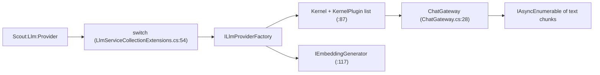

# Llm

> The single door to a language model: one provider, one shared kernel, one streaming gateway.

## To change here, read

- [[pages/invariants/pluggable-boundaries]]
- [[pages/invariants/local-first-default]]
- [[pages/invariants/secrets-never-in-source]]
- [[pages/invariants/no-executive-writes]]
- [[pages/conventions/testing]]

## Responsibility

Owns provider selection, the shared `Kernel` (chat completion, embeddings, every registered plugin) and automatic function calling. Does not own prompts or history ([[pages/services/conversation]]) nor the plugins themselves ([[pages/services/plugin-github]], [[pages/services/skills]], [[pages/services/knowledge]]).

## Public contract

- **Entry point:** `AddScoutLlm(IServiceCollection, IConfiguration)` at `src/Scout.Llm/LlmServiceCollectionExtensions.cs:39`.
- **Consumer abstraction:** `IChatGateway` with `StreamAsync` and `CompleteAsync` (`src/Scout.Llm/Abstractions/IChatGateway.cs:8`); request record `ChatRequest` (`src/Scout.Llm/Abstractions/ChatRequest.cs:9`); history turn `ConversationTurn` (`src/Scout.Llm/Abstractions/ConversationTurn.cs:22`); rate-limit signal `LlmRateLimitException` (`src/Scout.Llm/Abstractions/LlmRateLimitException.cs:9`); quota or billing signal `LlmQuotaExceededException` with the provider's `Code` (`src/Scout.Llm/Abstractions/LlmQuotaExceededException.cs:9`).
- **Provider seam:** `ILlmProviderFactory` (`src/Scout.Llm/Abstractions/ILlmProviderFactory.cs:17`) with `AddToKernel` and `CreateEmbeddingGenerator`. Eight factories live under `src/Scout.Llm/Providers/`: Ollama (`:103` name), OpenAI, OpenRouter, AzureOpenAI, Mistral, HuggingFace, AzureAIInference, Gemini; each has an `Add<Name>LlmProvider` extension.
- **Configuration keys:** `Scout:Llm:Provider`; one block per provider under `Scout:Llm:<Provider>` with `ApiKey`, `Endpoint`, `Chat:Model`, `Embeddings:Model` (AzureOpenAI uses `Chat:Deployment` and `Embeddings:Deployment`); Ollama also reads `Embeddings:MaxBatchSize`, `Embeddings:ExpectedDimensions`, `Embeddings:HttpTimeoutSeconds`. Options types: `src/Scout.Llm/Configuration/LlmOptions.cs:12`.
- **External boundaries:** the chosen provider's HTTP API (Ollama on localhost by default, `src/Scout.Llm/Configuration/LlmOptions.cs:207`; hosted APIs otherwise).

## How it works

The kernel adds every `KernelPlugin` from DI (`src/Scout.Llm/LlmServiceCollectionExtensions.cs:96`). The gateway streams through the Project Expert agent when one is registered (`src/Scout.Llm/ChatGateway.cs:88`) and through plain chat otherwise (`:99`). Both stream loops hand a provider error to one helper (`:164`, `:241`, helper at `:259`) that turns HTTP 429 into a domain exception, whether the connector raised the OpenAI SDK's `ClientResultException` (the streaming OpenAI connector, which Ollama and OpenRouter also use) or Semantic Kernel's `HttpOperationException`. A 429 whose OpenAI-shaped body carries a billing code (`credit_balance_exhausted`, `organization_spend_limit_exceeded`, `project_spend_limit_exceeded`, `organization_usage_limit_exceeded`) or the type `insufficient_quota` becomes `LlmQuotaExceededException` (`:280`); any other 429, including an unreadable body, becomes `LlmRateLimitException`; any other status (401, 500) still propagates as the raw SDK exception. The domain exceptions keep the SDK exception as `InnerException`, typed only as `Exception`. The embedding generator is built from the factory, not from the kernel, to avoid a construction cycle (`src/Scout.Llm/LlmServiceCollectionExtensions.cs:117`).

## Invariants

- [[pages/invariants/pluggable-boundaries]]: the provider switch is the swap point; the list is closed.
- [[pages/invariants/local-first-default]]: blank provider resolves to Ollama (`:48`).
- [[pages/invariants/secrets-never-in-source]]: every `ApiKey` defaults to empty (`src/Scout.Llm/Configuration/LlmOptions.cs:51`).
- [[pages/invariants/no-executive-writes]]: the gateway offers all kernel functions with `FunctionChoiceBehavior.Auto()` (`src/Scout.Llm/ChatGateway.cs:343`) and has no allow-list.

## Hot spots

- `src/Scout.Llm/ChatGateway.cs:339` builds `OpenAIPromptExecutionSettings` for every provider.
- `src/Scout.Llm/ChatGateway.cs:59` builds the request log label per provider (Ollama, OpenAI, Gemini; `unknown` fields for the others) and never reads an API key.
- `src/Scout.Llm/LlmServiceCollectionExtensions.cs:54` is the closed provider switch.

## Testing footprint

`tests/Scout.Llm.Tests` (166 test attributes, 25 files): composition and unknown-provider behaviour (`LlmServiceCollectionExtensionsTests.cs`), gateway streaming, agent path, function calling and rate limit (`ChatGateway*Tests.cs`; `ChatGatewayRateLimitTests.cs` drives the real OpenAI connector against a stubbed HTTP handler for the quota and throttling 429s), a regression for the kernel and embedder construction cycle (`CompositionCycleRegressionTests.cs`), and a registration and a validation test file per provider. `OllamaHttpBoundaryFailureTests.cs` covers HTTP failure on the Ollama boundary.

## Related

Direct project references: none. Dated changes: [[pages/history/llm]]. Referenced by [[pages/services/conversation]], [[pages/services/host-console]]. Map: [[pages/architecture/project-map]].
