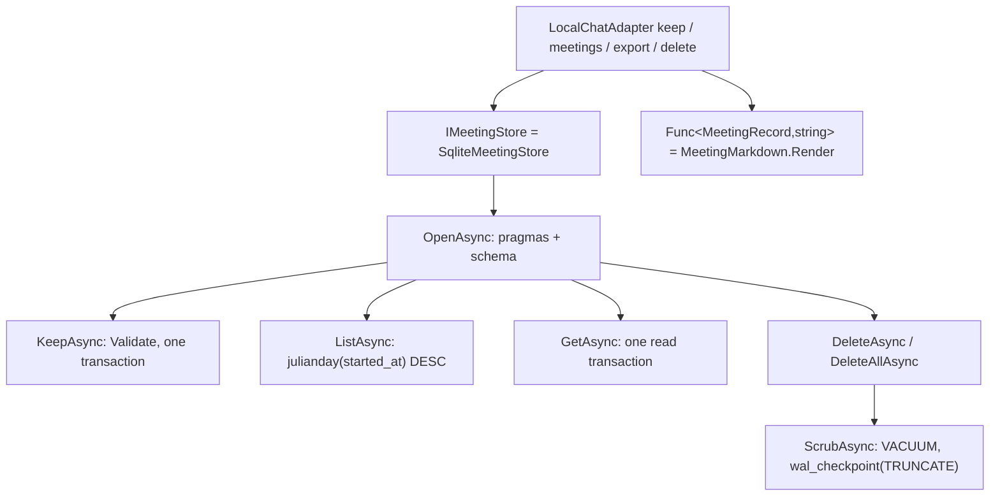

# Meetings

> Keeps a meeting on the owner's machine only when the owner chooses to, and gives it back as Markdown or deletes it.

## To change here, read

- [[pages/decisions/0037-meetings-kept-locally-in-sqlite]]
- [[pages/invariants/no-executive-writes]]
- [[pages/invariants/pluggable-boundaries]]
- [[pages/invariants/local-first-default]]
- [[pages/invariants/secrets-never-in-source]]
- [[pages/roadmap/live-assistant]] - phase 6, the meeting session
- [[pages/services/adapter-local]] - the requests that reach the store
- [[pages/conventions/testing]]

## Responsibility

Owns the meetings database: its schema, keeping a meeting with its lines and turns in one transaction, listing, reading, deleting with the text scrubbed from the file, the limits of a meeting, and the Markdown document of one. Does not own when a meeting is kept, the wire requests or their sentences ([[pages/services/adapter-local]]), nor the Stop row's "Keep this meeting", the Meetings screen or the file the owner saves the export to (the desktop, [[pages/services/desktop-quick-ask]]).

## Public contract

- **Entry point:** `AddMeetings(IServiceCollection, IConfiguration)` (`src/Scout.Meetings/MeetingsServiceCollectionExtensions.cs:18`), called by [[pages/services/host-console]]. With `Scout:Meetings:DbPath` set and its parent folder existing (`:30`), it registers `SqliteMeetingStore` as the `IMeetingStore` (`:35`) and `MeetingMarkdown.Render` as a `Func<MeetingRecord, string>` (`:36`), the two together; otherwise nothing, and the feature is off. Resolving the store opens no file.
- **Abstraction:** `IMeetingStore` in `Scout.Conversation` (`src/Scout.Conversation/Abstractions/IMeetingStore.cs:7`, [[pages/services/conversation]]) with `KeepAsync`, `ListAsync`, `GetAsync`, `DeleteAsync` and `DeleteAllAsync` (`:13` to `:25`), over the records `MeetingRecord`, `MeetingLine`, `MeetingTurn` and `MeetingSummary` (`:29`, `:38`, `:41`, `:44`).
- **Key types:**
  - `SqliteMeetingStore` (`src/Scout.Meetings/SqliteMeetingStore.cs:14`).
  - `MeetingMarkdown.Render` (`src/Scout.Meetings/MeetingMarkdown.cs:15`).
  - `MeetingStoreException` (`src/Scout.Meetings/MeetingStoreException.cs:7`), whose message names the operation and the SQLite error code only.
- **Configuration keys:** `Scout:Meetings:DbPath`, a path, never a credential; the desktop passes `SCOUT__MEETINGS__DBPATH=<userData>/meetings.db` on every worker start (`ui/packages/main/src/worker/build-env.ts:113`), see Desktop side. `appsettings.json` does not name it.
- **Packages:** `Microsoft.Data.Sqlite` 9.0.10 (`Directory.Packages.props:44`), the version `Scout.Knowledge` already resolves through its vector connector, over `SQLitePCLRaw.bundle_e_sqlite3` 3.0.5 (`Directory.Packages.props:43`); pinning 9.0.10 left the Knowledge graph unchanged.
- **External boundaries:** the database file and its `-wal` and `-shm` companions, under the configured folder. No network: the assembly references no `System.Net` or HTTP assembly (`tests/Scout.Meetings.Tests/SqliteMeetingStoreTests.cs:281`).

## How it works

- **Open:** one connection per call (`src/Scout.Meetings/SqliteMeetingStore.cs:308`), the pool reusing them. Each open runs `PRAGMA foreign_keys = ON`, `secure_delete = ON` and `journal_mode = WAL`, and creates the schema if it is missing (`:21`): `schema_version` holding one row, version 1, and `meetings(id, started_at, ended_at, title)`, `lines(meeting_id, seq, at, lane, text, translation, language)` and `turns(meeting_id, seq, at, question, answer, screenshot, transcript, screen_text)`, both keyed by meeting and seq with `ON DELETE CASCADE` (`:33`, `:42`).
- **Keep** (`src/Scout.Meetings/SqliteMeetingStore.cs:67`): `Validate` first (`:291`), so a meeting past the limits throws `ArgumentException` before anything is opened and nothing is stored. The limits (`:16` to `:19`): a title of 1 to 200 characters, not blank; at most 5,000 lines of at most 2,000 characters; at most 500 turns. The id is 16 random bytes in base64url, 22 characters (`:70`), and the meeting, its lines and its turns are inserted in one transaction (`:74`, `:136`), each line and turn numbered from 1 in the order given. Times are stored as round-trip text with their offset (`:338`), so a time read back carries the offset the desktop sent.
- **List** (`src/Scout.Meetings/SqliteMeetingStore.cs:146`): newest first by `julianday(started_at)` (`:159`), which compares the instants whatever their offsets, then by insertion; each summary carries its line and turn counts.
- **Get** (`src/Scout.Meetings/SqliteMeetingStore.cs:184`): the meeting, its lines and its turns in seq order, inside one read transaction (`:190`), or null.
- **Delete** (`src/Scout.Meetings/SqliteMeetingStore.cs:252`, `:274`): the meeting rows go and the cascade takes their lines and turns; then `VACUUM` rebuilds the file and `PRAGMA wal_checkpoint(TRUNCATE)` empties the write-ahead log (`:327`). `secure_delete` alone overwrote the freed pages but left 704 of them on the free list; without the checkpoint the deleted text stayed in `meetings.db-wal` (both measured by the Gate 5 mutations of 2026-11-04). A checkpoint another connection's read holds back truncates nothing, and the busy flag it answers is not read, so a list racing a delete can leave the text in the log until the next delete. The scrub runs after the delete has committed and does not take the caller's cancellation token, so a Stop that cancels the request cannot leave the deleted text on disk; it also runs when the delete finds nothing and answers false, so a retry of a delete whose scrub failed repairs it.
- **Errors:** every `SqliteException` becomes a `MeetingStoreException` "Scout could not <save|list|read|delete> the meetings database (SQLite error <code>)." (`src/Scout.Meetings/SqliteMeetingStore.cs:343`), never with a title, a line or a turn in it.
- **Markdown** (`src/Scout.Meetings/MeetingMarkdown.cs:15`): `# <title>`, the start and end as `yyyy-MM-dd HH:mm:ss zzz`, `## Transcript` with one `- [HH:mm:ss] You|Others: text` item per line, `me` being You and anything else Others (`:31`), and a nested `- (<language>) <translation>` item when there is a translation (`:33`); then `## Questions`, a `### [HH:mm:ss] <question>` heading per turn, `_With screenshot, transcript, screen text_` naming the flags that were set (`:55`), and the answer as written (`:57`). Titles, lines and questions are folded onto one line (`:80`), times are written in the offset each carries (`:82`) and every line ends in `\n`, so the same meeting always renders the same text.

## Desktop side

What the desktop sends and shows; the detail is on [[pages/services/desktop-quick-ask]] (Meeting mode) and [[pages/services/desktop-ui]] (Meetings).

- **Keep.** The quick-ask window's Stop row sends one `keep` only when the owner ticks "Keep this meeting", off by default, and clicks Done (`ui/packages/renderer/src/app/quick-ask/quick-ask.component.ts:855`): both lanes' lines from the meeting's start with their translation and language, and the turns asked during it with their flags, every time in local time with its offset (`:896`, `:65`). Main checks the limits above before the worker sees the meeting and answers past them with the adapter's own sentence (`ui/packages/main/src/quick-ask/quick-ask.ts:412`, `:56`).
- **List, export, delete.** The Meetings screen asks for at most 100 meetings, newest first, exports one through the system's save dialog, which main writes with the `markdown` text, and deletes one or all after a confirm (`ui/packages/renderer/src/app/meetings/meetings.component.ts:303`, `:268`, `:287`; `ui/packages/main/src/quick-ask/quick-ask.ts:1110`, `:1123`, `:1150`). Each request carries an `m-<n>` id and a 30 s guard, and the adapter's `fail` sentences, such as the not-configured one, reach the owner as written (`ui/packages/main/src/quick-ask/quick-ask.ts:1042`).
- **Never.** The renderer never sends or receives a path, and main logs only ids, counts and the export's length.

## Invariants

- [[pages/invariants/no-executive-writes]]: the only writes are to the database the configuration names, Scout's own data folder, and only for a meeting the owner chose to keep in the desktop; nothing leaves the process. The model has no function that reaches the store.
- [[pages/invariants/pluggable-boundaries]]: no Sqlite type leaves the project; the adapter sees `IMeetingStore` and a `Func<MeetingRecord, string>`, both over Conversation records.
- [[pages/invariants/local-first-default]]: works offline, with no account and no provider.
- [[pages/invariants/secrets-never-in-source]]: no credential; the exception messages carry no meeting text.

## Hot spots

- `src/Scout.Meetings/SqliteMeetingStore.cs:327`: the scrub after a delete is what keeps deleted text off the disk; removing either statement fails the delete tests.
- `src/Scout.Meetings/SqliteMeetingStore.cs:291`: the limits are checked here only; the adapter maps the `ArgumentException` to its limits sentence ([[pages/services/adapter-local]]).

## Cache footprint

None. Not applicable: every call opens the file and reads it.

## Cross-service dependencies

- **Reads from:** none.
- **Written to by:** [[pages/services/adapter-local]] through `IMeetingStore`, composed by [[pages/services/host-console]].

## Testing footprint

`tests/Scout.Meetings.Tests` (14 test attributes, 21 cases, 3 files), against a real file in a temporary folder:
- A kept meeting read back with both lanes, the translation and its language, the turns and their flags, and the offset (`tests/Scout.Meetings.Tests/SqliteMeetingStoreTests.cs:75`); two keeps with distinct 22-character ids, one schema row at version 1 and WAL mode (`:95`).
- The list newest first across three offsets, with its counts and its limit (`tests/Scout.Meetings.Tests/SqliteMeetingStoreTests.cs:110`).
- A delete taking the lines and turns, leaving the marker text in neither the file nor its WAL, `freelist_count` 0, the other meeting intact, and a second delete false (`tests/Scout.Meetings.Tests/SqliteMeetingStoreTests.cs:133`); delete all (`:154`); a delete whose caller cancels after the row is gone, for one and for all, still scrubbing (`tests/Scout.Meetings.Tests/SqliteMeetingStoreTests.cs:173`); a retried delete of a meeting already gone still scrubbing (`:201`).
- 5,001 lines, 501 turns, a blank title, a 201-character title and a 2,001-character line refused with nothing stored (`tests/Scout.Meetings.Tests/SqliteMeetingStoreTests.cs:237`), and a meeting at every limit kept (`:247`).
- A file that is not a database throwing `MeetingStoreException` with error 26 and no meeting text, on keep and on list (`tests/Scout.Meetings.Tests/SqliteMeetingStoreTests.cs:260`), the Rule I test of this boundary.
- No network assembly referenced (`tests/Scout.Meetings.Tests/SqliteMeetingStoreTests.cs:281`).
- The whole Markdown document of a meeting with a translation, a multi-line answer and each flag combination, twice identical (`tests/Scout.Meetings.Tests/MeetingMarkdownTests.cs:10`), and the empty sections (`:68`).
- `AddMeetings` with no path, a missing folder and an existing one, the renderer present exactly with the store and no file created (`tests/Scout.Meetings.Tests/MeetingsServiceCollectionExtensionsTests.cs:13`).

## Known violations / P1 debt

None.

## Related

Direct project references: [[pages/services/conversation]]. Referenced by [[pages/services/host-console]]. Map: [[pages/architecture/project-map]]. Decision: [[pages/decisions/0037-meetings-kept-locally-in-sqlite]].
