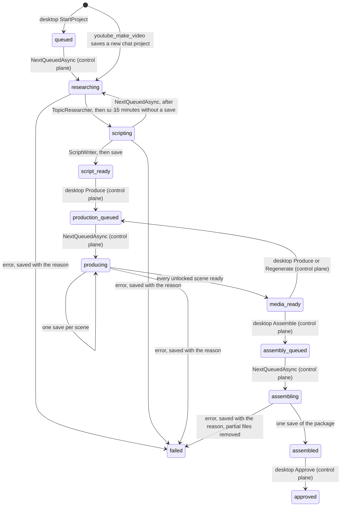

# Operator

> Turns "make a video about X" into a researched script the owner reviews on the desktop's Production screen, a script the owner sends to production into scenes with narration and pictures, and those scenes, once the owner asks for assembly, into a video with Shorts, a thumbnail and checks, writing only the control plane's own state and the project's media directory ([[pages/decisions/0033-channel-operator-architecture]]).

## To change here, read

- [[pages/invariants/no-executive-writes]]
- [[pages/invariants/pluggable-boundaries]]
- [[pages/decisions/0032-per-feature-write-permissions]]
- [[pages/decisions/0033-channel-operator-architecture]]
- [[pages/decisions/0012-llm-communication-through-semantic-kernel]]
- [[pages/roadmap/youtube-channel-operator]] - phases 2 to 4, and the phases still to come
- [[pages/conventions/testing]]

## Responsibility

Owns phases 2 to 4 of [[pages/roadmap/youtube-channel-operator]] on the worker side: topic research, the script with its factual claims, the run of one project from researching to `script_ready`, the production stage from `producing` to `media_ready` (scenes, narration, pictures, the files in the project's media directory), the assembly stage from `assembling` to `assembled` (the video, the Shorts, the thumbnail, the checks and the first metadata, rendered with `ffmpeg`), the background worker that takes projects, the readiness report, the search and picture counters and the model functions `youtube_make_video` and `youtube_video_status`. Does not own the operator's state, which the control plane holds and checks against the owner's YouTube write grant ([[pages/services/control-plane]]); nor the YouTube client ([[pages/services/plugin-youtube]]); nor the write gate ([[pages/services/llm]]); nor posting into a chat, which the adapters do behind `IOriginNotifier` ([[pages/services/conversation]]); nor the Production and Assembly pages ([[pages/services/desktop-operator]]). Nor the speech and image services, which [[pages/services/llm]] registers for the connected provider; nor the `ffmpeg` and font files, which Scout Desktop supplies and names in configuration ([[pages/services/desktop-operator]]); nor the owner's review of the package (rights, metadata edits, approval), which the control plane holds. Publishing is a later phase.

## Public contract

- **Entry point:** `AddYouTubeOperator(IServiceCollection)` (`src/Scout.Operator/OperatorServiceCollectionExtensions.cs:23`). The caller registers an `IOperatorControlPlane`, the YouTube client and the origin notifier first, and `AddScoutLlm` supplies the kernel and `MediaCapabilities`; [[pages/services/host-console]] does that only when YouTube is configured. The caller also binds `OperatorMediaOptions` (`src/Scout.Operator/FfmpegToolset.cs:11`) from `Scout:Operator` (`FfmpegPath`, `FontPath`); the operator registers the process runner, the toolset and the assembly stages itself, the runner with `TryAdd` so a test can put its own first (`src/Scout.Operator/OperatorServiceCollectionExtensions.cs:49`).
- **Control-plane seam:** `IOperatorControlPlane` (`src/Scout.Operator/IOperatorControlPlane.cs:9`) with `GetMandateAsync`, `SaveProjectAsync(project, originReference)`, `NextQueuedAsync`, `GetProjectAsync(id)` (`:28`), `ListRecentAsync(limit)` (`:31`), `GetMediaDirectoryAsync(projectId)` (`:34`) and `ReportReadinessAsync(readiness)` (`:37`), over plain records that mirror the `operator.proto` messages: `OperatorMandate` (`:41`), `OperatorProjectState` (`:54`) with its `Scenes` (`:67`) and its `Package` (`:70`), the script, section, chapter and claim records, `QueuedProject` (`:105`), `OperatorScene` (`:112`), `OperatorReadiness` (`:127`), and `OperatorPackage` (`:141`) with its `OperatorShort` (`:157`) and `OperatorCheck` (`:160`) records. No gRPC or Contracts type crosses it; every failure is an `InvalidOperationException` whose message the owner can read. The host supplies the gRPC and the closed implementations.
- **Model tools:** plugin `YouTubeOperator` (`src/Scout.Operator/YouTubeOperatorPlugin.cs:12`) with `youtube_make_video(topic)` (`:39`), declared a write of feature `youtube`, catalog row "Scout's data folder", with `topic` as the only argument the request summary shows (`src/Scout.Operator/OperatorServiceCollectionExtensions.cs:43`), and `youtube_video_status()` (`src/Scout.Operator/YouTubeOperatorPlugin.cs:82`), a read. Neither takes a chat reference as a parameter.
- **Hosted services:** `OperatorWorker` (`src/Scout.Operator/OperatorWorker.cs:13`) and `ReadinessReporter` (`src/Scout.Operator/ReadinessReporter.cs:15`).
- **External boundaries:** the control plane through `IOperatorControlPlane`; YouTube through `IYouTubeClient` (`GetMyChannelAsync`, `ListUploadsAsync`, `SearchVideosAsync`); the chat model through the kernel's `IChatCompletionService` with no settings and no kernel, so the model is offered no function (`src/Scout.Operator/ModelJson.cs:48`); the originating chat through `IOriginNotifier`; the connected provider's speech and image services through the kernel's `ITextToAudioService` and `ITextToImageService`, with the settings `MediaCapabilities` carries; the filesystem, only to write, read and check files in the media directory the control plane gives; and one external program, `ffmpeg`, started through `IProcessRunner` (`src/Scout.Operator/ProcessRunner.cs:11`) with an argument list, never a shell, standard input closed at once, a timeout, and only the end of its error output kept. No network call of its own.

## How it works

`youtube_make_video` reads the turn's origin from `ChatOrigin.Current` (`src/Scout.Operator/YouTubeOperatorPlugin.cs:45`), reads the mandate and refuses a topic that contains one of its blocked topics, in any case (`:57`), saves a project with an empty id, status `researching` and origin `chat` with that reference, and hands the saved project to the worker through an in-process channel (`:75`); the turn does not wait for the pipeline. It answers "Started a video project on <topic>; I will post here when the script is ready.", or, outside a chat turn, points to the desktop's Production screen. A blocked topic, or a control plane that refuses or cannot be reached, starts nothing and throws an `InvalidOperationException` whose message is "Could not start a video project on <topic>: <reason>" (`:59`, `:72`): `WriteGateFilter` then records the write as `failed: InvalidOperationException`, never `succeeded`, and Semantic Kernel hands the message to the model, which tells the user. Because the function is declared, `WriteGateFilter` asks the control plane before it runs, and the control plane checks the YouTube grant again on the save. The plugin holds no reference to the kernel or the chat service, so the kernel can be built from it without a construction cycle.

`OperatorWorker` runs one project at a time (`src/Scout.Operator/OperatorWorker.cs:22`): a project handed over from chat at once, otherwise the project `NextQueuedAsync` returns (`:38`), then it waits until either 30 seconds pass (`:20`) or a chat hands a project over (`:66`). A control plane that cannot answer is logged once until it answers again (`:43`), so with no desktop the worker idles quietly. A project that throws out of the pipeline is logged by id and exception type and saved as failed once more with the reason the exception carries (`:75`); when the pipeline could not save its own failure, that reason is the original cause, so the stored error is the real one once the control plane answers again. On shutdown the loop ends; a project cut short keeps the status of its last save, and the control plane hands it out again once it has gone 15 minutes without a save ([[pages/services/control-plane]]).

`OperatorPipeline.RunAsync` (`src/Scout.Operator/OperatorPipeline.cs:74`) runs the production stage below for a project taken as `producing` (`:80`); otherwise it posts "Researching <topic>..." to the origin, reads the mandate, fails the project before any search when the topic contains a blocked topic of the mandate, with "The channel mandate blocks the topic "<blocked>"; choose another topic or change the mandate in Scout Desktop, Production." (`:153`), so a project the desktop queued is held to the mandate too, researches, saves `scripting` with the candidates, writes the script, and saves `script_ready` with the script and the claims; then it posts "Script ready for <topic>: open Scout Desktop, Production, to review it." Any failure saves `failed` with a readable reason and posts "The video project on <topic> stopped: <reason>", also when that save itself fails; then it throws an `InvalidOperationException` carrying the original reason, not the save's failure (`:123`). Every save first reads the project back with `GetProjectAsync` and changes only status, candidates, script, claims and error (`:354`), so the topic, the origin and every claim the owner decided (any status other than `pending`) go back exactly as read; the fresh claims follow them, renumbered past the ids the owner's claims use, and a fresh claim with the same text as a decided one is dropped (`:360`). A project without an origin posts nothing; a notice the chat cannot take is logged and the project continues (`:381`). The reference is never logged.

`TopicResearcher` (`src/Scout.Operator/TopicResearcher.cs:24`) reads the owner's channel and its ten latest uploads, then searches YouTube for the topic and the mandate's pillars, case-insensitively distinct, at most five per project (`:115`), each search taken from `SearchBudget` first (`:75`). With an API key and no Google sign-in, reading the owner's own channel answers 401 and the plugin's sign-in message; research then goes on without the uploads and tells the model "The channel's own uploads are unavailable because Scout is not signed in to the owner's YouTube channel; propose topics without the channel's history." (`:30`, `:63`). Any other YouTube error on the channel fails the research as before. `SearchBudget` (`src/Scout.Operator/SearchBudget.cs:9`) allows 40 searches a day in this process and resets at midnight Pacific time (`:50`), below the 100-a-day `search.list` bucket; Pacific time is the system zone `America/Los_Angeles`, else `Pacific Standard Time`, else a fixed UTC-8 on a host without time zone data, found without ever throwing (`:85`); with today's searches spent, research continues without search and tells the model "The YouTube search budget for today (40 searches) is spent; it resets at midnight Pacific time." The model is asked for five candidates as JSON `{title, reason, fit}`; a candidate whose title contains a blocked topic of the mandate, in any case, is dropped by the same `BlockedTopic` match the topic check uses (`:37`, `:108`), fit is clamped to 0..1, and at most five are kept. The research sources are the watch links of the uploads and of the search results. A YouTube error fails the research with YouTube's own user-safe message; a timeout or a reset with "Could not reach YouTube. Try again later."

`ScriptWriter` (`src/Scout.Operator/ScriptWriter.cs:15`) asks for hook, sections, call to action, three to five title variants, description, tags, chapters and claims, in the mandate's language (English when empty, `:73`). A claim keeps only the source links the research read (`:59`), its risk is `high` or `standard`, every claim starts `pending` (`:60`), and at most 25 are kept (`:19`).

`ModelJson.AskAsync` (`src/Scout.Operator/ModelJson.cs:13`) is the one way both stages ask the model: one JSON object, parsed from the first `{` to the last `}`; an answer that is not the JSON asked for gets one more request built afresh from the same system prompt and request plus "Your previous answer was not valid JSON in the shape asked for. Answer again with the JSON only.", never the bad answer, so the second request costs what the first did (`:35`, `:42`), and a second bad answer fails the project with "The AI model did not return topic candidates in the expected form, twice." or the script's equivalent. A model that throws fails it with "The AI model did not answer; check the AI Source in Scout Desktop." (`:54`).

**Production.** `ProduceAsync` (`src/Scout.Operator/OperatorPipeline.cs:174`) posts "Producing narration and visuals for <topic>..." through `RunAsync`, asks the control plane for the project's media directory, and reads the project. With no scenes it needs the script, else it fails with "The project has no script to produce; write the script first." (`:185`), plans the scenes and saves them once. Then, scene by scene in order, it reads the project again (`:199`) and skips a locked scene and a scene that is `ready` with its generated files on disk (`:212`, `:322`); for every other scene it makes the narration unless the owner attached audio, and the picture unless the owner attached a visual, and saves that one scene `ready` before the next (`:245`), so a restart, or the control plane handing the project out again after 15 minutes without a save, continues where it stopped. Every production save goes through `SaveProductionAsync` (`:268`), which reads the project immediately before and changes only the scene just produced, only while it is unlocked, and never media whose source is `owner` (`:327`, `:347`); every other scene, and the owner's order, locks and attachments, go back exactly as read, and the control plane keeps the owner's order, locks and attachments even when the owner changes them between that read and the save ([[pages/services/control-plane]]), so they never fail the run. When the read shows the project is no longer `producing`, because the owner regenerated a scene or produced it again, or the control plane refuses the save with "The project is no longer producing." because that happened between the read and the save (`:281`), the run stops without saving, without a `failed` save and without a notice (`:138`), and the next poll takes the project afresh. The fallback notes ("No narration: ...", "No picture: ...", the picture caps) go into the scene's `error` on a `ready` scene, because the scene message has no other text field. A narration or picture that fails saves that scene `failed` with the reason and stops the run (`:224`): the project is saved `failed` with the same reason and the chat hears "The video project on <topic> stopped: <reason>"; the owner's Produce or Regenerate starts it again. When every scene is done the project is saved `media_ready` (`:252`) and the chat hears "Media ready for <topic>: review the scenes in Scout Desktop, Production."

**Assembly.** A project taken as `assembling` (`src/Scout.Operator/OperatorPipeline.cs:90`) posts "Assembling <topic>..." and runs `AssembleAsync` (`:287`): it asks `FfmpegToolset` for the tools and fails with the readiness note when there are none, reads the media directory and the project, stops without saving when the project is no longer `assembling`, reads the mandate, renders through `AssemblyStage` (`src/Scout.Operator/AssemblyStage.cs:13`), and saves once through `SaveStageAsync` (`src/Scout.Operator/OperatorPipeline.cs:268`), the same gated save production uses: the project read immediately before, `assembled`, the package built on that read (`:305`). The chat then hears "Video ready to review for <topic>: open Scout Desktop, YouTube operator." A save the control plane refuses with "The project is no longer assembling.", or a read that shows another status, stops the run without a failed save and without a notice (`:281`). Any other failure saves the project `failed` with the reason and the package `failed` with the same error, no files, no checks and no duration, the owner's rights, approval and metadata as read (`src/Scout.Operator/AssemblyStage.cs:128`), and the chat hears "The video project on <topic> stopped: <reason>". A package the control plane cannot take removes the rendered files before that failure is saved (`src/Scout.Operator/OperatorPipeline.cs:310`). When that failed save itself fails, the worker's last-resort save of an `assembling` project fails the package too, keeping the owner's fields, so it is never left `assembling` (`src/Scout.Operator/OperatorPipeline.cs:354`).

`AssemblyStage.RenderAsync` measures every scene's audio file that is on disk, the owner's and the generated, with `MediaProbe` (`src/Scout.Operator/MediaProbe.cs:18`: `ffmpeg -hide_banner -nostdin -i <file>`, read from the `Duration: HH:MM:SS.xx` line ffmpeg writes about its input, its exit code ignored because ffmpeg exits with an error when given no output (`:27`); a file with no length fails the project with "Scout could not read the length of <file>."), and uses those lengths for the video, the chapters, the Shorts and the package duration; the scenes go back to the control plane as read, because it refuses scene changes on a project that is not producing (`src/Scout.Operator/AssemblyStage.cs:37`). Then the video, and the Shorts, the thumbnail and the loudness measure at the same time (`:46`); a render that fails waits for all three to end, then removes `video.mp4`, the Shorts and `thumbnail.png` (`:57`) and keeps the scene segments. Once the package is saved, only the segments the saved video was not joined from and the `short-<n>.mp4` past the ones it cut are removed, best effort, a folder that cannot be listed left as it is (`:71`, `src/Scout.Operator/OperatorPipeline.cs:316`), so the next assembly after one scene changed renders only that scene again.

`Assembler` (`src/Scout.Operator/Assembler.cs:22`) renders one 1920x1080 segment per scene in order and joins them with the concat demuxer: `ffconcat version 1.0` and one `file 'segment-<key>.mp4'` line each, plain names resolved next to the list, the video copied with `-c:v copy` and the audio encoded again with the render's audio settings, then `-movflags +faststart` (`:130`, `:133`), because copying each segment's padded last AAC frame overlaps the next segment and ffmpeg logs a non-monotonic DTS at every join; the segments themselves carry no `+faststart` (`:126`). A scene lasts its measured length, at least 2 s (`:28`). Its picture, when the file is in the media directory, is read once a second (`-loop 1 -framerate 1`), scaled to fit and padded black to 1920x1080, then repeated to 30 fps with `fps=30`, so the scaling runs once a second (`:97`, `:98`); without one it is a text card, a `color` source of `0x14181f` with the first sentence of the narration, wrapped at 32 characters, in white at 64 px. Its audio is the narration file, or `anullsrc` silence, resampled to 48 kHz and padded to the scene's length; the output stops at that length. Its narration is burned in as caption lines wrapped at 42 characters (`:30`), white at 44 px on a dark box near the bottom, each shown for an equal share of the scene through `enable=between(t,from,to)`; drawing uses `drawtext` with the font passed by path, so there is no fontconfig and no libass dependency. Every text and the font path go through `FilterText.Escape` (`src/Scout.Operator/FilterText.cs:14`), escaped for the filter option and again for the filter graph, with text expansion off (`:72`) and control characters turned to spaces, so no narration can change the graph. A scene's file name is resolved through `MediaFiles.PathFor`, so a name that would leave the media directory fails the project before ffmpeg reads anything (`src/Scout.Operator/Assembler.cs:143`). A segment is named after a hash of its exact command and the length and write time of its inputs (`:54`) and is rendered only when that file is not there yet (`:55`), so an assembly that failed after some segments continues from them, and a later assembly reuses every scene that did not change. A scene that is not `ready`, or whose picture or narration file is missing, is still assembled (a text card or silence) and marked a placeholder for the checks.

Every file ffmpeg writes goes through `MediaFiles.RenderAsync` (`src/Scout.Operator/MediaFiles.cs:91`): ffmpeg writes a hidden `.<guid>.<name>` with the same extension in the media directory, which is moved over the target only when it exists after a zero exit and holds at least 1 KB; a smaller file, such as a 261-byte mp4 with no frames in it, fails with the step's sentence and "(ffmpeg wrote an empty file)", for example "Scout could not join the scenes into the video (ffmpeg wrote an empty file)"; any failure deletes it and leaves the target as it was. `FfmpegToolset.RunAsync` (`src/Scout.Operator/FfmpegToolset.cs:105`) turns an exit other than zero into the step's sentence followed by ffmpeg's last error line, for example "Scout could not render scene 2 (ffmpeg: ...)" or "Scout could not join the scenes into the video (ffmpeg: ...)", with a timeout of 2 minutes plus four times the media's length, twelve times with VP9 (`:119`). Every render is H.264 through `libopenh264`, else `h264_videotoolbox`, at 6 Mbit/s, `yuv420p`, 30 fps, with AAC at 192 kbit/s, 48 kHz, stereo; with neither H.264 encoder, `libvpx-vp9` with Opus, still in `.mp4`, at its real-time speed: `-deadline realtime -cpu-used 8 -row-mt 1` (`:32`).

`ShortsCutter` (`src/Scout.Operator/ShortsCutter.cs:13`) cuts up to three Shorts, `short-1.mp4` and on, from the assembled video (`:28`): each starts where a scene starts and runs over whole following scenes while they fit in 60 s, is kept only at 20 s or more, and a single scene longer than 60 s is cut at 60 s; a lead scene that cannot reach 20 s is skipped and the next scene leads. The frame is 1080x1920: the background is the video cropped to the vertical frame, shrunk to 270x480, blurred with `gblur=sigma=6` and scaled back up (`crop=ih*9/16:ih,scale=270:480,gblur=sigma=6,scale=1080:1920`, `:86`), because `boxblur` is GPL-only and absent from the bundled LGPL ffmpeg; the video fitted across the width in the middle, and the lead scene's first sentence as the hook at the top, wrapped at 22 characters, at most three lines (`:81`). The frame ends with `setsar=1`, because the crop's odd width leaves a non-square sample aspect ratio the overlay would carry into the Short.

`ThumbnailMaker` (`src/Scout.Operator/ThumbnailMaker.cs:12`) asks `VisualGenerator.ThumbnailAsync` (`src/Scout.Operator/VisualGenerator.cs:90`) for a picture of the first title, with the image settings and a prompt that forbids text, logos, trademarks and real people, counted against the same 40 pictures a day, and writes the title it was made for to `thumbnail.txt` beside it (`src/Scout.Operator/ThumbnailMaker.cs:16`); a later assembly whose title is the same uses that picture again without asking the image service (`:24`); a title file that cannot be read or written only means the picture is made again next time. Without an image service, with the day's pictures spent, or when the service fails or returns no bytes, which gives the place back, it removes `thumbnail.txt` and saves the frame at a tenth of the video instead (`:43`, `:45`), taken again on every assembly. Either way the file is `thumbnail.png`.

`PackageChecks` (`src/Scout.Operator/PackageChecks.cs:14`) builds the first metadata and six checks. The title is the first title variant, else the topic, cut to 100 characters at the last word that fits, with no trailing space (`:115`, `:139`); the description is the script's description followed by a chapters list, `0:00 <heading>` lines timed from the measured scene lengths: each section starts at its first scene, the first is forced to 0:00, a chapter less than 10 s after the previous one or before the end is dropped, and the list is left out unless three remain, YouTube's rule (`:123`, `:220`); a description over 5000 characters cuts the script's text at a word and keeps the chapters list whole, or, when the list alone does not fit, is cut as a whole. The tags are the script's, cleaned, at most 100 characters each, kept in order while they fit 500 characters counted YouTube's way, two more for a tag with a space and a comma between tags (`:165`, `:180`). Nothing self-promotional is added. When the owner edited the metadata, the title, description and tags go back as read (`src/Scout.Operator/AssemblyStage.cs:102`), and so do `rights_confirmed`, `approved_at` and `metadata_edited`, always. The checks (`src/Scout.Operator/PackageChecks.cs:40` to `:111`): `duration` fails under 0:30 or over 12 hours; `loudness` warns outside -18 to -11 LUFS integrated, measured with `-af loudnorm=print_format=json -f null -` and read from the `input_i` of the JSON at the end of the error output (`:184`), and warns when it cannot be measured; `captions` fails when a scene has narration and no caption line; `placeholders` fails when a scene is not ready or misses its picture or narration file; `metadata` fails on a title outside 1 to 100 characters, a description over 5000, or tags over 500; `discoverability` warns when the title shares no word of three letters or more with the topic or the mandate's pillars, or the description has no `0:00` chapter line, and passes otherwise.

`FfmpegToolset.ProbeAsync` (`src/Scout.Operator/FfmpegToolset.cs:81`) keeps a probe that found the tools for the life of the process, and answers a failed one again for 2 minutes, then probes again (`:55`, `:86`), so an ffmpeg installed after the worker started is found without a restart. `ffmpeg` from `Scout:Operator:FfmpegPath` must answer `-hide_banner -version`; with the setting empty it is looked for as `ffmpeg` on the system path, then `/opt/homebrew/bin/ffmpeg`, then `/usr/local/bin/ffmpeg` (`:57`), because an app started from the macOS Finder does not get the shell's path; a configured path that fails is never replaced. There is no `ffprobe`. The font file at `FontPath` must exist; `ffmpeg -hide_banner -encoders` must list a usable encoder pair, picked in the order above (`:131`); `-filters` must list every filter the assembly uses, `anullsrc`, `apad`, `aresample`, `color`, `crop`, `drawtext`, `format`, `fps`, `gblur`, `loudnorm`, `overlay`, `pad`, `scale`, `setsar` and `split` (`:59`, `:154`), and `-demuxers` the `concat` and `lavfi` demuxers (`:62`, `:166`). Otherwise assembly is unavailable with one of "Scout could not run ffmpeg, so videos cannot be assembled.", "Scout has no font for captions and text cards, so videos cannot be assembled.", "The ffmpeg Scout found has no H.264 or VP9 encoder it can use, so videos cannot be assembled." or "The ffmpeg Scout found has no <name> filter, so videos cannot be assembled." (or `demuxer`); when it is available the note is "Videos are assembled with ffmpeg and the <encoder> encoder."

`ProcessRunner` (`src/Scout.Operator/ProcessRunner.cs:27`) starts the program with `UseShellExecute` off and each argument added to `ArgumentList` (`:50`), redirects and closes standard input at once (`:43`, `:63`), because the worker's own standard input is the quick-ask channel and the watchdog's end-of-input signal ([[pages/services/host-console]]), reads standard output whole and keeps the last 8192 characters of standard error (`:29`), and kills the program and every process it started on a timeout or a cancellation (`:86`). A program that cannot be started fails with "Scout could not start <name>."; one past its timeout with "<name> ran longer than <n> seconds and was stopped."

`ScenePlanner` (`src/Scout.Operator/ScenePlanner.cs:14`) makes one scene of the hook, one per section, and one of the call to action, in that order; a section whose narration is longer than 700 characters is split at sentence ends into parts of at most 700 characters, a single sentence longer than that staying whole (`:55`). It asks the model once, through `ModelJson`, for exactly one picture prompt per scene in the mandate's voice and style, never a real person's likeness, a public figure, a logo, a trademark or readable text (`:85`); a list of the wrong length is asked for once more, and a second one fails the project with "The AI model did not return a picture prompt for every scene in the expected form, twice." Scenes are `s1`, `s2`, ... in order, `planned`, with audio `none` and a `text_card` visual. Nothing caps the number of scenes; the picture cap below does.

`NarrationGenerator` (`src/Scout.Operator/NarrationGenerator.cs:17`) sends the scene's narration to the kernel's `ITextToAudioService` with `MediaCapabilities.SpeechSettings` and saves the bytes as `scene-<id>.mp3` (`:57`). Without the service the scene has audio `none` and the note "No narration: the connected AI Source has no speech service in Scout; attach your own audio in Scout Desktop, Production." The duration is always the estimate at 150 words a minute (`:27`), because neither installed connector reports the audio's length. A service that throws, or returns no bytes, fails the scene with "The AI Source could not make the narration of scene <n>; regenerate it in Scout Desktop, Production."

`VisualGenerator` (`src/Scout.Operator/VisualGenerator.cs:20`) sends the scene's prompt to the kernel's `ITextToImageService` with `MediaCapabilities.ImageSettings` and saves the returned bytes as `scene-<id>.png` (`:79`). A picture that comes back only as a link is refused like a failure and never fetched (`:73`), so no provider URL is ever downloaded. A scene shows a text card (no file, drawn in phase 4) with a note when there is no image service, when it is past the 30th scene of the video (`:50`), or when this process already made 40 pictures since midnight Pacific time (`:55`), counted by its own `SearchBudget` instance with a limit of 40, separate from the search counter. A service that throws fails the scene with "The AI Source could not make the picture of scene <n>; regenerate it in Scout Desktop, Production.", and that picture, like one that comes back without bytes, gives its place in the day's 40 back (`:69`, `:75`, `src/Scout.Operator/SearchBudget.cs:70`); a file that cannot be saved after the provider made the picture keeps its place.

`MediaFiles` (`src/Scout.Operator/MediaFiles.cs:9`) is the only writer of files. It refuses, with "Scout refused to write a file outside the project's media folder.", a media directory that is not an absolute path, and a file name that is empty, starts with a dot (`.` and `..` among them), contains `..` or a backslash, or holds a character the platform forbids in a file name, `/` included (`:67`); it then resolves the full path and refuses one that is not inside the directory or is the directory itself (`:62`, `:77`). It writes a new temporary file in the same directory, opened with `CreateNew` so a planted file or link is never written through, and renames it over the target (`:22`, `:28`); on an I/O failure it deletes the temporary file and fails with "Scout could not save <file> in the project's media folder." A scene id from the control plane that would leave the directory therefore fails the project before anything is written.

`ReadinessReporter` (`src/Scout.Operator/ReadinessReporter.cs:15`) reports, when the worker starts and every 10 minutes on a `PeriodicTimer` made before the first report (`:23`, `:65`), speech and images from `MediaCapabilities`, the provider's name, `ffmpeg_available` from `FfmpegToolset` with its note, naming the encoder or why videos cannot be assembled (`src/Scout.Operator/ReadinessReporter.cs:57`), and `youtube_signed_in` true when `Scout:Plugins:YouTube:TokenFile` names a file that exists (`:51`), the file the desktop writes after the Google sign-in and the plugin reads its bearer token from. Its notes say what the owner must supply: "<Provider> has no speech or image service in Scout; narration needs your own audio and visuals become text cards.", the speech-only or image-only variant, "No AI Source is connected; ..." with provider `None`, and "Scout is not signed in to YouTube; research goes on without the channel's own uploads." (`:25`). A control plane that cannot take the report is logged once until it takes one again. It runs only where the operator is composed, so with YouTube unconfigured nothing reports readiness.

`youtube_video_status` shows "<topic>: producing (<ready> of <total> scenes ready)" for a producing project, with ", <n> failed" when a scene failed (`src/Scout.Operator/YouTubeOperatorPlugin.cs:101`).

## Invariants

- [[pages/invariants/no-executive-writes]]: the operator writes nothing outside the control plane's state and the project's media directory, and refuses a file name that would leave it or starts with a dot, nothing written in the media directory or its parent (`tests/Scout.Operator.Tests/MediaFilesTests.cs:18`, `tests/Scout.Operator.Tests/ProductionTests.cs:185`); its one model-callable write, `youtube_make_video`, is declared to the write gate and lands on a `Write` row of the catalog (`tests/Scout.Host.Console.Tests/WriteDeclarationCatalogTests.cs:13`); the research and script requests offer the model no function, so a title in a search result cannot make it call one (`tests/Scout.Operator.Tests/TopicResearcherTests.cs:109`).
- Every write goes through the gate: a composed chat turn that calls `youtube_make_video` asks the gate with `youtube | Scout's data folder | youtube_make_video(topic=...)` before the project is saved (`tests/Scout.Host.Console.Tests/HostOperatorTurnTests.cs:48`), and a save the control plane refuses is recorded as failed, never succeeded (`:70`). The statuses and the claim status the operator sends, and its scope text, are the ones the control plane accepts (`tests/Scout.Host.Console.Tests/OperatorContractTests.cs:44`, `:144`).
- Progress only to the origin: the only posts are the start, ready and failure notices, to the reference the turn carried; a project without one posts nothing (`tests/Scout.Operator.Tests/OperatorPipelineTests.cs:30`, `:51`).
- The owner's claim decisions are never changed or dropped by the worker (`tests/Scout.Operator.Tests/OperatorPipelineTests.cs:132`).
- A locked scene and the owner's own media are never regenerated and go back exactly as read (`tests/Scout.Operator.Tests/ProductionTests.cs:111`); the production statuses and every scene value the operator sends pass the control plane's worker validation (`tests/Scout.Host.Console.Tests/OperatorContractTests.cs:67`), and a scene save from a read older than the owner's reorder keeps the owner's order, while after a regenerate it is refused with exactly the words the pipeline stops on, "The project is no longer producing." (`:100`).
- Media only from the connected provider's Semantic Kernel services, never a link fetched from the provider (`tests/Scout.Operator.Tests/VisualGeneratorTests.cs:61`).
- The mandate's blocked topics hold from the first step: `youtube_make_video` and the pipeline refuse a blocked topic before any search (`tests/Scout.Operator.Tests/YouTubeOperatorPluginTests.cs:84`, `tests/Scout.Operator.Tests/OperatorPipelineTests.cs:84`).
- Assembly writes only inside the media directory, through the same confinement, and reads only scene files that resolve inside it (`tests/Scout.Operator.Tests/AssemblerTests.cs:147`, `tests/Scout.Operator.Tests/MediaProbeTests.cs:44`); ffmpeg gets an argument list, never a shell string, and no standard input (`tests/Scout.Operator.Tests/ProcessRunnerTests.cs:10`, `:19`); a failed assembly leaves no partial package file, even when a Short fails while the thumbnail is still being made (`tests/Scout.Operator.Tests/AssemblyTests.cs:176`, `:300`).
- The owner's package fields, `rights_confirmed`, `approved_at`, `metadata_edited` and edited metadata, go back exactly as read (`tests/Scout.Operator.Tests/AssemblyTests.cs:123`, `tests/Scout.Host.Console.Tests/GrpcOperatorControlPlaneTests.cs:281`), and a last-resort failed save keeps them too (`tests/Scout.Operator.Tests/OperatorWorkerTests.cs:145`).
- The first metadata always fits YouTube's limits, whatever length the model gives the title or the owner gives the topic, and both sides count tags the same way (`tests/Scout.Operator.Tests/AssemblyTests.cs:100`, `tests/Scout.Host.Console.Tests/OperatorContractTests.cs:164`).
- [[pages/invariants/pluggable-boundaries]]: no vendor or gRPC type in the project; the model is reached through Semantic Kernel only.

## Hot spots

- `src/Scout.Operator/OperatorPipeline.cs:363`: the claim merge is what keeps a save from being refused by the control plane's tamper check; a change to claim ids or statuses must keep decided claims byte for byte.
- `src/Scout.Operator/OperatorServiceCollectionExtensions.cs:43`: the declaration's plugin and function names must match the plugin, or the write runs ungated; `tests/Scout.Operator.Tests/YouTubeOperatorPluginTests.cs:149` fails when they drift.
- `src/Scout.Operator/SearchBudget.cs:9`: the counter is per process; a worker restart starts a new count, so YouTube's own bucket is the hard limit. The picture counter of `VisualGenerator` is per process too, so a restart allows 40 more pictures that day.
- `src/Scout.Operator/FilterText.cs:14`: every text or path placed in a filter graph must go through `Escape`; a narration with a `,`, `;`, `[` or `'` would otherwise end the filter and start another.
- `src/Scout.Operator/Assembler.cs:54`: the segment key must cover everything that changes the rendered segment; a new input to a segment command that the key does not see makes a re-assembly reuse a stale segment.
- `src/Scout.Operator/OperatorPipeline.cs:268`: every production and assembly save must start from a read made immediately before it; a save built from an older read carries a stale scene list after any owner edit, which the control plane refuses with `FAILED_PRECONDITION`. A save that still races an owner edit in the moment between that read and the save is refused and fails the run with the control plane's words.

## Testing footprint

`tests/Scout.Operator.Tests` (156 test attributes, 185 cases on 2026-11-03, 20 test files plus `Fakes/`, with `FakeProcessRunner`, which answers by the shape of the command, reports a `Duration:` for a read, records every timeout and writes the output file, so no test runs ffmpeg): the search budget's daily cap, Pacific reset and its time zone fallbacks (`tests/Scout.Operator.Tests/SearchBudgetTests.cs:8` to `:54`); research queries, blocked topics, the spent budget, the sources, the one retry and its fresh history, no function offered, research without a sign-in, and a failing call each for YouTube and the model (`tests/Scout.Operator.Tests/TopicResearcherTests.cs:12` to `:183`); the script's claim cap, source filter, risk, language and title rule (`tests/Scout.Operator.Tests/ScriptWriterTests.cs:15` to `:77`); the pipeline's saves and notices, the failure path, a blocked topic refused before any search, the failure notice when the control plane goes down mid-run, a notice that throws, and the owner's decisions carried through (`tests/Scout.Operator.Tests/OperatorPipelineTests.cs:30` to `:132`); the worker taking a queued project, waking at once for a chat project, logging an unreachable control plane once and stopping cleanly, saving a project failed when every save fails, and keeping the original reason when the failure's own save failed, and failing an assembling project's package with it (`tests/Scout.Operator.Tests/OperatorWorkerTests.cs:45` to `:145`); the functions driven through a real `ConversationConductor` turn for the origin, the closed reply, the refused start, the blocked topic, the status list and its failure, and the declaration matching the plugin (`tests/Scout.Operator.Tests/YouTubeOperatorPluginTests.cs:48` to `:149`), including the scene counts of a producing project (`:119`); the planner's order, the split at 700 characters, the one prompt request in the mandate's voice without real people or logos, and its retry (`tests/Scout.Operator.Tests/ScenePlannerTests.cs:22` to `:73`); narration saved as `scene-<id>.mp3` with the speech settings, the fallback without speech, a speech service that throws and a media directory that cannot be written (`tests/Scout.Operator.Tests/NarrationGeneratorTests.cs:17` to `:65`); the picture saved as `scene-<id>.png`, the text card without an image service, an image service that throws, a link refused, the 40 a day, a failed picture given back to the day's count, and the 30 a video (`tests/Scout.Operator.Tests/VisualGeneratorTests.cs:19` to `:122`); file names that would leave the media directory or start with a dot, a relative directory, and the whole-file replace (`tests/Scout.Operator.Tests/MediaFilesTests.cs:18` to `:40`); production from no scenes to `media_ready` with one save per scene and the two notices, the fallbacks with their notes, the resumed run, locked and owner media untouched, a failing speech service, a media directory the control plane cannot give, a scene id that would escape, an owner's reorder mid-run against a fake that refuses a stale scene list, a regenerate between scenes or during one that stops the run without saving, a save refused because the project is no longer producing that stops the run without a failed save, a planned scene with the owner's image that still gets its narration, and a project with no script (`tests/Scout.Operator.Tests/ProductionTests.cs:42` to `:276`); the readiness content per provider and sign-in, its 10-minute period and the failure logged once, and the note when videos cannot be assembled (`tests/Scout.Operator.Tests/ReadinessReporterTests.cs:30` to `:111`); a render that fails or writes nothing leaving the previous file whole (`tests/Scout.Operator.Tests/MediaFilesTests.cs:54`). Assembly: the process runner against `/bin/sh` for the argument list, the closed input, the error tail, a missing program, the timeout kill and the cancellation (`tests/Scout.Operator.Tests/ProcessRunnerTests.cs:10` to `:69`); the encoder order from recorded `-encoders` listings, a found probe kept and a failed one retried after 2 minutes, the system path then Homebrew then `/usr/local` with no fallback from a configured path, a missing `gblur`, `drawtext` or `lavfi`, a filter or demuxer listing that times out, VP9 at real-time speed with its longer timeout, and each reason assembly is unavailable, and a command's non-zero exit and timeout (`tests/Scout.Operator.Tests/FfmpegToolsetTests.cs:25` to `:232`); ffmpeg's `Duration:` line, its command and error exit, a file it cannot read and a name outside the directory (`tests/Scout.Operator.Tests/MediaProbeTests.cs:16` to `:44`); the exact segment commands with a picture and as a text card over silence, the concat list and command, the escaping, the captions timed evenly, the reuse of segments, the confinement, a failing segment, a join that exits zero but writes under 1 KB, and placeholders (`tests/Scout.Operator.Tests/AssemblerTests.cs:31` to `:214`); the Shorts plan, the `gblur` layout command with square pixels and the files (`tests/Scout.Operator.Tests/ShortsCutterTests.cs:23` to `:65`); the thumbnail from the image service, made once per title, from the frame without one and never mistaken for a picture, made again when its title file cannot be read or written, after a failure that gives its place back, and once the day's pictures are spent (`tests/Scout.Operator.Tests/ThumbnailMakerTests.cs:25` to `:128`); each check, the loudness read from a recorded `loudnorm` output, the chapters, the title and description cut to YouTube's limits, and the tags (`tests/Scout.Operator.Tests/PackageChecksTests.cs:38` to `:153`); and the pipeline from `assembling` to `assembled` with the measured lengths, a long title or topic, the owner's metadata kept, ffmpeg unavailable, a narration ffmpeg cannot read, a join failing then resumed, a second assembly that renders only the changed scene, a media folder that cannot be listed after the save, the Shorts, thumbnail and loudness run together and a failing Short that leaves no thumbnail, the refusal and the read that stop the run, and a package the control plane cannot take (`tests/Scout.Operator.Tests/AssemblyTests.cs:64` to `:368`). The gRPC control plane and the composed host are tested in [[pages/services/host-console]].

## Cache footprint

None. The operator keeps no state of its own besides the in-process search and picture counters and the hand-over channel; every project lives in the control plane, and its media files in the directory the control plane names.

## Cross-service dependencies

- **Reads from:** [[pages/services/control-plane]] through `WorkerGate` (mandate, queued projects, a project, the latest projects, a project's media directory), on the host's gRPC client ([[pages/services/host-console]]); YouTube through [[pages/services/plugin-youtube]]; the chat model and the speech and image services through [[pages/services/llm]]; the `ffmpeg` and font files [[pages/services/desktop-ui]] supplies.
- **Written to by:** nobody; it writes its drafts, its packages and its readiness to [[pages/services/control-plane]], its media files, the video, the Shorts and the thumbnail into the project's media directory, and its notices through the adapters behind [[pages/services/conversation]].

## Known violations / P1 debt

- A project is taken again when it has sat in `researching` or `scripting` for 15 minutes without a save ([[pages/services/control-plane]]). One worker never polls while it runs a project, so it cannot take its own run twice; with a second worker on the same control plane, a stage that runs longer than 15 minutes, such as a script written by a slow local model, would be taken by the other worker and run twice, the last save winning. Scout Desktop starts one worker. The same holds for a `producing` project; each scene save renews it, so only one scene longer than 15 minutes would let a second worker take it.
- Narration durations are estimates at 150 words a minute until assembly; assembly measures the files but cannot save the measured lengths on the scenes, which the control plane holds as produced, so the desktop shows the estimates.
- No test runs a real ffmpeg: the commands are asserted argument by argument, and the filter graphs, the encoder flags and the concat of segments with copied video and re-encoded audio are proven only by running the desktop build. A broken graph fails the assembly with ffmpeg's last line.
- A media file's length is read from the last 8192 characters ffmpeg writes about it; a file whose tags fill more than that before the `Duration:` line reads as having no length.
- The probe checks the filters and demuxers by name, not the encoders and decoders the inputs need (PNG, MP3); an ffmpeg without them fails at the first segment with ffmpeg's last line.
- Without a font file assembly is unavailable; Scout Desktop must ship and name the font on every platform.
- A scene with a fallback note is `ready` with the note in `error`, the one text field the scene message has; the desktop must not read that as a failure.

## Related

Direct project references: [[pages/services/llm]] (`AddWriteFunction`), [[pages/services/conversation]] (`ChatOrigin`, `IOriginNotifier`), [[pages/services/plugin-youtube]]. Referenced by [[pages/services/host-console]]. Map: [[pages/architecture/project-map]].
