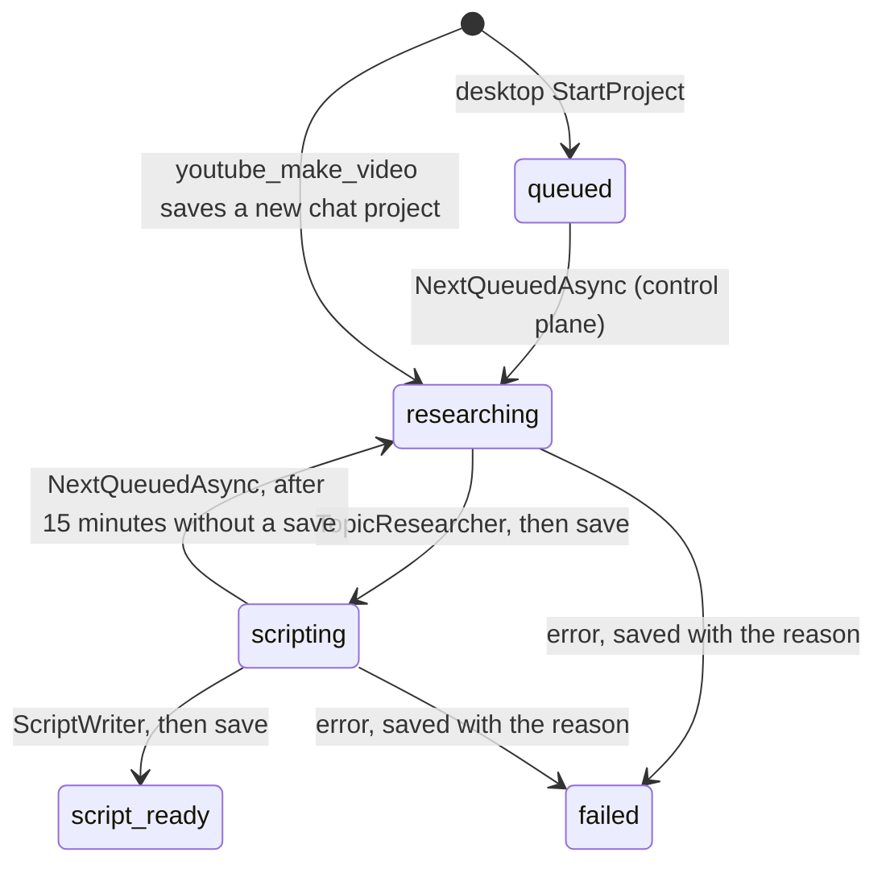

# Operator

> Turns "make a video about X" into a researched script the owner reviews on the desktop's Production screen, without writing anything outside the control plane's own state ([[pages/decisions/0033-channel-operator-architecture]]).

## To change here, read

- [[pages/invariants/no-executive-writes]]
- [[pages/invariants/pluggable-boundaries]]
- [[pages/decisions/0032-per-feature-write-permissions]]
- [[pages/decisions/0033-channel-operator-architecture]]
- [[pages/decisions/0012-llm-communication-through-semantic-kernel]]
- [[pages/roadmap/youtube-channel-operator]] - phase 2, and the phases still to come
- [[pages/conventions/testing]]

## Responsibility

Owns phase 2 of [[pages/roadmap/youtube-channel-operator]]: topic research, the script with its factual claims, the run of one project from researching to `script_ready`, the background worker that takes projects, the search quota counter and the model functions `youtube_make_video` and `youtube_video_status`. Does not own the operator's state, which the control plane holds and checks against the owner's YouTube write grant ([[pages/services/control-plane]]); nor the YouTube client ([[pages/services/plugin-youtube]]); nor the write gate ([[pages/services/llm]]); nor posting into a chat, which the adapters do behind `IOriginNotifier` ([[pages/services/conversation]]); nor the Production screen ([[pages/services/desktop-ui]]). Narration, visuals, assembly and publishing are later phases.

## Public contract

- **Entry point:** `AddYouTubeOperator(IServiceCollection)` (`src/Scout.Operator/OperatorServiceCollectionExtensions.cs:21`). The caller registers an `IOperatorControlPlane`, the YouTube client and the origin notifier first; [[pages/services/host-console]] does that only when YouTube is configured.
- **Control-plane seam:** `IOperatorControlPlane` (`src/Scout.Operator/IOperatorControlPlane.cs:9`) with `GetMandateAsync`, `SaveProjectAsync(project, originReference)`, `NextQueuedAsync`, `GetProjectAsync(id)` (`:24`) and `ListRecentAsync(limit)` (`:27`), over plain records that mirror the `operator.proto` messages: `OperatorMandate` (`:31`), `OperatorProjectState` (`:44`), the script, section, chapter and claim records, and `QueuedProject` (`:88`). No gRPC or Contracts type crosses it; every failure is an `InvalidOperationException` whose message the owner can read. The host supplies the gRPC and the closed implementations.
- **Model tools:** plugin `YouTubeOperator` (`src/Scout.Operator/YouTubeOperatorPlugin.cs:12`) with `youtube_make_video(topic)` (`:39`), declared a write of feature `youtube`, catalog row "Scout's data folder", with `topic` as the only argument the request summary shows (`src/Scout.Operator/OperatorServiceCollectionExtensions.cs:37`), and `youtube_video_status()` (`src/Scout.Operator/YouTubeOperatorPlugin.cs:82`), a read. Neither takes a chat reference as a parameter.
- **Hosted service:** `OperatorWorker` (`src/Scout.Operator/OperatorWorker.cs:13`).
- **External boundaries:** the control plane through `IOperatorControlPlane`; YouTube through `IYouTubeClient` (`GetMyChannelAsync`, `ListUploadsAsync`, `SearchVideosAsync`); the chat model through the kernel's `IChatCompletionService` with no settings and no kernel, so the model is offered no function (`src/Scout.Operator/ModelJson.cs:48`); the originating chat through `IOriginNotifier`. No file, process or network call of its own.

## How it works

`youtube_make_video` reads the turn's origin from `ChatOrigin.Current` (`src/Scout.Operator/YouTubeOperatorPlugin.cs:45`), reads the mandate and refuses a topic that contains one of its blocked topics, in any case (`:57`), saves a project with an empty id, status `researching` and origin `chat` with that reference, and hands the saved project to the worker through an in-process channel (`:75`); the turn does not wait for the pipeline. It answers "Started a video project on <topic>; I will post here when the script is ready.", or, outside a chat turn, points to the desktop's Production screen. A blocked topic, or a control plane that refuses or cannot be reached, starts nothing and throws an `InvalidOperationException` whose message is "Could not start a video project on <topic>: <reason>" (`:59`, `:72`): `WriteGateFilter` then records the write as `failed: InvalidOperationException`, never `succeeded`, and Semantic Kernel hands the message to the model, which tells the user. Because the function is declared, `WriteGateFilter` asks the control plane before it runs, and the control plane checks the YouTube grant again on the save. The plugin holds no reference to the kernel or the chat service, so the kernel can be built from it without a construction cycle.

`OperatorWorker` runs one project at a time (`src/Scout.Operator/OperatorWorker.cs:22`): a project handed over from chat at once, otherwise the project `NextQueuedAsync` returns (`:38`), then it waits until either 30 seconds pass (`:20`) or a chat hands a project over (`:66`). A control plane that cannot answer is logged once until it answers again (`:43`), so with no desktop the worker idles quietly. A project that throws out of the pipeline is logged by id and exception type and saved as failed once more with the reason the exception carries (`:75`); when the pipeline could not save its own failure, that reason is the original cause, so the stored error is the real one once the control plane answers again. On shutdown the loop ends; a project cut short keeps the status of its last save, and the control plane hands it out again once it has gone 15 minutes without a save ([[pages/services/control-plane]]).

`OperatorPipeline.RunAsync` (`src/Scout.Operator/OperatorPipeline.cs:40`) posts "Researching <topic>..." to the origin, reads the mandate, fails the project before any search when the topic contains a blocked topic of the mandate, with "The channel mandate blocks the topic "<blocked>"; choose another topic or change the mandate in Scout Desktop, Production." (`:50`), so a project the desktop queued is held to the mandate too, researches, saves `scripting` with the candidates, writes the script, and saves `script_ready` with the script and the claims; then it posts "Script ready for <topic>: open Scout Desktop, Production, to review it." Any failure saves `failed` with a readable reason and posts "The video project on <topic> stopped: <reason>", also when that save itself fails; then it throws an `InvalidOperationException` carrying the original reason, not the save's failure (`:78`). Every save first reads the project back with `GetProjectAsync` and changes only status, candidates, script, claims and error (`:97`), so the topic, the origin and every claim the owner decided (any status other than `pending`) go back exactly as read; the fresh claims follow them, renumbered past the ids the owner's claims use, and a fresh claim with the same text as a decided one is dropped (`:103`). A project without an origin posts nothing; a notice the chat cannot take is logged and the project continues (`:124`). The reference is never logged.

`TopicResearcher` (`src/Scout.Operator/TopicResearcher.cs:24`) reads the owner's channel and its ten latest uploads, then searches YouTube for the topic and the mandate's pillars, case-insensitively distinct, at most five per project (`:115`), each search taken from `SearchBudget` first (`:75`). With an API key and no Google sign-in, reading the owner's own channel answers 401 and the plugin's sign-in message; research then goes on without the uploads and tells the model "The channel's own uploads are unavailable because Scout is not signed in to the owner's YouTube channel; propose topics without the channel's history." (`:30`, `:63`). Any other YouTube error on the channel fails the research as before. `SearchBudget` (`src/Scout.Operator/SearchBudget.cs:8`) allows 40 searches a day in this process and resets at midnight Pacific time (`:41`), below the 100-a-day `search.list` bucket; Pacific time is the system zone `America/Los_Angeles`, else `Pacific Standard Time`, else a fixed UTC-8 on a host without time zone data, found without ever throwing (`:63`); with today's searches spent, research continues without search and tells the model "The YouTube search budget for today (40 searches) is spent; it resets at midnight Pacific time." The model is asked for five candidates as JSON `{title, reason, fit}`; a candidate whose title contains a blocked topic of the mandate, in any case, is dropped by the same `BlockedTopic` match the topic check uses (`:37`, `:108`), fit is clamped to 0..1, and at most five are kept. The research sources are the watch links of the uploads and of the search results. A YouTube error fails the research with YouTube's own user-safe message; a timeout or a reset with "Could not reach YouTube. Try again later."

`ScriptWriter` (`src/Scout.Operator/ScriptWriter.cs:15`) asks for hook, sections, call to action, three to five title variants, description, tags, chapters and claims, in the mandate's language (English when empty, `:73`). A claim keeps only the source links the research read (`:59`), its risk is `high` or `standard`, every claim starts `pending` (`:60`), and at most 25 are kept (`:19`).

`ModelJson.AskAsync` (`src/Scout.Operator/ModelJson.cs:13`) is the one way both stages ask the model: one JSON object, parsed from the first `{` to the last `}`; an answer that is not the JSON asked for gets one more request built afresh from the same system prompt and request plus "Your previous answer was not valid JSON in the shape asked for. Answer again with the JSON only.", never the bad answer, so the second request costs what the first did (`:35`, `:42`), and a second bad answer fails the project with "The AI model did not return topic candidates in the expected form, twice." or the script's equivalent. A model that throws fails it with "The AI model did not answer; check the AI Source in Scout Desktop." (`:54`).

## Invariants

- [[pages/invariants/no-executive-writes]]: the operator writes nothing outside the control plane's state; its one model-callable write, `youtube_make_video`, is declared to the write gate and lands on a `Write` row of the catalog (`tests/Scout.Host.Console.Tests/WriteDeclarationCatalogTests.cs:13`); the research and script requests offer the model no function, so a title in a search result cannot make it call one (`tests/Scout.Operator.Tests/TopicResearcherTests.cs:109`).
- Every write goes through the gate: a composed chat turn that calls `youtube_make_video` asks the gate with `youtube | Scout's data folder | youtube_make_video(topic=...)` before the project is saved (`tests/Scout.Host.Console.Tests/HostOperatorTurnTests.cs:48`), and a save the control plane refuses is recorded as failed, never succeeded (`:70`). The statuses and the claim status the operator sends, and its scope text, are the ones the control plane accepts (`tests/Scout.Host.Console.Tests/OperatorContractTests.cs:44`, `:67`).
- Progress only to the origin: the only posts are the start, ready and failure notices, to the reference the turn carried; a project without one posts nothing (`tests/Scout.Operator.Tests/OperatorPipelineTests.cs:30`, `:51`).
- The owner's claim decisions are never changed or dropped by the worker (`tests/Scout.Operator.Tests/OperatorPipelineTests.cs:132`).
- The mandate's blocked topics hold from the first step: `youtube_make_video` and the pipeline refuse a blocked topic before any search (`tests/Scout.Operator.Tests/YouTubeOperatorPluginTests.cs:84`, `tests/Scout.Operator.Tests/OperatorPipelineTests.cs:84`).
- [[pages/invariants/pluggable-boundaries]]: no vendor or gRPC type in the project; the model is reached through Semantic Kernel only.

## Hot spots

- `src/Scout.Operator/OperatorPipeline.cs:103`: the claim merge is what keeps a save from being refused by the control plane's tamper check; a change to claim ids or statuses must keep decided claims byte for byte.
- `src/Scout.Operator/OperatorServiceCollectionExtensions.cs:37`: the declaration's plugin and function names must match the plugin, or the write runs ungated; `tests/Scout.Operator.Tests/YouTubeOperatorPluginTests.cs:135` fails when they drift.
- `src/Scout.Operator/SearchBudget.cs:8`: the counter is per process; a worker restart starts a new count, so YouTube's own bucket is the hard limit.

## Testing footprint

`tests/Scout.Operator.Tests` (43 test attributes, 44 cases on 2026-11-03, 6 test files plus `Fakes/`): the search budget's daily cap, Pacific reset and its time zone fallbacks (`tests/Scout.Operator.Tests/SearchBudgetTests.cs:8` to `:54`); research queries, blocked topics, the spent budget, the sources, the one retry and its fresh history, no function offered, research without a sign-in, and a failing call each for YouTube and the model (`tests/Scout.Operator.Tests/TopicResearcherTests.cs:12` to `:183`); the script's claim cap, source filter, risk, language and title rule (`tests/Scout.Operator.Tests/ScriptWriterTests.cs:15` to `:77`); the pipeline's saves and notices, the failure path, a blocked topic refused before any search, the failure notice when the control plane goes down mid-run, a notice that throws, and the owner's decisions carried through (`tests/Scout.Operator.Tests/OperatorPipelineTests.cs:30` to `:132`); the worker taking a queued project, waking at once for a chat project, logging an unreachable control plane once and stopping cleanly, saving a project failed when every save fails, and keeping the original reason when the failure's own save failed (`tests/Scout.Operator.Tests/OperatorWorkerTests.cs:44` to `:119`); the functions driven through a real `ConversationConductor` turn for the origin, the closed reply, the refused start, the blocked topic, the status list and its failure, and the declaration matching the plugin (`tests/Scout.Operator.Tests/YouTubeOperatorPluginTests.cs:48` to `:135`). The gRPC control plane and the composed host are tested in [[pages/services/host-console]].

## Cache footprint

None. The operator keeps no state of its own besides the in-process search counter and the hand-over channel; every project lives in the control plane.

## Cross-service dependencies

- **Reads from:** [[pages/services/control-plane]] through `WorkerGate` (mandate, queued projects, a project, the latest projects), on the host's gRPC client ([[pages/services/host-console]]); YouTube through [[pages/services/plugin-youtube]]; the chat model through [[pages/services/llm]].
- **Written to by:** nobody; it writes its drafts to [[pages/services/control-plane]] and its notices through the adapters behind [[pages/services/conversation]].

## Known violations / P1 debt

- A project is taken again when it has sat in `researching` or `scripting` for 15 minutes without a save ([[pages/services/control-plane]]). One worker never polls while it runs a project, so it cannot take its own run twice; with a second worker on the same control plane, a stage that runs longer than 15 minutes, such as a script written by a slow local model, would be taken by the other worker and run twice, the last save winning. Scout Desktop starts one worker.

## Related

Direct project references: [[pages/services/llm]] (`AddWriteFunction`), [[pages/services/conversation]] (`ChatOrigin`, `IOriginNotifier`), [[pages/services/plugin-youtube]]. Referenced by [[pages/services/host-console]]. Map: [[pages/architecture/project-map]].
