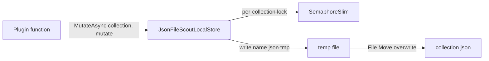

# Plugin.Common

> The shared library of the day-to-day plugins: where Scout keeps its own state, and how dates are parsed against an injected clock.

## To change here, read

- [[pages/invariants/no-executive-writes]]
- [[pages/invariants/pluggable-boundaries]]
- [[pages/invariants/local-first-default]]
- [[pages/architecture/plugin-catalogue]]
- [[pages/conventions/testing]]

## Responsibility

Owns `IScoutLocalStore` and its JSON-file implementation, the options for its directory, `RelaxedDate`, and the `AddScoutPluginCommon` registration. Does not own any plugin's document shape; each plugin defines its own.

## Public contract

- **Entry point:** `AddScoutPluginCommon(IServiceCollection, IConfiguration)` at `src/Scout.Plugin.Common/ScoutPluginCommonServiceCollectionExtensions.cs:22`; idempotent (`TryAdd`, `:30,31`) so plugins call it in any order.
- **Store:** `IScoutLocalStore` with `ReadOrCreateAsync<T>` and `MutateAsync<T>` (`src/Scout.Plugin.Common/Abstractions/IScoutLocalStore.cs:15,24`); implementation `JsonFileScoutLocalStore` (`src/Scout.Plugin.Common/JsonFileScoutLocalStore.cs:14`).
- **Dates:** `RelaxedDate.TryParse`, `Today`, `Now` (`src/Scout.Plugin.Common/RelaxedDate.cs:66,73,82`); ISO and day/month formats, relative words and weekday names in English and Portuguese (`:14,26,38`), unknown time zones fall back to UTC (`:143`).
- **Configuration keys:** section `Scout:Plugins:LocalStore` (`src/Scout.Plugin.Common/ScoutPluginCommonServiceCollectionExtensions.cs:16`), key `RootDirectory` (`src/Scout.Plugin.Common/ScoutLocalStoreOptions.cs:11`). Default directory is `{LocalApplicationData}/Scout/plugin-data` (`src/Scout.Plugin.Common/JsonFileScoutLocalStore.cs:30`).
- **Model tools:** none; this is a library.

## How it works

One file per collection, named `<collection>.json` (`:110`). A mutation loads, runs the callback, writes a `.tmp` file and moves it over the target under a per-collection lock (`:51-72,90-104`). Collection names are restricted to ASCII letters, digits, `-` and `_` so a name cannot escape the directory (`:114-128`).

## Invariants

- [[pages/invariants/no-executive-writes]]: the interface comment calls this the only write surface plugins may touch besides chat messages and says it stores Scout-owned data locally (`src/Scout.Plugin.Common/Abstractions/IScoutLocalStore.cs:3`). It is a convention, not a guard: a grep of `src/Scout.Plugin.*` finds no `File.` or `Directory.` write calls outside this project, and the only non-GET HTTP call is the Ship24 search POST in [[pages/services/plugin-parcels]].
- [[pages/invariants/pluggable-boundaries]]: plugins depend on this small library, never on each other. Converter, Dictionary, Nutrition, Recipes and WebSearch reference it in their `.csproj` without using any of its types.

## Hot spots

- `src/Scout.Plugin.Common/JsonFileScoutLocalStore.cs:92`: state is plain, unencrypted JSON in the user's profile; ledger entries, notes and parcel numbers sit there readable by anything running as that user.
- `src/Scout.Plugin.Common/JsonFileScoutLocalStore.cs:83`: a corrupt file throws on load; plugins such as Reminders catch it themselves (`src/Scout.Plugin.Reminders/RemindersPlugin.cs:16`).

## Testing footprint

`tests/Scout.Plugin.Common.Tests` (9 test attributes, 2 files): JsonFileScoutLocalStoreTests, RelaxedDateTests. `AddScoutPluginCommon` has no test of its own here; the plugin extension tests exercise it.

## Related

Direct project references: none. Used by the stateful plugins (Notes, Lists, Reminders, Ledger, News, Parcels) and by the date-aware plugins. Referenced by most [[pages/architecture/plugin-catalogue]] entries. Map: [[pages/architecture/project-map]].
