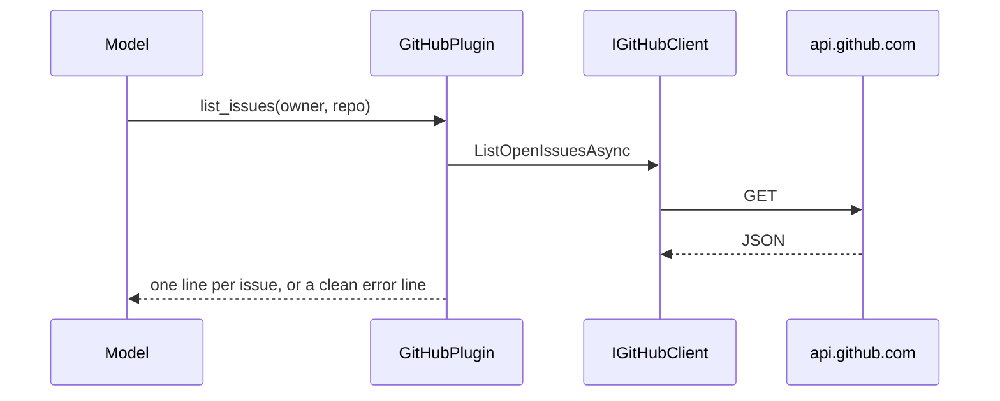

# Plugin.GitHub

> Lets the model list repositories, pull requests and issues, and describe a repository, using the user's own token.

## To change here, read

- [[pages/invariants/no-executive-writes]]
- [[pages/invariants/secrets-never-in-source]]
- [[pages/invariants/pluggable-boundaries]]
- [[pages/conventions/testing]]

## Responsibility

Owns the GitHub REST client and the kernel functions. Does not own token storage in the desktop UI ([[pages/services/control-plane]]) or kernel composition ([[pages/services/llm]]).

## Public contract

- **Entry point:** `AddGitHubPlugin(IServiceCollection, IConfiguration)` at `src/Scout.Plugin.GitHub/GitHubServiceCollectionExtensions.cs:28`; returns early when the token is blank (`:38`).
- **Abstraction:** `IGitHubClient` with four read methods (`src/Scout.Plugin.GitHub/Abstractions/IGitHubClient.cs:7`); internal implementation `GitHubClient` (`src/Scout.Plugin.GitHub/GitHubClient.cs:14`); records `GitHubRepository`, `GitHubPullRequest`, `GitHubIssue`, `RepositoryInfo`; `GitHubApiException` (`src/Scout.Plugin.GitHub/GitHubApiException.cs:10`).
- **Model tools:** plugin `GitHub` (`src/Scout.Plugin.GitHub/GitHubServiceCollectionExtensions.cs:56`) with `list_repositories` (`src/Scout.Plugin.GitHub/GitHubPlugin.cs:29`), `list_pull_requests` (`:51`), `list_issues` (`:76`), `get_repository` (`:101`).
- **Configuration keys:** `Scout:Plugins:GitHub` with `Token` (`src/Scout.Plugin.GitHub/GitHubOptions.cs:8`).
- **External boundaries:** HTTPS to the GitHub REST API with a bearer token, 30 second timeout, API version header (`src/Scout.Plugin.GitHub/GitHubServiceCollectionExtensions.cs:43`); GET requests only (`src/Scout.Plugin.GitHub/GitHubClient.cs:140,157`).

## How it works

Every function catches `GitHubApiException`, `HttpRequestException` and `OperationCanceledException` and returns a user-safe string, so a tool call never throws into the kernel (`src/Scout.Plugin.GitHub/GitHubPlugin.cs:160`). `get_repository` assembles metadata, languages, README excerpt and top-level entries from several GETs, treating 404 as absent (`src/Scout.Plugin.GitHub/GitHubClient.cs:137`).

## Invariants

- [[pages/invariants/no-executive-writes]]: held because no write method exists; no allow-list or test guards it.
- [[pages/invariants/secrets-never-in-source]]: token read from configuration only; blank means the plugin is absent.
- [[pages/invariants/pluggable-boundaries]]: a `KernelPlugin` singleton picked up by the shared kernel.

## Hot spots

- `src/Scout.Plugin.GitHub/GitHubClient.cs:169`: maps 401, 403 (rate limit) and 404 to user-facing errors.
- `src/Scout.Plugin.GitHub/GitHubOptions.cs:11`: comment says read-only scopes suffice, while the control plane asks for `repo` and `read:org` (`src/Scout.ControlPlane/Features/FeatureCatalog.cs:26`) and lists "Create issues" in its scope matrix (`:51`) although this plugin has no issue-creating function.

## Testing footprint

`tests/Scout.Plugin.GitHub.Tests` (47 test attributes, 5 files): client list and repository calls against a fake handler (`Fakes/`), plugin output and error mapping, function metadata, and DI self-gating with header checks.

## Related

Direct project references: none. Referenced by [[pages/services/host-console]]. Map: [[pages/architecture/project-map]].
