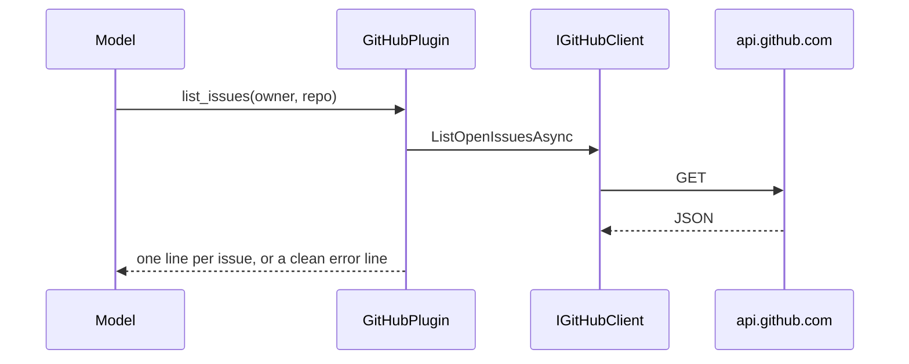

# Plugin.GitHub

> Lets the model list repositories, pull requests and issues, describe a repository, and read one pull request with its diffs and comments, one issue and one file for a code review ([[pages/roadmap/code-quality-assistant]]), as the owner's GitHub account through the Scout GitHub App ([[pages/decisions/0019-github-app-device-flow]]) or a configured token.

## To change here, read

- [[pages/invariants/no-executive-writes]]
- [[pages/invariants/secrets-never-in-source]]
- [[pages/invariants/pluggable-boundaries]]
- [[pages/decisions/0019-github-app-device-flow]]
- [[pages/decisions/0038-code-quality-assistant-on-the-write-gate]]
- [[pages/conventions/testing]]

## Responsibility

Owns the GitHub REST client, the kernel functions and reading the token file. Does not own the sign-in, the refresh or the file itself, which the desktop main process writes ([[pages/services/desktop-ui]]), nor kernel composition ([[pages/services/llm]]).

## Public contract

- **Entry point:** `AddGitHubPlugin(IServiceCollection, IConfiguration)` at `src/Scout.Plugin.GitHub/GitHubServiceCollectionExtensions.cs:29`; returns early when both the token and the token file are blank (`:44`). A token file takes precedence: it adds `GitHubTokenFileHandler` to the client pipeline (`:65`) instead of a fixed bearer header.
- **Abstraction:** `IGitHubClient` with nine read methods (`src/Scout.Plugin.GitHub/Abstractions/IGitHubClient.cs:7`): the four listings and, since 2026-11-06, `GetPullRequestAsync` (`:33`), `ListPullRequestFilesAsync` (`:40`, the files alone, so one file's diff costs one request), `ListPullRequestCommentsAsync` (`:47`), `GetIssueAsync` (`:53`) and `GetFileContentAsync` (`:60`); each answers null for a 404, so the plugin says "not found" and never "check the token" for a missing number; internal implementation `GitHubClient` in two parts (`src/Scout.Plugin.GitHub/GitHubClient.cs:14`, `src/Scout.Plugin.GitHub/GitHubClient.Reads.cs:12`); records `GitHubRepository`, `GitHubPullRequest`, `GitHubIssue`, `RepositoryInfo`, `PullRequestDetails` with `ChangedFile`, `PullRequestComment`, `IssueDetails`, `RepositoryFile`; `GitHubApiException` (`src/Scout.Plugin.GitHub/GitHubApiException.cs:10`).
- **Model tools:** plugin `GitHub` (`src/Scout.Plugin.GitHub/GitHubServiceCollectionExtensions.cs:68`) with `list_repositories` (`src/Scout.Plugin.GitHub/GitHubPlugin.cs:31`), `list_pull_requests` (`:53`), `list_issues` (`:83`), `get_repository` (`:113`), and the single-item reads a review needs: `get_pull_request` (`src/Scout.Plugin.GitHub/GitHubPlugin.Reads.cs:37`), `get_pull_request_file` (`:75`), `list_pull_request_comments` (`:131`), `get_issue` (`:173`), `get_file_contents` (`:219`). Exactly these nine exist (`tests/Scout.Plugin.GitHub.Tests/GitHubPluginMetadataTests.cs:38`).
- **Bounds:** a pull request answer carries the diffs that fit 12,000 characters and marks the rest (`src/Scout.Plugin.GitHub/GitHubPlugin.Reads.cs:17`); one file's diff or text is cut at 20,000 (`:20`); a description at 4,000 (`:23`); GitHub lists at most 100 changed files per request (`:26`), so a larger pull request says how many files it changes and that the review covers part of it, and a file beyond the hundredth is reported as not listed, never as not changed. GitHub itself omits the diff of a binary or very large file and the inline content of a file over 1 MB, and types a symlink or a submodule as such; all are said in the answer.
- **Name grammar:** every owner, repository, path and reference the model passes is checked before a URL is built (`src/Scout.Plugin.GitHub/GitHubNames.cs:29`, `:32`, `:42`): letters, digits, dots, hyphens and underscores for names; a relative path without `.` or `..` segments; a reference of letters, digits, dots, slashes, hyphens and underscores. A refused value answers a fixed sentence and sends nothing (`tests/Scout.Plugin.GitHub.Tests/GitHubPluginReadsTests.cs:165`, `tests/Scout.Plugin.GitHub.Tests/GitHubNamesTests.cs`).
- **Declared in the catalog:** the `github` feature's `Contents`, `Pull requests` and `Issues` rows name every read above, the five new ones included, so the Features screen shows the owner what the functions reach (`src/Scout.ControlPlane/Features/FeatureCatalog.cs:19`); a read the catalog does not name is a Rule A finding.
- **Configuration keys:** `Scout:Plugins:GitHub` with `Token` (`src/Scout.Plugin.GitHub/GitHubOptions.cs:14`) and `TokenFile` (`src/Scout.Plugin.GitHub/GitHubOptions.cs:21`), the path of a JSON file with an `access_token` field. The desktop sets `SCOUT__PLUGINS__GITHUB__TOKENFILE` while the owner is connected through the browser, or `SCOUT__PLUGINS__GITHUB__TOKEN` when the owner pasted a token on the Features screen ([[pages/decisions/0019-github-app-device-flow]]).
- **External boundaries:** HTTPS to the GitHub REST API with a bearer token, 30 second timeout, API version header (`src/Scout.Plugin.GitHub/GitHubServiceCollectionExtensions.cs:47`); GET requests only (`src/Scout.Plugin.GitHub/GitHubClient.cs:140,157`; the reads part calls those two, `src/Scout.Plugin.GitHub/GitHubClient.Reads.cs:109` for the one `JsonDocument` read): `pulls/{n}`, `pulls/{n}/files`, `pulls/{n}/comments`, `issues/{n}`, `issues/{n}/comments`, `contents/{path}?ref=` beside the four listing endpoints. The token file on the local filesystem.

## How it works

With a token file, `GitHubTokenFileHandler` (`src/Scout.Plugin.GitHub/GitHubTokenFileHandler.cs:14`) sets the bearer header on every request from the file, and re-reads the file whenever its write time changes (`:40`), so the token the desktop refreshes every 8 hours is used without a restart. A missing, empty, unparsable or unreadable file throws `GitHubApiException` with "GitHub is not connected. Connect it on the Features screen." before any request leaves the process (`:70`). A 401 on a request that used the file becomes "GitHub rejected the connection. Disconnect and connect GitHub again on the Features screen." (`:35`, `tests/Scout.Plugin.GitHub.Tests/GitHubTokenFileHandlerTests.cs:111`); a 401 for a configured `Token` keeps "Check the configured token" (`:127`). Neither message carries the token or the file contents.

Every function catches `GitHubApiException`, `HttpRequestException` and `OperationCanceledException` and returns a user-safe string, so a tool call never throws into the kernel (`src/Scout.Plugin.GitHub/GitHubPlugin.cs:177`, `tests/Scout.Plugin.GitHub.Tests/GitHubPluginReadsTests.cs:189`). `get_repository` assembles metadata, languages, README excerpt and top-level entries from several GETs, treating 404 as absent (`src/Scout.Plugin.GitHub/GitHubClient.cs:137`).

## The code quality assistant (2026-11-06)

Two bundled skills direct the model over these reads ([[pages/services/skills]]): `code-review` (`src/Scout.Skills/skills/code-review.md`) reads the pull request, the existing comments, the diffs left out and the surrounding code, loads the language skill for each extension and answers findings anchored to `path:line`; `project-improvements` (`src/Scout.Skills/skills/project-improvements.md`) reads the project through the Knowledge index when it is indexed or through `get_repository`, `get_file_contents` and the issues otherwise, and answers a prioritised what, why, how, where list. Posting the review and opening the issues are the declared writes of [[pages/decisions/0038-code-quality-assistant-on-the-write-gate]] phases 2 and 3; until they land, both skills say so.

## Invariants

- [[pages/invariants/no-executive-writes]]: held because no write method exists, and through the desktop sign-in also by the GitHub App's read-only permissions until [[pages/decisions/0038-code-quality-assistant-on-the-write-gate]] phase 2 widens it. `tests/Scout.Plugin.GitHub.Tests/GitHubTokenFileHandlerTests.cs:140` invokes every function, the five new ones included, and fails on any request to `api.github.com` that is not a GET.
- [[pages/invariants/secrets-never-in-source]]: the token or the token file path comes from configuration only; blank means the plugin is absent.
- [[pages/invariants/pluggable-boundaries]]: a `KernelPlugin` singleton picked up by the shared kernel.

## Hot spots

- `src/Scout.Plugin.GitHub/GitHubClient.cs:169`: maps 401, 403 (rate limit) and 404 to user-facing errors.

## Testing footprint

`tests/Scout.Plugin.GitHub.Tests` (147 tests on 2026-11-06, 9 files): the single-item reads against the stub handler, 404, 5xx and timeout (`tests/Scout.Plugin.GitHub.Tests/GitHubClientReadsTests.cs`), the plugin's bounded formatting, refusals and clean error lines (`tests/Scout.Plugin.GitHub.Tests/GitHubPluginReadsTests.cs`), the name grammar (`tests/Scout.Plugin.GitHub.Tests/GitHubNamesTests.cs`); before that (66 on 2026-10-23, 6 files): client list and repository calls against a fake handler (`Fakes/`), plugin output and error mapping, function metadata, DI self-gating with header checks, and the token-file path through the real composition with a recording primary handler (`tests/Scout.Plugin.GitHub.Tests/GitHubTokenFileHandlerTests.cs:44`: bearer from the file and again after a rewrite; `:66`: missing file answers not connected and sends nothing; `:95`: a file deleted on disconnect stops the old token).

## Related

Direct project references: none. Referenced by [[pages/services/host-console]]. Map: [[pages/architecture/project-map]].
