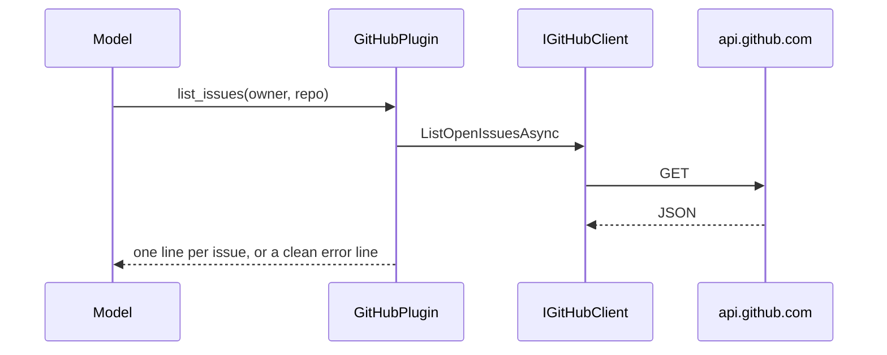

# Plugin.GitHub

> Lets the model list repositories, pull requests and issues, describe a repository, and read one pull request with its diffs and comments, one issue and one file for a code review ([[pages/roadmap/code-quality-assistant]]), as the owner's GitHub account through the Scout GitHub App ([[pages/decisions/0019-github-app-device-flow]]) or a configured token.

## To change here, read

- [[pages/invariants/no-executive-writes]]
- [[pages/invariants/secrets-never-in-source]]
- [[pages/invariants/pluggable-boundaries]]
- [[pages/decisions/0019-github-app-device-flow]]
- [[pages/decisions/0038-code-quality-assistant-on-the-write-gate]]
- [[pages/conventions/testing]]

## Responsibility

Owns the GitHub REST client, the kernel functions and reading the token file. Does not own the sign-in, the refresh or the file itself, which the desktop main process writes ([[pages/services/desktop-ui]]), nor kernel composition ([[pages/services/llm]]).

## Public contract

- **Entry point:** `AddGitHubPlugin(IServiceCollection, IConfiguration)` at `src/Scout.Plugin.GitHub/GitHubServiceCollectionExtensions.cs:29`; returns early when both the token and the token file are blank (`:44`). A token file takes precedence: it adds `GitHubTokenFileHandler` to the client pipeline (`:65`) instead of a fixed bearer header.
- **Abstraction:** `IGitHubClient` with nine read methods (`src/Scout.Plugin.GitHub/Abstractions/IGitHubClient.cs:7`): the four listings and, since 2026-11-06, `GetPullRequestAsync` (`:33`), `ListPullRequestFilesAsync` (`:40`, the files alone, so one file's diff costs one request), `ListPullRequestCommentsAsync` (`:47`), `GetIssueAsync` (`:53`) and `GetFileContentAsync` (`:60`); each answers null for a 404, so the plugin says "not found" and never "check the token" for a missing number; internal implementation `GitHubClient` in two parts (`src/Scout.Plugin.GitHub/GitHubClient.cs:14`, `src/Scout.Plugin.GitHub/GitHubClient.Reads.cs:12`); records `GitHubRepository`, `GitHubPullRequest`, `GitHubIssue`, `RepositoryInfo`, `PullRequestDetails` with `ChangedFile`, `PullRequestComment`, `IssueDetails`, `RepositoryFile`; `GitHubApiException` (`src/Scout.Plugin.GitHub/GitHubApiException.cs:10`).
- **Model tools:** plugin `GitHub` (`src/Scout.Plugin.GitHub/GitHubServiceCollectionExtensions.cs:68`) with `list_repositories` (`src/Scout.Plugin.GitHub/GitHubPlugin.cs:31`), `list_pull_requests` (`:53`), `list_issues` (`:83`), `get_repository` (`:113`), and the single-item reads a review needs: `get_pull_request` (`src/Scout.Plugin.GitHub/GitHubPlugin.Reads.cs:37`), `get_pull_request_file` (`:75`), `list_pull_request_comments` (`:131`), `get_issue` (`:173`), `get_file_contents` (`:219`), and the two whole-project reads an audit needs: `list_repository_files` (`src/Scout.Plugin.GitHub/GitHubPlugin.Reads.cs:287`; the recursive tree in one call, counts by top-level folder and by extension, an optional folder prefix and extension list, at most 300 paths (`:275`), and a note when GitHub cut the tree) and `search_code` (`:333`; GitHub's code search on the default branch, first 30 files with the fragments GitHub highlights, about ten searches a minute). Exactly these eleven exist (`tests/Scout.Plugin.GitHub.Tests/GitHubPluginMetadataTests.cs:38`).
- **Bounds:** a pull request answer carries the diffs that fit 12,000 characters and marks the rest (`src/Scout.Plugin.GitHub/GitHubPlugin.Reads.cs:17`); one file's diff or text is cut at 20,000 (`:20`); a description at 4,000 (`:23`); GitHub lists at most 100 changed files per request (`:26`), so a larger pull request says how many files it changes and that the review covers part of it, and a file beyond the hundredth is reported as not listed, never as not changed. GitHub itself omits the diff of a binary or very large file and the inline content of a file over 1 MB, and types a symlink or a submodule as such; all are said in the answer.
- **Name grammar:** every owner, repository, path, reference and search query the model passes is checked before a URL is built; a query may not carry a `repo:`, `org:` or `user:` qualifier, so a search cannot leave the repository given (`src/Scout.Plugin.GitHub/GitHubNames.cs:58`, `tests/Scout.Plugin.GitHub.Tests/GitHubPluginReadsTests.cs:278`); every owner, repository, path and reference is checked (`src/Scout.Plugin.GitHub/GitHubNames.cs:29`, `:32`, `:42`): letters, digits, dots, hyphens and underscores for names; a relative path without `.` or `..` segments; a reference of letters, digits, dots, slashes, hyphens and underscores. A refused value answers a fixed sentence and sends nothing (`tests/Scout.Plugin.GitHub.Tests/GitHubPluginReadsTests.cs:165`, `tests/Scout.Plugin.GitHub.Tests/GitHubNamesTests.cs`).
- **Declared in the catalog:** the `github` feature's `Contents`, `Pull requests` and `Issues` rows name every read above, the five new ones included, so the Features screen shows the owner what the functions reach (`src/Scout.ControlPlane/Features/FeatureCatalog.cs:19`); a read the catalog does not name is a Rule A finding.
- **Configuration keys:** `Scout:Plugins:GitHub` with `Token` (`src/Scout.Plugin.GitHub/GitHubOptions.cs:14`) and `TokenFile` (`src/Scout.Plugin.GitHub/GitHubOptions.cs:21`), the path of a JSON file with an `access_token` field. The desktop sets `SCOUT__PLUGINS__GITHUB__TOKENFILE` while the owner is connected through the browser, or `SCOUT__PLUGINS__GITHUB__TOKEN` when the owner pasted a token on the Features screen ([[pages/decisions/0019-github-app-device-flow]]).
- **External boundaries:** HTTPS to the GitHub REST API with a bearer token, 30 second timeout, API version header (`src/Scout.Plugin.GitHub/GitHubServiceCollectionExtensions.cs:47`); GET requests only (`src/Scout.Plugin.GitHub/GitHubClient.cs:140,157`; the reads part calls those two, `src/Scout.Plugin.GitHub/GitHubClient.Reads.cs:109` for the one `JsonDocument` read): `pulls/{n}`, `pulls/{n}/files`, `pulls/{n}/comments`, `issues/{n}`, `issues/{n}/comments`, `contents/{path}?ref=` beside the four listing endpoints. The token file on the local filesystem.

## How it works

With a token file, `GitHubTokenFileHandler` (`src/Scout.Plugin.GitHub/GitHubTokenFileHandler.cs:14`) sets the bearer header on every request from the file, and re-reads the file whenever its write time changes (`:40`), so the token the desktop refreshes every 8 hours is used without a restart. A missing, empty, unparsable or unreadable file throws `GitHubApiException` with "GitHub is not connected. Connect it on the Features screen." before any request leaves the process (`:70`). A 401 on a request that used the file becomes "GitHub rejected the connection. Disconnect and connect GitHub again on the Features screen." (`:35`, `tests/Scout.Plugin.GitHub.Tests/GitHubTokenFileHandlerTests.cs:111`); a 401 for a configured `Token` keeps "Check the configured token" (`:127`). Neither message carries the token or the file contents.

Every function catches `GitHubApiException`, `HttpRequestException` and `OperationCanceledException` and returns a user-safe string, so a tool call never throws into the kernel (`src/Scout.Plugin.GitHub/GitHubPlugin.cs:177`, `tests/Scout.Plugin.GitHub.Tests/GitHubPluginReadsTests.cs:189`). `get_repository` assembles metadata, languages, README excerpt and top-level entries from several GETs, treating 404 as absent (`src/Scout.Plugin.GitHub/GitHubClient.cs:137`).

## The writes (ADR 0038 phases 2 and 3, 2026-11-06)

- **Plugin `GitHubActions`** (`src/Scout.Plugin.GitHub/GitHubActionsPlugin.cs`) with `submit_pull_request_review` (`:75`) and `create_issue` (`:166`), both declared with `AddWriteFunction` for the `github` feature's `Scout's data folder` row (`src/Scout.Plugin.GitHub/GitHubServiceCollectionExtensions.cs:86`, `:88`), so the `WriteGateFilter` refuses them before anything is saved while GitHub writes are not granted. Neither reaches GitHub: the function checks names and caps (50 comments, 10,000 characters of body, 2,000 per comment, a title of 256), anchors every review comment to a right-side line of the diff and names the ones it dropped (`:285`, `src/Scout.Plugin.GitHub/DiffLines.cs:17`; a line number the model writes as a string is read), saves a `GitHubDraft` with the chat's origin (`src/Scout.Plugin.GitHub/GitHubDrafts.cs`), asks the gate for the irreversible row, "Pull request reviews" or "New issues" (`:37`, `:40`, `:233`), and answers that the action waits on the Review screen; a refusal deletes the draft and relays the reason; a control plane that does not answer deletes the draft and says so (`:52`); an `Allowed` answer, which only a misconfigured catalog row could give, runs nothing.
- **Drafts:** one JSON file per draft under `Scout/github-drafts` in the user's local application data, or `Scout:Plugins:GitHub:DraftsDirectory` (`src/Scout.Plugin.GitHub/GitHubOptions.cs`); written through a temporary file and a rename; found by action id (`src/Scout.Plugin.GitHub/GitHubDrafts.cs:88`); purged after seven days (`:52`, `:109`), which is what clears a rejected or undecided action's draft.
- **Executor:** `GitHubActionExecutor` (`src/Scout.Plugin.GitHub/GitHubActionExecutor.cs`), a hosted service registered with the plugin (`src/Scout.Plugin.GitHub/GitHubServiceCollectionExtensions.cs:90`), every minute claims the next approved `github` action through `IApprovedActions` (`src/Scout.Llm/Abstractions/IApprovedActions.cs:8`), marks the draft posting, posts it with `IGitHubWriteClient` (`src/Scout.Plugin.GitHub/Abstractions/IGitHubWriteClient.cs:10`, `:14`; `src/Scout.Plugin.GitHub/GitHubWriteClient.cs:20`, `:34`: `POST pulls/{n}/reviews` with event `COMMENT` and side `RIGHT`, `POST issues`), records the write against the action, deletes the draft and tells the originating chat (`:67`, `:110`). No draft: recorded failed (`:34`). Transport fault, timeout, 5xx, a 401 while the token file is rewritten, a 403 rate limit or a 429 (`:179`): nothing recorded, the draft unmarked, the claim lapses and a later run retries. Any other GitHub answer, a 422 naming what was rejected among them (`src/Scout.Plugin.GitHub/GitHubWriteClient.cs:48`): recorded failed, draft deleted, chat told why. Every run is safe to repeat: a post this process made but could not record is recorded on the next run without a second post (`:161`), and a draft another run left posting is recorded failed as possibly posted, never posted again (`:36`). Any other exception is logged and leaves the action for the next run; nothing stops the host.
- **Catalog:** the `github` feature is `WriteClass.Executive` with the rows `Scout's data folder` (`Write`), `Pull request reviews` and `New issues` (`IrreversibleWrite`) beside the four reads (`src/Scout.ControlPlane/Features/FeatureCatalog.cs:73`, `:77`, `:81`); enabling GitHub on a host without the desktop card confirms the writes like YouTube, and the Features screen shows the grant button and the write rows generically ([[pages/services/desktop-ui]]).
- **Enforcement:** `tests/Scout.Plugin.GitHub.Tests/GitHubTokenFileHandlerTests.cs:140` every read function sends only GETs; `:194` the only non-GETs come from the write client to its two endpoints; `:216` the two write functions themselves send nothing but reads and queue; `tests/Scout.Host.Console.Tests/WriteDeclarationCatalogTests.cs:13` every declared write names a write row.

## The conventions profile (ADR 0038 phase 4, 2026-11-06)

`get_project_conventions` (`src/Scout.Plugin.GitHub/GitHubActionsPlugin.cs:241`) reads, and `remember_project_conventions` (`:272`) writes, the Markdown profile of a repository's own rules, one JSON file per repository under `Scout/github-profiles` (`src/Scout.Plugin.GitHub/GitHubProfileStore.cs`; or `Scout:Plugins:GitHub:ProfilesDirectory`), 40 to 20,000 characters, dated and with the chat it came from. The write is declared on the `github` feature's `Scout's data folder` row, so it runs only under the owner's GitHub write grant and is logged; the `code-audit` skill reads the profile before judging any code and saves it after discovering it from the project's files or after the owner corrects a rule in chat (`tests/Scout.Plugin.GitHub.Tests/GitHubActionsPluginTests.cs:126`).

## The code quality assistant (2026-11-06)

Three bundled skills direct the model over these reads ([[pages/services/skills]]): `code-audit` (`src/Scout.Skills/skills/code-audit.md`) audits a whole repository with no pull request, learning its conventions first (the tree, the manifests, the lint and CI configuration, a sample per layer, `search_code` to confirm each rule) and then one dimension at a time (bugs, security, conventions, performance, tests, documentation), every finding anchored to `path:line` and to the profile line it departs from; `code-review` (`src/Scout.Skills/skills/code-review.md`) reads the pull request, the existing comments, the diffs left out and the surrounding code, loads the language skill for each extension and answers findings anchored to `path:line`; `project-improvements` (`src/Scout.Skills/skills/project-improvements.md`) reads the project through the Knowledge index when it is indexed or through `get_repository`, `get_file_contents` and the issues otherwise, and answers a prioritised what, why, how, where list. Posting the review and opening the issues go through `submit_pull_request_review` and `create_issue` above; both skills tell the model to call them only when the user asks, to relay that the action waits for the owner, and never to say it was posted, because the chat hears from the executor.

## Invariants

- [[pages/invariants/no-executive-writes]] as [[pages/decisions/0032-per-feature-write-permissions]] reshaped it: the two writes are declared rows of the `github` feature, run only under the owner's grant and after the owner's approval of each action, and are logged; everything else the plugin does is a GET (`tests/Scout.Plugin.GitHub.Tests/GitHubTokenFileHandlerTests.cs:140`, `:194`).
- [[pages/invariants/secrets-never-in-source]]: the token or the token file path comes from configuration only; blank means the plugin is absent.
- [[pages/invariants/pluggable-boundaries]]: a `KernelPlugin` singleton picked up by the shared kernel.

## Hot spots

- `src/Scout.Plugin.GitHub/GitHubClient.cs:169`: maps 401, 403 (rate limit) and 404 to user-facing errors.

## Testing footprint

`tests/Scout.Plugin.GitHub.Tests` (215 tests on 2026-11-06, 15 files): the tree and search reads and the query guard, the conventions profile;: the writes (`GitHubActionsPluginTests`, `GitHubActionExecutorTests`, `GitHubWriteClientTests`, `GitHubDraftStoreTests`, `DiffLinesTests`); the single-item reads against the stub handler, 404, 5xx and timeout (`tests/Scout.Plugin.GitHub.Tests/GitHubClientReadsTests.cs`), the plugin's bounded formatting, refusals and clean error lines (`tests/Scout.Plugin.GitHub.Tests/GitHubPluginReadsTests.cs`), the name grammar (`tests/Scout.Plugin.GitHub.Tests/GitHubNamesTests.cs`); before that (66 on 2026-10-23, 6 files): client list and repository calls against a fake handler (`Fakes/`), plugin output and error mapping, function metadata, DI self-gating with header checks, and the token-file path through the real composition with a recording primary handler (`tests/Scout.Plugin.GitHub.Tests/GitHubTokenFileHandlerTests.cs:44`: bearer from the file and again after a rewrite; `:66`: missing file answers not connected and sends nothing; `:95`: a file deleted on disconnect stops the old token).

## Related

Direct project references: none. Referenced by [[pages/services/host-console]]. Map: [[pages/architecture/project-map]].
