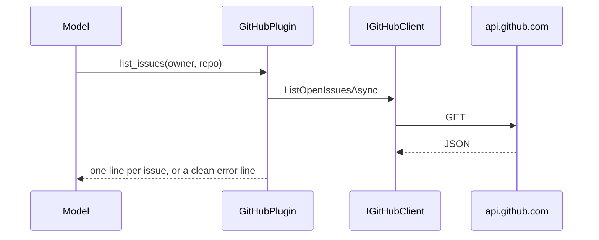

# Plugin.GitHub

> Lets the model list repositories, pull requests and issues, and describe a repository, as the owner's GitHub account through the read-only Scout GitHub App ([[pages/decisions/0019-github-app-device-flow]]) or a configured token.

## To change here, read

- [[pages/invariants/no-executive-writes]]
- [[pages/invariants/secrets-never-in-source]]
- [[pages/invariants/pluggable-boundaries]]
- [[pages/decisions/0019-github-app-device-flow]]
- [[pages/conventions/testing]]

## Responsibility

Owns the GitHub REST client, the kernel functions and reading the token file. Does not own the sign-in, the refresh or the file itself, which the desktop main process writes ([[pages/services/desktop-ui]]), nor kernel composition ([[pages/services/llm]]).

## Public contract

- **Entry point:** `AddGitHubPlugin(IServiceCollection, IConfiguration)` at `src/Scout.Plugin.GitHub/GitHubServiceCollectionExtensions.cs:29`; returns early when both the token and the token file are blank (`:44`). A token file takes precedence: it adds `GitHubTokenFileHandler` to the client pipeline (`:65`) instead of a fixed bearer header.
- **Abstraction:** `IGitHubClient` with four read methods (`src/Scout.Plugin.GitHub/Abstractions/IGitHubClient.cs:7`); internal implementation `GitHubClient` (`src/Scout.Plugin.GitHub/GitHubClient.cs:14`); records `GitHubRepository`, `GitHubPullRequest`, `GitHubIssue`, `RepositoryInfo`; `GitHubApiException` (`src/Scout.Plugin.GitHub/GitHubApiException.cs:10`).
- **Model tools:** plugin `GitHub` (`src/Scout.Plugin.GitHub/GitHubServiceCollectionExtensions.cs:68`) with `list_repositories` (`src/Scout.Plugin.GitHub/GitHubPlugin.cs:29`), `list_pull_requests` (`:51`), `list_issues` (`:76`), `get_repository` (`:101`).
- **Configuration keys:** `Scout:Plugins:GitHub` with `Token` (`src/Scout.Plugin.GitHub/GitHubOptions.cs:14`) and `TokenFile` (`src/Scout.Plugin.GitHub/GitHubOptions.cs:21`), the path of a JSON file with an `access_token` field. The desktop sets `SCOUT__PLUGINS__GITHUB__TOKENFILE` while the owner is connected through the browser, or `SCOUT__PLUGINS__GITHUB__TOKEN` when the owner pasted a token on the Features screen ([[pages/decisions/0019-github-app-device-flow]]).
- **External boundaries:** HTTPS to the GitHub REST API with a bearer token, 30 second timeout, API version header (`src/Scout.Plugin.GitHub/GitHubServiceCollectionExtensions.cs:47`); GET requests only (`src/Scout.Plugin.GitHub/GitHubClient.cs:140,157`). The token file on the local filesystem.

## How it works

With a token file, `GitHubTokenFileHandler` (`src/Scout.Plugin.GitHub/GitHubTokenFileHandler.cs:14`) sets the bearer header on every request from the file, and re-reads the file whenever its write time changes (`:40`), so the token the desktop refreshes every 8 hours is used without a restart. A missing, empty, unparsable or unreadable file throws `GitHubApiException` with "GitHub is not connected. Connect it on the Features screen." before any request leaves the process (`:70`). A 401 on a request that used the file becomes "GitHub rejected the connection. Disconnect and connect GitHub again on the Features screen." (`:35`, `tests/Scout.Plugin.GitHub.Tests/GitHubTokenFileHandlerTests.cs:111`); a 401 for a configured `Token` keeps "Check the configured token" (`:127`). Neither message carries the token or the file contents.

Every function catches `GitHubApiException`, `HttpRequestException` and `OperationCanceledException` and returns a user-safe string, so a tool call never throws into the kernel (`src/Scout.Plugin.GitHub/GitHubPlugin.cs:160`). `get_repository` assembles metadata, languages, README excerpt and top-level entries from several GETs, treating 404 as absent (`src/Scout.Plugin.GitHub/GitHubClient.cs:137`).

## Invariants

- [[pages/invariants/no-executive-writes]]: held because no write method exists, and through the desktop sign-in also by the GitHub App's read-only permissions. `tests/Scout.Plugin.GitHub.Tests/GitHubTokenFileHandlerTests.cs:140` invokes every function and fails on any request to `api.github.com` that is not a GET.
- [[pages/invariants/secrets-never-in-source]]: the token or the token file path comes from configuration only; blank means the plugin is absent.
- [[pages/invariants/pluggable-boundaries]]: a `KernelPlugin` singleton picked up by the shared kernel.

## Hot spots

- `src/Scout.Plugin.GitHub/GitHubClient.cs:169`: maps 401, 403 (rate limit) and 404 to user-facing errors.

## Testing footprint

`tests/Scout.Plugin.GitHub.Tests` (66 tests on 2026-10-23, 6 files): client list and repository calls against a fake handler (`Fakes/`), plugin output and error mapping, function metadata, DI self-gating with header checks, and the token-file path through the real composition with a recording primary handler (`tests/Scout.Plugin.GitHub.Tests/GitHubTokenFileHandlerTests.cs:44`: bearer from the file and again after a rewrite; `:66`: missing file answers not connected and sends nothing; `:95`: a file deleted on disconnect stops the old token).

## Related

Direct project references: none. Referenced by [[pages/services/host-console]]. Map: [[pages/architecture/project-map]].
