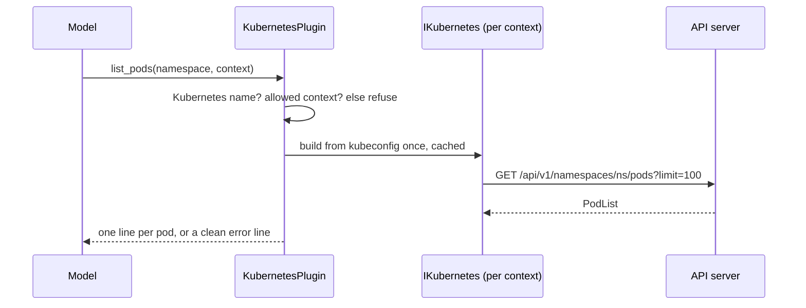

# Plugin.Kubernetes

> Lets the model list namespaces, pods, deployments and events and describe a pod, in the clusters the owner allowed from the kubeconfig on this computer ([[pages/decisions/0020-kubernetes-from-local-kubeconfig]]).

## To change here, read

- [[pages/invariants/no-executive-writes]]
- [[pages/invariants/secrets-never-in-source]]
- [[pages/invariants/pluggable-boundaries]]
- [[pages/decisions/0009-descriptive-vs-executive-writes]] (Kubernetes is strict read-only; any write needs its own ADR)
- [[pages/decisions/0020-kubernetes-from-local-kubeconfig]]
- [[pages/conventions/testing]]

## Responsibility

Owns the Kubernetes clients, the kernel functions and the mapping of failures to short messages. Does not own finding the kubeconfig or the owner's consent, which the desktop main process does ([[pages/services/desktop-ui]]), nor kernel composition ([[pages/services/llm]]).

## Public contract

- **Entry point:** `AddKubernetesPlugin(IServiceCollection, IConfiguration)` at `src/Scout.Plugin.Kubernetes/KubernetesServiceCollectionExtensions.cs:21`; returns early when the kubeconfig path is blank or no context is allowed (`src/Scout.Plugin.Kubernetes/KubernetesServiceCollectionExtensions.cs:33`). Registers the `KubernetesPlugin` singleton, which DI disposes, and a `KernelPlugin` named `Kubernetes`.
- **Model tools:** `list_contexts` (`src/Scout.Plugin.Kubernetes/KubernetesPlugin.cs:68`), `list_namespaces` (`src/Scout.Plugin.Kubernetes/KubernetesPlugin.cs:77`), `list_pods` (`src/Scout.Plugin.Kubernetes/KubernetesPlugin.cs:95`), `describe_pod` (`src/Scout.Plugin.Kubernetes/KubernetesPlugin.cs:119`), `list_deployments` (`src/Scout.Plugin.Kubernetes/KubernetesPlugin.cs:149`), `list_events` (`src/Scout.Plugin.Kubernetes/KubernetesPlugin.cs:176`). `list_contexts` returns the labels only, one per line, the first being the default ([[pages/decisions/0020-kubernetes-from-local-kubeconfig]]). Each other function takes an optional `context` label; `list_pods`, `list_deployments` and `list_events` take an optional namespace, all namespaces when omitted.
- **Configuration keys:** `Scout:Plugins:Kubernetes` with `KubeconfigPath` (`src/Scout.Plugin.Kubernetes/KubernetesOptions.cs:11`) and `Contexts` (`src/Scout.Plugin.Kubernetes/KubernetesOptions.cs:17`), a list of `{Name, Label}` (`src/Scout.Plugin.Kubernetes/KubernetesOptions.cs:21`); a blank label means the name. The desktop sets `SCOUT__PLUGINS__KUBERNETES__KUBECONFIGPATH` and `SCOUT__PLUGINS__KUBERNETES__CONTEXTS__<n>__NAME` and `__LABEL` after the owner picks and labels contexts.
- **External boundaries:** HTTPS GETs to each allowed cluster's API server through `KubernetesClient` 19.0.2 with a 15 s request timeout (`src/Scout.Plugin.Kubernetes/KubernetesPlugin.cs:309`); the kubeconfig file, read in place; and, for a user with an `exec` section, the owner's own credential command, which the library runs when it builds the client, now bounded by the same 15 s (`src/Scout.Plugin.Kubernetes/KubernetesPlugin.cs:38` sets the library's process-wide `ExecTimeout`, 2 minutes by default).

## How it works

**Model input never shapes a path.** KubernetesClient builds the request path by concatenating the namespace and the pod name, so a value like `../secrets/x` or `x/services/y:80/proxy/z` would reach another API, and the pod name also goes into the events field selector. Before any client is built, a namespace must match the DNS-1123 label pattern (63 characters at most) and a pod name the DNS-1123 subdomain pattern (253 at most), anchored with `\z` (`src/Scout.Plugin.Kubernetes/KubernetesPlugin.cs:215`, `src/Scout.Plugin.Kubernetes/KubernetesPlugin.cs:218`); anything else answers "'<value>' is not a valid Kubernetes namespace." or "... pod name.", quoting at most 63 characters (`src/Scout.Plugin.Kubernetes/KubernetesPlugin.cs:223`).

`RunAsync` (`src/Scout.Plugin.Kubernetes/KubernetesPlugin.cs:235`) then resolves the context (omitted means the first allowed one), matches the requested label (trimmed, any case) to its context name, refuses any other value, a raw context name included, with "That is not a context Scout may read. Allowed contexts: <labels>." before a client exists (`src/Scout.Plugin.Kubernetes/KubernetesPlugin.cs:244`), gets the context's client and runs the read. Each context gets one client through a `Lazy` with `ExecutionAndPublication` (`src/Scout.Plugin.Kubernetes/KubernetesPlugin.cs:289`), so concurrent first calls build it once; a failed build is dropped from the cache, so the next call tries again. The client comes from `KubernetesClientConfiguration.BuildConfigFromConfigFile(path, context)` (`src/Scout.Plugin.Kubernetes/KubernetesPlugin.cs:305`). The library's `ExecTokenProvider` still runs an exec command a second time on the client's first request, without a lock, so one client build can mean two runs of the command (a `ponytail:` line there).

A pod line carries phase, ready containers, restarts and the first waiting or terminated reason, such as `CrashLoopBackOff` or `ImagePullBackOff`. `describe_pod` adds one line per container and the last 20 events (`src/Scout.Plugin.Kubernetes/KubernetesPlugin.cs:24`) of that pod, which a field selector picks on the server (`src/Scout.Plugin.Kubernetes/KubernetesPlugin.cs:133`). `list_pods`, `list_deployments` and `list_namespaces` ask the server for at most 100 items and end with "...and N more; ask about one namespace to narrow it." from the list's `remainingItemCount`, or "...and more; ..." when only a continue token comes back (`src/Scout.Plugin.Kubernetes/KubernetesPlugin.cs:313`). `list_events` keeps events seen in the last `sinceMinutes`, clamped to 1 to 1440 (`src/Scout.Plugin.Kubernetes/KubernetesPlugin.cs:191`), warnings first, cut at 100 lines (`src/Scout.Plugin.Kubernetes/KubernetesPlugin.cs:325`); it fetches every event the server keeps and filters locally (a `ponytail:` line). An event message longer than 200 characters is cut with "...".

Failures never quote the cluster's answer or the library's text: 401 and 403 answer "The credentials for context X cannot read Y." (`src/Scout.Plugin.Kubernetes/KubernetesPlugin.cs:272`), a refused connection "Could not reach the cluster for context X." (`src/Scout.Plugin.Kubernetes/KubernetesPlugin.cs:279`), a request timeout says the cluster did not answer within 15 seconds while a caller's own cancellation propagates (`src/Scout.Plugin.Kubernetes/KubernetesPlugin.cs:283`), an exec credential command that fails or hangs "The command that gets the token for context X failed." and any other kubeconfig problem "The Kubernetes configuration for context X could not be read." (`src/Scout.Plugin.Kubernetes/KubernetesPlugin.cs:334`).

## Invariants

- [[pages/invariants/no-executive-writes]]: no write, log, secret, exec, attach, port-forward, proxy or watch call exists, and model input cannot redirect a GET to another API path. `tests/Scout.Plugin.Kubernetes.Tests/KubernetesPluginTests.cs:250` invokes every function through a kernel against an in-process API server and fails on any request that is not a GET; `tests/Scout.Plugin.Kubernetes.Tests/KubernetesPluginTests.cs:239` fails if a seventh function appears; `tests/Scout.Plugin.Kubernetes.Tests/KubernetesPluginTests.cs:320` and `tests/Scout.Plugin.Kubernetes.Tests/KubernetesPluginTests.cs:337` send traversal, proxy, encoded-slash and field-selector inputs and fail on any recorded request.
- [[pages/invariants/secrets-never-in-source]]: the kubeconfig path and context names arrive through configuration only; no message returns a token, a response body or an exec env value (`tests/Scout.Plugin.Kubernetes.Tests/KubernetesPluginTests.cs:93`, `tests/Scout.Plugin.Kubernetes.Tests/KubernetesPluginTests.cs:123`).
- [[pages/invariants/pluggable-boundaries]]: `KubernetesClient` types stay inside this project; the host sees a `KernelPlugin`.

## Hot spots

- `src/Scout.Plugin.Kubernetes/KubernetesPlugin.cs:334` - the exec failure is recognised by the library's "external exec failed" message prefix; a KubernetesClient upgrade can change it.
- `src/Scout.Plugin.Kubernetes/KubernetesPlugin.cs:38` - `ExecTimeout` is a static on the library, so this sets it for the whole worker process.
- The KubernetesClient adds `?watch=false` to list calls; it is a GET and not a watch.

## Testing footprint

`tests/Scout.Plugin.Kubernetes.Tests` (52 tests on 2026-10-23, 3 files). `Fakes/FakeKubernetesApi.cs` is an `HttpListener` on 127.0.0.1 with a temp kubeconfig whose contexts point at it with bearer tokens, at a closed port, at an exec user whose command is `false` and at one whose command sleeps 40 s; it records every request before routing by path, serves list routes that honour `limit` with `remainingItemCount`, and can delay its answers. The real client runs against it: pods with `CrashLoopBackOff` (`tests/Scout.Plugin.Kubernetes.Tests/KubernetesPluginTests.cs:50`), the first allowed context by default (`tests/Scout.Plugin.Kubernetes.Tests/KubernetesPluginTests.cs:62`), a refused context with no request (`tests/Scout.Plugin.Kubernetes.Tests/KubernetesPluginTests.cs:82`), unreachable (`tests/Scout.Plugin.Kubernetes.Tests/KubernetesPluginTests.cs:115`), exec failure with no request (`tests/Scout.Plugin.Kubernetes.Tests/KubernetesPluginTests.cs:123`), missing kubeconfig (`tests/Scout.Plugin.Kubernetes.Tests/KubernetesPluginTests.cs:135`), `limit=100` with the remaining count (`tests/Scout.Plugin.Kubernetes.Tests/KubernetesPluginTests.cs:270`), a request timeout (`tests/Scout.Plugin.Kubernetes.Tests/KubernetesPluginTests.cs:401`), a hung credential command failing in 15 s, the one test that waits that long (`tests/Scout.Plugin.Kubernetes.Tests/KubernetesPluginTests.cs:420`), one client build under concurrent first calls through an injected builder (`tests/Scout.Plugin.Kubernetes.Tests/KubernetesPluginTests.cs:433`), and the GET-only, function-set and name checks above. Labels: `list_contexts` returns labels (`tests/Scout.Plugin.Kubernetes.Tests/KubernetesPluginTests.cs:505`), `PROD` selects the prod context (`tests/Scout.Plugin.Kubernetes.Tests/KubernetesPluginTests.cs:513`), a raw context name or unknown label is refused with no request (`tests/Scout.Plugin.Kubernetes.Tests/KubernetesPluginTests.cs:526`), and no reply from fixtures named `AKS???01-admin` on `*.example.invalid` clusters contains `example.invalid` or `-admin` (`tests/Scout.Plugin.Kubernetes.Tests/KubernetesPluginTests.cs:538`). DI gating, including binding `Contexts:0..n:Name` and `:Label`, is in `tests/Scout.Plugin.Kubernetes.Tests/KubernetesServiceCollectionExtensionsTests.cs:16`.

## Related

Direct project references: none. Referenced by [[pages/services/host-console]]. Map: [[pages/architecture/project-map]].
