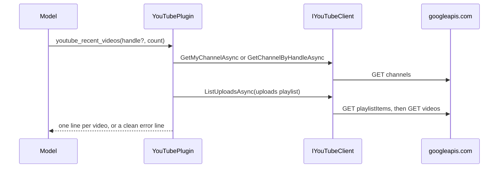

# Plugin.YouTube

> Lets the model read a YouTube channel's overview, its latest uploads and the statistics of named videos: the owner's own channel through the desktop's Google sign-in, or any public channel by handle with an API key ([[pages/decisions/0030-youtube-plugin-read-only-with-browser-sign-in]]). With the sign-in it also gives the channel operator the clients that upload, set thumbnails and titles, and read the owner's analytics and reach reports; the model never reaches them ([[pages/decisions/0032-per-feature-write-permissions]]).

## To change here, read

- [[pages/invariants/no-executive-writes]]
- [[pages/invariants/secrets-never-in-source]]
- [[pages/invariants/pluggable-boundaries]]
- [[pages/decisions/0030-youtube-plugin-read-only-with-browser-sign-in]]
- [[pages/decisions/0032-per-feature-write-permissions]] - the writes run only as actions the owner approved
- [[pages/roadmap/youtube-creator-assistant]] - the phases still to come
- [[pages/conventions/testing]]

## Responsibility

Owns the YouTube Data API v3 client, the kernel functions, reading the token file and appending the API key. Does not own the sign-in, the refresh or the token file itself, which the desktop main process writes ([[pages/services/desktop-ui]]), nor kernel composition ([[pages/services/llm]]), nor the channel operator that searches through this client and runs the approved writes and the analytics reads ([[pages/services/operator]]). Comments and captions are later phases ([[pages/roadmap/youtube-creator-assistant]]).

## Public contract

- **Entry point:** `AddYouTubePlugin(IServiceCollection, IConfiguration)` at `src/Scout.Plugin.YouTube/YouTubeServiceCollectionExtensions.cs:30`; returns early when both the API key and the token file are blank (`:45`). A token file takes precedence over a key: the client pipeline gets `YouTubeTokenFileHandler` or `YouTubeApiKeyHandler`, never both (`:56`).
- **Abstraction:** `IYouTubeClient` with five read methods (`src/Scout.Plugin.YouTube/Abstractions/IYouTubeClient.cs:7`): `GetMyChannelAsync` (`channels?mine=true`, sign-in only), `GetChannelByHandleAsync` (`channels?forHandle=`, without the `@`), `ListUploadsAsync` (`playlistItems` then one `videos` call, at most 50), `GetVideosAsync` (one `videos` call for at most 50 ids) and `SearchVideosAsync(query, max)` (`src/Scout.Plugin.YouTube/Abstractions/IYouTubeClient.cs:28`): one `search?part=snippet&type=video&order=relevance` call with `maxResults` clamped to 1..25 (`src/Scout.Plugin.YouTube/YouTubeClient.cs:89`), keeping only results that are videos, each a `YouTubeSearchResult` (video id, title, channel title, published date, description; no statistics, so one call spends one of the 100 searches `search.list` allows a day and nothing of the shared 10,000 units). Internal implementation `YouTubeClient` (`src/Scout.Plugin.YouTube/YouTubeClient.cs:17`); records `YouTubeChannel`, `YouTubeVideo` and `YouTubeSearchResult`; `YouTubeApiException` (`src/Scout.Plugin.YouTube/YouTubeApiException.cs:11`).
- **Signed-in clients:** registered only when a token file is configured, because an API key can neither write nor read analytics (`src/Scout.Plugin.YouTube/YouTubeServiceCollectionExtensions.cs:66`, `:77`), and never wrapped in a kernel plugin. `IYouTubeWriteClient` (`src/Scout.Plugin.YouTube/Abstractions/IYouTubeWriteClient.cs:7`) with `UploadVideoAsync(file, YouTubeUpload)` (`videos.insert`, resumable), `SetThumbnailAsync(videoId, file)` (`thumbnails.set`), `UpdateTitleAsync(videoId, title)` (`videos.list` then `videos.update`) and `GetVideoStatusAsync(videoId)` (`videos.list?part=status`); `IYouTubeAnalyticsClient` (`src/Scout.Plugin.YouTube/Abstractions/IYouTubeAnalyticsClient.cs:4`) with `ReportAsync(videoId, start, end)` and `RetentionAsync(videoId, start, end)`; `IYouTubeReportingClient` (`src/Scout.Plugin.YouTube/Abstractions/IYouTubeReportingClient.cs:7`) with `FindReachJobAsync`, `CreateReachJobAsync` (`jobs.create`, which the operator calls only after the control plane allows the write), `ListReportsAsync(jobId, createdAfter)` and `DownloadReachAsync(url)`. Implementations `YouTubeWriteClient` (`src/Scout.Plugin.YouTube/YouTubeWriteClient.cs:21`), `YouTubeAnalyticsClient` (`src/Scout.Plugin.YouTube/YouTubeAnalyticsClient.cs:13`), `YouTubeReportingClient` (`src/Scout.Plugin.YouTube/YouTubeReportingClient.cs:17`). `YouTubeApiException.Retryable` (`src/Scout.Plugin.YouTube/YouTubeApiException.cs:27`) is true for a 5xx, a 429, a 401, a spent quota and a missing token file: the same request can succeed later.
- **Model tools:** plugin `YouTube` (`src/Scout.Plugin.YouTube/YouTubeServiceCollectionExtensions.cs:61`) with `youtube_channel_overview(handle?)` (`src/Scout.Plugin.YouTube/YouTubePlugin.cs:37`), `youtube_recent_videos(handle?, count = 10)` (`:59`) and `youtube_video_stats(videos)` (`:95`). Without a handle the first two read the owner's own channel. Search has no model function: the channel operator calls it under its own daily budget ([[pages/services/operator]]), and a function would let the model spend YouTube's 100 daily searches outside that count.
- **Configuration keys:** `Scout:Plugins:YouTube` with `ApiKey` (`src/Scout.Plugin.YouTube/YouTubeOptions.cs:13`) and `TokenFile` (`:20`), the path of a JSON file `{"access_token": "...", "expires_at": <unix ms>}` of which only `access_token` is read. The desktop sets `SCOUT__PLUGINS__YOUTUBE__TOKENFILE` while the owner is signed in with Google, or `SCOUT__PLUGINS__YOUTUBE__APIKEY` when the owner pasted a key. `src/Scout.Host.Console/appsettings.json:47` carries both names with empty values.
- **External boundaries:** HTTPS to `https://www.googleapis.com/youtube/v3/` with a 30 second timeout, `Accept: application/json` and `User-Agent: Scout` (`src/Scout.Plugin.YouTube/YouTubeServiceCollectionExtensions.cs:48`); GET requests only from the model's client (`src/Scout.Plugin.YouTube/YouTubeClient.cs:108`). With the sign-in, the write client POSTs to `https://www.googleapis.com/upload/youtube/v3/videos` and `.../thumbnails/set` and GETs and PUTs `https://www.googleapis.com/youtube/v3/videos`, with no client timeout, a 30 second connect timeout and a handler that never follows a redirect (`src/Scout.Plugin.YouTube/YouTubeServiceCollectionExtensions.cs:86`); the Analytics client GETs `https://youtubeanalytics.googleapis.com/v2/reports`; the Reporting client GETs and POSTs `https://youtubereporting.googleapis.com/v1/jobs` and downloads reports from that host only; both with a 2 minute timeout. Scopes the sign-in must grant: `youtube.upload` for the upload and the thumbnail, `youtube` or `youtube.force-ssl` for `videos.update`, `yt-analytics.readonly` for the Analytics and Reporting APIs; the desktop asks for them ([[pages/services/desktop-ui]]). The token file on the local filesystem. Plain `HttpClient` and `System.Text.Json`: no Google SDK package.

## How it works

With a token file, `YouTubeTokenFileHandler` (`src/Scout.Plugin.YouTube/YouTubeTokenFileHandler.cs:14`) sets the bearer header from the file on every request and re-reads it when its write time changes (`:37`), so the token the desktop refreshes is used without a restart. A missing, empty, unparsable or unreadable file throws "YouTube is not connected. Sign in from the Scout app." before any request leaves the process (`:67`). A 401 on a signed-in request becomes "The YouTube sign-in is no longer valid. Sign in again in the Scout app." (`:32`). With a key, `YouTubeApiKeyHandler` (`src/Scout.Plugin.YouTube/YouTubeApiKeyHandler.cs:8`) appends `key=<ApiKey>` to the query string; the key is in no header.

Every non-success status is mapped in one place (`src/Scout.Plugin.YouTube/YouTubeClient.cs:125`), the search included: 401 asks to sign in again; on the `mine=true` call a 401 instead says "Sign in from the Scout app to read your own channel; an API key reads public channels by handle only." (`:129`), which only a key can reach because the token handler answers 401 first, while a 400 there gets the plain-reason message below; 403 with reason `quotaExceeded` or `dailyLimitExceeded` in Google's error body is the quota message, any other 403 "The YouTube credentials cannot read this."; 404 is not found; 400 names Google's reason only when it is a plain identifier (`:157`); 5xx is "currently unavailable". A 200 whose body is not JSON (a proxy or captive-portal page) becomes "YouTube returned an unexpected response." (`:119`). No message carries the request URL, the key, the token or Google's own message text. Timeouts and transport faults bubble unchanged, and every function catches them and returns a clean line, so a tool call never throws into the kernel (`src/Scout.Plugin.YouTube/YouTubePlugin.cs:196`).

`YouTubeWriteClient.UploadVideoAsync` (`src/Scout.Plugin.YouTube/YouTubeWriteClient.cs:53`) refuses a title or description holding `<` or `>` before any request, then opens a resumable session (`POST upload/youtube/v3/videos?uploadType=resumable&part=snippet,status` with `X-Upload-Content-Length`, `X-Upload-Content-Type: video/mp4` and the snippet and status: title, description, tags, category, the language code when there is one, privacy, `publishAt` when scheduled, `selfDeclaredMadeForKids`, `containsSyntheticMedia`) and PUTs the file to the session address, which must be HTTPS on `www.googleapis.com` or nothing is sent there (`:225`). The session lives in the caller's `UploadSession`, so a later call with the same instance asks that session first instead of opening a new one (`:74`). A PUT that runs longer than 5 minutes plus the bytes left at 100 KB a second counts as stalled and is cancelled (`:234`). After a 5xx, a dropped connection, a timeout or a stall it asks the session with `Content-Range: bytes */<total>`: a 308 with `Range: bytes=0-N` resumes from byte N+1 (`:274`), a 308 without it sends the whole file again, a 200 or 201 is the finished upload, and a 404 opens a new session and starts over; at most 5 attempts, 2 s apart then doubling, then "The upload to YouTube kept failing; Scout tries again later.", retryable. Any other 4xx is mapped and not retried. `SetThumbnailAsync` (`:121`) posts the PNG or JPEG bytes, refuses a file over 50 MB, and turns a 403 that is not a spent quota into "YouTube refused the thumbnail: custom thumbnails need a verified channel (verify it at youtube.com/verify), or the sign-in does not allow Scout to change this video." `UpdateTitleAsync` (`:143`) reads the snippet, sends nothing when the title is already the one asked for, and otherwise sends the snippet back whole with the new title (category, description, tags, language as YouTube holds them), because `videos.update` replaces every property of the parts it is sent. A 403 whose reason is `insufficientPermissions`, a sign-in without the upload scope, reads "YouTube needs the upload permission: open the YouTube card in Scout Desktop and allow writes again." and is retryable, on the upload and on the thumbnail (`src/Scout.Plugin.YouTube/YouTubeWriteClient.cs:322`); a 429 on a write reads "YouTube's upload rate limit is reached for now; Scout tries again later." (`:307`); every other status goes through the read client's mapping (`src/Scout.Plugin.YouTube/YouTubeClient.cs:125`), a 403 that is not a quota reading "The YouTube sign-in does not allow Scout to change this video; sign in again in Scout Desktop." The Analytics client reads the report's columns by name and fails with "YouTube Analytics returned a report Scout could not read." on a table it cannot read; no row means no data yet. The Reporting client reads the reach CSV by its header (`date`, `video_id`, `video_thumbnail_impressions`, `video_thumbnail_impressions_ctr`), and a missing column, a short row or a value that is not a number fails the whole report with "YouTube returned a reach report Scout could not read." (`src/Scout.Plugin.YouTube/YouTubeReportingClient.cs:79`); Google's metrics page (https://developers.google.com/youtube/reporting/v1/reports/metrics, read 2026-11-03) defines `video_thumbnail_impressions_ctr` as "The percentage of impressions that resulted in a click to watch the video. This is calculated as clicks divided by impressions.", which names a percentage but describes a fraction; the client reads it as a fraction, and a report holding any rate above 1 as percent, every rate in it divided by 100 (`src/Scout.Plugin.YouTube/YouTubeReportingClient.cs:100`). A download address that is not HTTPS on `youtubereporting.googleapis.com` is refused before any request (`:65`).

`youtube_video_stats` takes ids or links (`youtube.com/watch?v=`, `youtu.be/`, `youtube.com/shorts/`) separated by commas or spaces, extracts the 11-character ids (`src/Scout.Plugin.YouTube/YouTubePlugin.cs:193`), looks up the first 50 distinct ones in one call, and ends with a "Not found:" line for ids YouTube did not return and tokens that are not a video, then a "Not looked up" line for any id past the fiftieth (`tests/Scout.Plugin.YouTube.Tests/YouTubePluginTests.cs:113`). Counts are formatted with invariant thousands separators; a count the channel hides reads "hidden".

## Invariants

- [[pages/invariants/no-executive-writes]] as amended by [[pages/decisions/0032-per-feature-write-permissions]]: the model's functions only read; the only HTTP call of their client is `GetAsync`. `tests/Scout.Plugin.YouTube.Tests/YouTubeTokenFileHandlerTests.cs:133` invokes every function with the token file and with a key and fails on any request that is not a GET to `www.googleapis.com`, and on a key outside the query string. The write client is no kernel plugin; only the channel operator calls it, for actions the owner approved one by one ([[pages/services/operator]]). Neither the session address of an upload nor a report download can send the owner's token off Google's hosts (`tests/Scout.Plugin.YouTube.Tests/YouTubeWriteClientTests.cs:277`, `tests/Scout.Plugin.YouTube.Tests/YouTubeReportingClientTests.cs:130`).
- [[pages/invariants/secrets-never-in-source]]: the key or the token file path comes from configuration only; blank means the plugin is absent. The client logs no requests (`src/Scout.Plugin.YouTube/YouTubeServiceCollectionExtensions.cs:59`), because the key is in the URL and the framework's URL redaction can be switched off; `tests/Scout.Plugin.YouTube.Tests/YouTubeClientTests.cs:267` drives six failures with a key and asserts that no exception message and no log line carries it.
- [[pages/invariants/pluggable-boundaries]]: a `KernelPlugin` singleton picked up by the shared kernel; no Google type leaves the project.

## Hot spots

- `src/Scout.Plugin.YouTube/YouTubeClient.cs:125`: the status mapping, including the `mine` case that depends on the token handler answering 401 first.
- `src/Scout.Plugin.YouTube/YouTubeServiceCollectionExtensions.cs:86`: the write client's primary handler must not follow redirects; a handler that does would treat YouTube's 308 as a redirect and the resumable upload would never see it. The test stub replaces the primary handler, so only `tests/Scout.Plugin.YouTube.Tests/YouTubeServiceCollectionExtensionsTests.cs:129` guards it.
- `src/Scout.Plugin.YouTube/YouTubeServiceCollectionExtensions.cs:59`: removing `RemoveAllLoggers` would put the request URL, and with redaction off the key, in the worker's log.

## Testing footprint

`tests/Scout.Plugin.YouTube.Tests` (92 test attributes, 132 cases on 2026-11-03, 8 test files plus `Fakes/`, the stub recording each request's body and headers): the client against a stub handler with Google-shaped bodies (`Fakes/GoogleJson.cs`), the search request, its 1..25 clamp, its quota message and its transport failure (`tests/Scout.Plugin.YouTube.Tests/YouTubeClientTests.cs:113` to `:156`), one failing-call test per status and per exception (`:166` to `:257`); the plugin over the real client for the three answers and a clean line per failure (`tests/Scout.Plugin.YouTube.Tests/YouTubePluginTests.cs:43`, `:62`, `:79`, `:193`); the key path through the real composition (`:141`, `:172`); the token file through the real composition (`tests/Scout.Plugin.YouTube.Tests/YouTubeTokenFileHandlerTests.cs:36`: the rewritten token after a refresh; `:58`: missing file answers not connected and sends nothing; `:88`: a file deleted on sign-out); self-gating and precedence (`tests/Scout.Plugin.YouTube.Tests/YouTubeServiceCollectionExtensionsTests.cs:29`, `:67`); function metadata. The signed-in clients: none with a key alone, all three on the owner's token through the real composition, and the write client's timeout and redirect handler (`tests/Scout.Plugin.YouTube.Tests/YouTubeServiceCollectionExtensionsTests.cs:91`, `:101`, `:129`); the upload's session request and body, the whole PUT, the resume after a 5xx and after a connection reset mid-PUT from the confirmed byte, the resend when YouTube kept nothing, the restart on a 404 session, the query that finds the upload done, a session kept from an earlier call resumed and a rate-limited upload keeping its session (`tests/Scout.Plugin.YouTube.Tests/YouTubeWriteClientTests.cs:187`, `:202`), a stalled PUT resumed and the stall limit (`:217`, `:251`), five attempts then a retryable error that keeps the session, an untrusted session address, angle brackets, the quota, a missing upload permission on the upload and the thumbnail (`tests/Scout.Plugin.YouTube.Tests/YouTubeWriteClientTests.cs:317`, `:329`) and a rejected upload (`tests/Scout.Plugin.YouTube.Tests/YouTubeWriteClientTests.cs:56` to `:341`); the thumbnail's request, its 403 with the verified-channel hint and its 429 (`:353` to `:390`); the title sent with the whole snippet, not sent again, and not found (`:402` to `:438`); the video status (`:451`); the analytics request and columns by name, no rows, retention, a 5xx and an unreadable table (`tests/Scout.Plugin.YouTube.Tests/YouTubeAnalyticsClientTests.cs:20` to `:87`); the reach job found and created, the reports across pages, the CSV by header, a rate given in percent (`tests/Scout.Plugin.YouTube.Tests/YouTubeReportingClientTests.cs:111`), an untrusted download address, four malformed reports and a 5xx (`tests/Scout.Plugin.YouTube.Tests/YouTubeReportingClientTests.cs:20` to `:156`).

## Related

Direct project references: none. Referenced by [[pages/services/host-console]] and [[pages/services/operator]]. Catalog entry `youtube` in [[pages/services/control-plane]]. Map: [[pages/architecture/project-map]].
