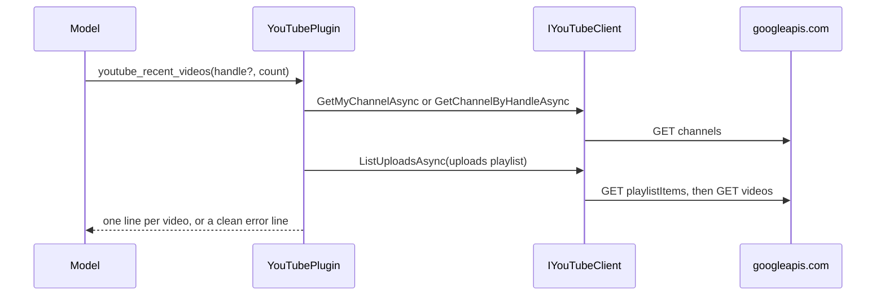

# Plugin.YouTube

> Lets the model read a YouTube channel's overview, its latest uploads and the statistics of named videos: the owner's own channel through the desktop's Google sign-in, or any public channel by handle with an API key ([[pages/decisions/0030-youtube-plugin-read-only-with-browser-sign-in]]).

## To change here, read

- [[pages/invariants/no-executive-writes]]
- [[pages/invariants/secrets-never-in-source]]
- [[pages/invariants/pluggable-boundaries]]
- [[pages/decisions/0030-youtube-plugin-read-only-with-browser-sign-in]]
- [[pages/roadmap/youtube-creator-assistant]] - the phases still to come
- [[pages/conventions/testing]]

## Responsibility

Owns the YouTube Data API v3 client, the kernel functions, reading the token file and appending the API key. Does not own the sign-in, the refresh or the token file itself, which the desktop main process writes ([[pages/services/desktop-ui]]), nor kernel composition ([[pages/services/llm]]), nor the channel operator that searches through this client ([[pages/services/operator]]). The Analytics API, comments and captions are later phases ([[pages/roadmap/youtube-creator-assistant]]).

## Public contract

- **Entry point:** `AddYouTubePlugin(IServiceCollection, IConfiguration)` at `src/Scout.Plugin.YouTube/YouTubeServiceCollectionExtensions.cs:29`; returns early when both the API key and the token file are blank (`:44`). A token file takes precedence over a key: the client pipeline gets `YouTubeTokenFileHandler` or `YouTubeApiKeyHandler`, never both (`:55`).
- **Abstraction:** `IYouTubeClient` with five read methods (`src/Scout.Plugin.YouTube/Abstractions/IYouTubeClient.cs:7`): `GetMyChannelAsync` (`channels?mine=true`, sign-in only), `GetChannelByHandleAsync` (`channels?forHandle=`, without the `@`), `ListUploadsAsync` (`playlistItems` then one `videos` call, at most 50), `GetVideosAsync` (one `videos` call for at most 50 ids) and `SearchVideosAsync(query, max)` (`src/Scout.Plugin.YouTube/Abstractions/IYouTubeClient.cs:28`): one `search?part=snippet&type=video&order=relevance` call with `maxResults` clamped to 1..25 (`src/Scout.Plugin.YouTube/YouTubeClient.cs:89`), keeping only results that are videos, each a `YouTubeSearchResult` (video id, title, channel title, published date, description; no statistics, so one call spends one of the 100 searches `search.list` allows a day and nothing of the shared 10,000 units). Internal implementation `YouTubeClient` (`src/Scout.Plugin.YouTube/YouTubeClient.cs:17`); records `YouTubeChannel`, `YouTubeVideo` and `YouTubeSearchResult`; `YouTubeApiException` (`src/Scout.Plugin.YouTube/YouTubeApiException.cs:11`).
- **Model tools:** plugin `YouTube` (`src/Scout.Plugin.YouTube/YouTubeServiceCollectionExtensions.cs:60`) with `youtube_channel_overview(handle?)` (`src/Scout.Plugin.YouTube/YouTubePlugin.cs:37`), `youtube_recent_videos(handle?, count = 10)` (`:59`) and `youtube_video_stats(videos)` (`:95`). Without a handle the first two read the owner's own channel. Search has no model function: the channel operator calls it under its own daily budget ([[pages/services/operator]]), and a function would let the model spend YouTube's 100 daily searches outside that count.
- **Configuration keys:** `Scout:Plugins:YouTube` with `ApiKey` (`src/Scout.Plugin.YouTube/YouTubeOptions.cs:13`) and `TokenFile` (`:20`), the path of a JSON file `{"access_token": "...", "expires_at": <unix ms>}` of which only `access_token` is read. The desktop sets `SCOUT__PLUGINS__YOUTUBE__TOKENFILE` while the owner is signed in with Google, or `SCOUT__PLUGINS__YOUTUBE__APIKEY` when the owner pasted a key. `src/Scout.Host.Console/appsettings.json:47` carries both names with empty values.
- **External boundaries:** HTTPS to `https://www.googleapis.com/youtube/v3/` with a 30 second timeout, `Accept: application/json` and `User-Agent: Scout` (`src/Scout.Plugin.YouTube/YouTubeServiceCollectionExtensions.cs:47`); GET requests only (`src/Scout.Plugin.YouTube/YouTubeClient.cs:108`). The token file on the local filesystem. Plain `HttpClient` and `System.Text.Json`: no Google SDK package.

## How it works

With a token file, `YouTubeTokenFileHandler` (`src/Scout.Plugin.YouTube/YouTubeTokenFileHandler.cs:14`) sets the bearer header from the file on every request and re-reads it when its write time changes (`:37`), so the token the desktop refreshes is used without a restart. A missing, empty, unparsable or unreadable file throws "YouTube is not connected. Sign in from the Scout app." before any request leaves the process (`:67`). A 401 on a signed-in request becomes "The YouTube sign-in is no longer valid. Sign in again in the Scout app." (`:32`). With a key, `YouTubeApiKeyHandler` (`src/Scout.Plugin.YouTube/YouTubeApiKeyHandler.cs:8`) appends `key=<ApiKey>` to the query string; the key is in no header.

Every non-success status is mapped in one place (`src/Scout.Plugin.YouTube/YouTubeClient.cs:125`), the search included: 401 asks to sign in again; on the `mine=true` call a 401 instead says "Sign in from the Scout app to read your own channel; an API key reads public channels by handle only." (`:129`), which only a key can reach because the token handler answers 401 first, while a 400 there gets the plain-reason message below; 403 with reason `quotaExceeded` or `dailyLimitExceeded` in Google's error body is the quota message, any other 403 "The YouTube credentials cannot read this."; 404 is not found; 400 names Google's reason only when it is a plain identifier (`:157`); 5xx is "currently unavailable". A 200 whose body is not JSON (a proxy or captive-portal page) becomes "YouTube returned an unexpected response." (`:119`). No message carries the request URL, the key, the token or Google's own message text. Timeouts and transport faults bubble unchanged, and every function catches them and returns a clean line, so a tool call never throws into the kernel (`src/Scout.Plugin.YouTube/YouTubePlugin.cs:196`).

`youtube_video_stats` takes ids or links (`youtube.com/watch?v=`, `youtu.be/`, `youtube.com/shorts/`) separated by commas or spaces, extracts the 11-character ids (`src/Scout.Plugin.YouTube/YouTubePlugin.cs:193`), looks up the first 50 distinct ones in one call, and ends with a "Not found:" line for ids YouTube did not return and tokens that are not a video, then a "Not looked up" line for any id past the fiftieth (`tests/Scout.Plugin.YouTube.Tests/YouTubePluginTests.cs:113`). Counts are formatted with invariant thousands separators; a count the channel hides reads "hidden".

## Invariants

- [[pages/invariants/no-executive-writes]]: no write method exists; the only HTTP call is `GetAsync`. `tests/Scout.Plugin.YouTube.Tests/YouTubeTokenFileHandlerTests.cs:133` invokes every function with the token file and with a key and fails on any request that is not a GET to `www.googleapis.com`, and on a key outside the query string.
- [[pages/invariants/secrets-never-in-source]]: the key or the token file path comes from configuration only; blank means the plugin is absent. The client logs no requests (`src/Scout.Plugin.YouTube/YouTubeServiceCollectionExtensions.cs:58`), because the key is in the URL and the framework's URL redaction can be switched off; `tests/Scout.Plugin.YouTube.Tests/YouTubeClientTests.cs:267` drives six failures with a key and asserts that no exception message and no log line carries it.
- [[pages/invariants/pluggable-boundaries]]: a `KernelPlugin` singleton picked up by the shared kernel; no Google type leaves the project.

## Hot spots

- `src/Scout.Plugin.YouTube/YouTubeClient.cs:125`: the status mapping, including the `mine` case that depends on the token handler answering 401 first.
- `src/Scout.Plugin.YouTube/YouTubeServiceCollectionExtensions.cs:58`: removing `RemoveAllLoggers` would put the request URL, and with redaction off the key, in the worker's log.

## Testing footprint

`tests/Scout.Plugin.YouTube.Tests` (49 test attributes, 84 cases on 2026-11-03, 5 test files plus `Fakes/`): the client against a stub handler with Google-shaped bodies (`Fakes/GoogleJson.cs`), the search request, its 1..25 clamp, its quota message and its transport failure (`tests/Scout.Plugin.YouTube.Tests/YouTubeClientTests.cs:113` to `:156`), one failing-call test per status and per exception (`:166` to `:257`); the plugin over the real client for the three answers and a clean line per failure (`tests/Scout.Plugin.YouTube.Tests/YouTubePluginTests.cs:43`, `:62`, `:79`, `:193`); the key path through the real composition (`:141`, `:172`); the token file through the real composition (`tests/Scout.Plugin.YouTube.Tests/YouTubeTokenFileHandlerTests.cs:36`: the rewritten token after a refresh; `:58`: missing file answers not connected and sends nothing; `:88`: a file deleted on sign-out); self-gating and precedence (`tests/Scout.Plugin.YouTube.Tests/YouTubeServiceCollectionExtensionsTests.cs:29`, `:67`); function metadata.

## Related

Direct project references: none. Referenced by [[pages/services/host-console]] and [[pages/services/operator]]. Catalog entry `youtube` in [[pages/services/control-plane]]. Map: [[pages/architecture/project-map]].
