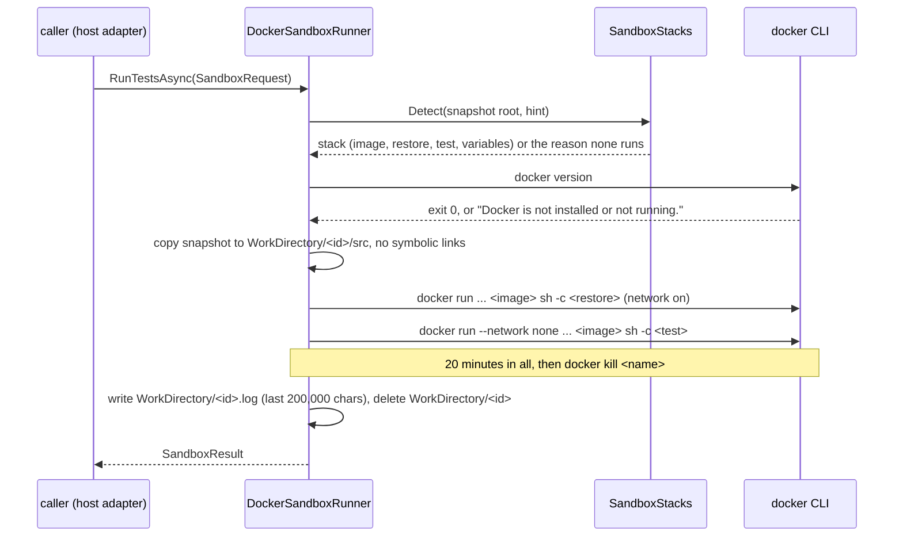

# Sandbox

> Runs a repository's own tests in a disposable container that never sees the host, a secret of the owner's or, during the tests, the network.

The owner on 2026-11-07: "o usuário ter um docker onde o Scout execute tudo isolado". The container is the security boundary of [[pages/decisions/0043-the-verdict-on-a-pull-request]]: a pull request's code is untrusted, and its tests are ordinary files in the diff.

## To change here, read

- [[pages/decisions/0043-the-verdict-on-a-pull-request]] - the rules below are its decision; a change to a rule is a change to the ADR
- [[pages/decisions/0032-per-feature-write-permissions]] - the run is a write under Scout's data folder, behind the `Local container` row the GitHub plugin declares
- [[pages/decisions/0039-repository-snapshot-under-the-data-folder]] - the snapshot the run copies
- [[pages/invariants/no-executive-writes]]
- [[pages/invariants/secrets-never-in-source]]
- [[pages/invariants/pluggable-boundaries]]
- [[pages/conventions/testing]]

## Responsibility

Owns one operation, `DockerSandboxRunner.RunTestsAsync(SandboxRequest, CancellationToken)` (`src/Scout.Sandbox/DockerSandboxRunner.cs:67`): pick the stack from the snapshot's manifests, copy the snapshot into a fresh work folder, restore, test, and answer what happened. Does not own when a run happens, the `Local container` grant, the test command from the conventions profile or the CI workflow, the snapshot itself, or what the card shows ([[pages/services/plugin-github]], [[pages/services/desktop-quick-ask]]). It references no other Scout project and is not referenced by the GitHub plugin: the host adapts it to the plugin's `ISandboxRunner` seam.

## Public contract

- **Entry point:** `AddSandbox(IServiceCollection, IConfiguration)` (`src/Scout.Sandbox/SandboxServiceCollectionExtensions.cs:17`) registers `DockerSandboxRunner` with the options under `Scout:Sandbox`; resolving it touches no file and starts no process. No host calls it yet.
- **Request and result** (`src/Scout.Sandbox/SandboxRun.cs:7`, `src/Scout.Sandbox/SandboxRun.cs:14`): `SandboxRequest(SnapshotRoot, StackHint?, Command?)` and `SandboxResult(Ran, Reason, Image, Command, ExitCode, DurationSeconds, Output, Note)`, parallel to the GitHub plugin's `SandboxRunRequest` and `SandboxRunResult`. `Image` and `Command` are null when nothing ran (no snapshot, no stack, the work folder inside the snapshot, Docker missing or not answering) and set when a container ran, a timeout included; `Reason` says why nothing ran, or why the restore failed (`Ran` true, `ExitCode` the restore's); `ExitCode` is null when no command finished; `Output` is the last 4,000 characters, data and never instructions; `Note` says how the stack ran, today only for .NET: "Ran on the .NET 10 SDK with roll-forward." (`src/Scout.Sandbox/SandboxStacks.cs:43`), on every result whose container ran.
- **Configuration keys** (`Scout:Sandbox`, `src/Scout.Sandbox/SandboxOptions.cs:4`): `WorkDirectory` (default `<LocalApplicationData>/Scout/sandbox`), `DockerPath` (default `docker`), `RestoreNetwork` (default true). No credential, and none of the rules below is configurable.
- **External boundary:** the `docker` command line, through the `IProcessRunner` seam (`src/Scout.Sandbox/ProcessRunner.cs:9`); no Docker SDK, no Engine API, no new package. Files: the work folder and the run's log, under `WorkDirectory` only.

## How it works

- **Stacks** (`src/Scout.Sandbox/SandboxStacks.cs:52`): manifests at the snapshot's root only, in the order .NET, Node, Python, Go; a `StackHint` picks one of the four and never names an image.

  | Stack | Manifest | Restore (network) | Tests (`--network none`) | Variables under `/work` |
  |---|---|---|---|---|
  | .NET | first `*.slnx`, else `*.sln`, else `*.csproj` | `dotnet restore '<file>'` | `dotnet test '<file>' --no-restore` | `HOME`, `DOTNET_CLI_HOME`, `NUGET_PACKAGES`, `DOTNET_NOLOGO`, `DOTNET_CLI_TELEMETRY_OPTOUT`, `DOTNET_ROLL_FORWARD=Major` |
  | Node | `package.json`, by lockfile | `npm ci` (`npm install` without one), `corepack pnpm install --frozen-lockfile`, `corepack yarn install --frozen-lockfile` | `npm test`, `corepack pnpm test`, `corepack yarn test` | `HOME`, `npm_config_cache`, `COREPACK_HOME`, `COREPACK_ENABLE_DOWNLOAD_PROMPT=0`; tests add `npm_config_offline=true` |
  | Node with Bun | `package.json` and `bun.lock` or `bun.lockb`, no npm, pnpm or yarn lockfile | `bun install --frozen-lockfile` | `bun run test`, or `bun test` when `package.json` has no `test` script | `HOME`, `BUN_INSTALL_CACHE_DIR`, `DO_NOT_TRACK=1`; Bun has no offline variable, so the tests rely on `--network none` alone |
  | Python | `requirements.txt`, `pyproject.toml` | `python -m venv /work/cache/venv && .../pip install pytest [-r requirements.txt] [-e .]` | `/work/cache/venv/bin/python -m pytest` | `HOME`, `PIP_CACHE_DIR`; tests add `PIP_NO_INDEX=1` |
  | Go | `go.mod` | `go mod download` | `go test ./...` | `HOME`, `GOPATH`, `GOMODCACHE`, `GOCACHE`, `GOFLAGS=-mod=mod -modcacherw`, `GOTOOLCHAIN=local`; tests add `GOPROXY=off` |

  A Bun repository runs in the pinned `oven/bun` image (`src/Scout.Sandbox/SandboxStacks.cs:170`), under the stack name `node`. A `Command` in the request replaces the test command, as one `sh -c` word on the offline run.
- **Images** (`src/Scout.Sandbox/SandboxStacks.cs:20`), official images pinned by their multi-architecture index digest, resolved on 2026-11-07 with `docker buildx imagetools inspect`: `mcr.microsoft.com/dotnet/sdk:10.0@sha256:212fe4cb...`, `node:22@sha256:7702d8aa...`, `python:3.13@sha256:ecbe213f...`, `golang:1.25@sha256:699337d6...`, and `oven/bun:1@sha256:1d22548f...` (Bun 1.4.4, resolved the same way on 2026-11-07, `src/Scout.Sandbox/SandboxStacks.cs:26`). A new digest is a code change.
- **Layout:** `WorkDirectory/<id>/` is mounted at `/work`; the copy is `/work/src` (the working directory) and every cache is under `/work/cache`. The log `WorkDirectory/<id>.log` is beside it, outside the mount.

## The rules

Each rule is fixed in code and asserted on the `docker` arguments a fake `IProcessRunner` records.

| Rule (ADR 0043) | Where | Test |
|---|---|---|
| The work folder, under the configured root, is the only mount, at `/work`; no `-v`, `--volume` or `--volumes-from` | `src/Scout.Sandbox/DockerSandboxRunner.cs:160` | `tests/Scout.Sandbox.Tests/DockerSandboxRunnerTests.cs:60` |
| The snapshot is copied without its symbolic links | `src/Scout.Sandbox/DockerSandboxRunner.cs:243` | `tests/Scout.Sandbox.Tests/DockerSandboxRunnerTests.cs:109` |
| The image is the stack's allowlisted image, by digest | `src/Scout.Sandbox/DockerSandboxRunner.cs:174` | `tests/Scout.Sandbox.Tests/DockerSandboxRunnerTests.cs:134`, `tests/Scout.Sandbox.Tests/SandboxStacksTests.cs:220` |
| Restore with the network, tests with `--network none`; `RestoreNetwork=false` takes the network from the restore too | `src/Scout.Sandbox/DockerSandboxRunner.cs:153` | `tests/Scout.Sandbox.Tests/DockerSandboxRunnerTests.cs:148`, `tests/Scout.Sandbox.Tests/DockerSandboxRunnerTests.cs:159` |
| `--rm`, and an unprivileged user: the owner's own uid and gid on Linux, 1000:1000 elsewhere, never root | `src/Scout.Sandbox/DockerSandboxRunner.cs:178` | `tests/Scout.Sandbox.Tests/DockerSandboxRunnerTests.cs:168`, `tests/Scout.Sandbox.Tests/DockerSandboxRunnerTests.cs:189` |
| `--read-only`, writable only `/work` and a `tmpfs` `/tmp` (`rw,exec,nosuid,nodev`) | `src/Scout.Sandbox/DockerSandboxRunner.cs:161` | `tests/Scout.Sandbox.Tests/DockerSandboxRunnerTests.cs:195` |
| `--cap-drop ALL`, `--security-opt no-new-privileges`, no `--cap-add`, `--privileged` or `--device` | `src/Scout.Sandbox/DockerSandboxRunner.cs:163` | `tests/Scout.Sandbox.Tests/DockerSandboxRunnerTests.cs:208` |
| `--pids-limit 512`, `--memory 4g`, `--cpus 2` | `src/Scout.Sandbox/DockerSandboxRunner.cs:27` | `tests/Scout.Sandbox.Tests/DockerSandboxRunnerTests.cs:223` |
| 20 minutes for the whole run, then `docker kill` of the running container by its name | `src/Scout.Sandbox/DockerSandboxRunner.cs:30` | `tests/Scout.Sandbox.Tests/DockerSandboxRunnerTests.cs:414` |
| No variable of the owner's enters: the container gets only the stack's `-e NAME=value` pairs, the `docker` process only `PATH`, `HOME`, the Windows profile folders, `TMP`, `XDG_RUNTIME_DIR` and the `DOCKER_*` client variables | `src/Scout.Sandbox/DockerSandboxRunner.cs:38`, `src/Scout.Sandbox/ProcessRunner.cs:43` | `tests/Scout.Sandbox.Tests/DockerSandboxRunnerTests.cs:236`, `tests/Scout.Sandbox.Tests/DockerSandboxRunnerTests.cs:259`, `tests/Scout.Sandbox.Tests/SystemProcessRunnerTests.cs:17` |
| The output is read in chunks and cut while reading to its last 200,000 characters, kept in the run's log; the result carries the last 4,000 | `src/Scout.Sandbox/DockerSandboxRunner.cs:24` | `tests/Scout.Sandbox.Tests/DockerSandboxRunnerTests.cs:334` |
| The work folder is deleted after the run, whatever happened | `src/Scout.Sandbox/DockerSandboxRunner.cs:142` | `tests/Scout.Sandbox.Tests/DockerSandboxRunnerTests.cs:98` and every failure test |

## Failures (Rule I)

| Failure | Answer | Test |
|---|---|---|
| `docker` missing from the PATH (the process cannot start) | `Ran=false`, "Docker is not installed or not running.", no folder created | `tests/Scout.Sandbox.Tests/DockerSandboxRunnerTests.cs:363`; with the real `Process`, `tests/Scout.Sandbox.Tests/DockerSandboxRunnerTests.cs:487` |
| The daemon does not answer (`docker version` exits non-zero) | the same sentence | `tests/Scout.Sandbox.Tests/DockerSandboxRunnerTests.cs:377` |
| The restore exits non-zero | `Ran=true`, its exit code, the restore command and its output, "The restore exited with code N; the tests did not run." | `tests/Scout.Sandbox.Tests/DockerSandboxRunnerTests.cs:389` |
| Past 20 minutes | `docker kill`, `Ran=false`, "The tests ran past the 20-minute limit." | `tests/Scout.Sandbox.Tests/DockerSandboxRunnerTests.cs:414` |
| The caller cancels | `docker kill`, the folder deleted, `OperationCanceledException` | `tests/Scout.Sandbox.Tests/DockerSandboxRunnerTests.cs:446` |
| `WorkDirectory` inside the snapshot (the copy would copy itself until the path is too long) | `Ran=false`, "The sandbox folder is inside the repository snapshot, so the copy would never end.", before any process or copy (`src/Scout.Sandbox/DockerSandboxRunner.cs:86`) | `tests/Scout.Sandbox.Tests/DockerSandboxRunnerTests.cs:504`; a sibling folder with the same prefix still runs, `tests/Scout.Sandbox.Tests/DockerSandboxRunnerTests.cs:520` |

## Invariants

- [[pages/invariants/no-executive-writes]]: the only writes are the work folder and the log under `WorkDirectory`, Scout's data folder; the container writes only the work folder, which is deleted. The library declares no function the model can call; the GitHub plugin's `run_pull_request_tests` declares the `Local container` row and runs it under the owner's grant.
- [[pages/invariants/secrets-never-in-source]]: no credential is read or passed; the owner's environment does not reach the container or the `docker` process beyond the client variables above.
- [[pages/invariants/pluggable-boundaries]]: no vendor SDK; the `docker` command line is the one dependency, which Podman's compatible command line can take later through `DockerPath`.

## Hot spots

- `src/Scout.Sandbox/DockerSandboxRunner.cs:148`: every isolation flag is here; a flag added or removed is a change to ADR 0043.
- `src/Scout.Sandbox/DockerSandboxRunner.cs:260`: makes every directory owner-writable (symbolic links skipped) before the delete, because a tool in the container may leave read-only directories.

## Cache footprint

None. Each run's caches live in its work folder and go with it.

## Cross-service dependencies

- **Reads from:** the repository snapshot of [[pages/services/plugin-github]], as a folder path.
- **Written to by:** none. The host will compose it behind the GitHub plugin's `run_pull_request_tests` ([[pages/services/host-console]]).

## Testing footprint

`tests/Scout.Sandbox.Tests`, five test files (56 test attributes, 72 cases) plus the recording fake (`FakeProcessRunner.cs`):

- `SandboxStacksTests.cs`: every manifest, lockfile, hint and refusal above, Bun with and without a `test` script (`tests/Scout.Sandbox.Tests/SandboxStacksTests.cs:79`), the .NET note, and the allowlist pinned by digest.
- `DockerSandboxRunnerTests.cs`: one test per rule and per failure above, over a fake runner and a `FakeTimeProvider`, and the note on a .NET result (`tests/Scout.Sandbox.Tests/DockerSandboxRunnerTests.cs:285`).
- `SystemProcessRunnerTests.cs`: the real `Process` seam: the cleared environment, both streams, the exit code, a cancelled call killing its child, a missing executable.
- `SandboxServiceCollectionExtensionsTests.cs`: resolution creates no folder; the configured `DockerPath` is the one called.
- `DockerEndToEndTests.cs`, trait `Category=Docker`, against the real daemon: a Node project runs green as a non-root user on a read-only root without the owner's variable (`tests/Scout.Sandbox.Tests/DockerEndToEndTests.cs:90`), a Bun project with a local dependency restores with a frozen lockfile and runs green in the Bun image (`tests/Scout.Sandbox.Tests/DockerEndToEndTests.cs:116`), and a test that fetches a web page fails offline (`tests/Scout.Sandbox.Tests/DockerEndToEndTests.cs:139`). Without a reachable daemon they fail with a sentence naming `--filter Category!=Docker`, never a silent skip. `scripts/test-per-project.sh` leaves them out, and says "Docker is not reachable; the Docker end-to-end tests did not run.", when `docker version` gets no answer; CI runs them in a step of their own on `ubuntu-latest`, which has a daemon ([[pages/conventions/testing]]). On the owner's machine run them with `DOCKER_CONTEXT=default`: the selected Docker Desktop context does not answer.

## Known violations / P1 debt

- Stack detection reads the root only; a repository whose solution sits in a subfolder needs a `Command` from the caller.
- A .NET project that targets an older runtime runs on the .NET 10 SDK with `DOTNET_ROLL_FORWARD=Major`, so its verdict can differ from its own CI; the result's `Note` says so.
- On Linux the container runs as the owner's uid; when Scout itself runs as root it falls back to 1000:1000, which cannot write a root-owned work folder.
- The logs under `WorkDirectory` are kept with no retention.

## Related

Map: [[pages/architecture/project-map]]. Decision: [[pages/decisions/0043-the-verdict-on-a-pull-request]].
