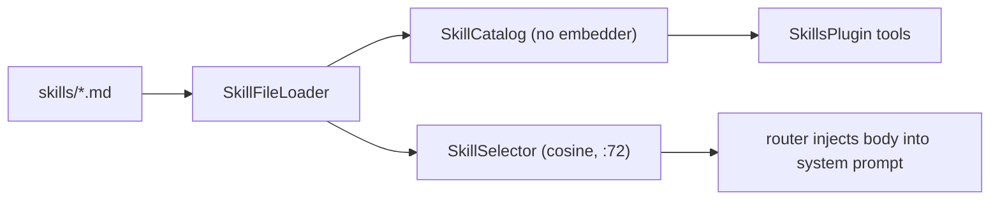

# Skills

> Process guides stored as markdown, picked by similarity or by the model on demand.

## To change here, read

- [[pages/invariants/no-executive-writes]]
- [[pages/invariants/pluggable-boundaries]]
- [[pages/services/conversation]]
- [[pages/conventions/testing]]

## Responsibility

Owns skill file parsing, the catalog, the selector and prompt composition. Does not own embeddings ([[pages/services/llm]]) or the router that calls the selector ([[pages/services/conversation]]).

## Public contract

- **Entry point:** `AddScoutSkills(IServiceCollection, IConfiguration)` at `src/Scout.Skills/SkillsServiceCollectionExtensions.cs:29`.
- **Abstractions:** `ISkillSelector` (`src/Scout.Skills/ISkillSelector.cs:8`), `ISkillCatalog` (`src/Scout.Skills/ISkillCatalog.cs:9`), record `Skill` (`src/Scout.Skills/Skill.cs:15`), `NoOpSkillSelector` (`src/Scout.Skills/NoOpSkillSelector.cs:7`), `SkillPromptComposer` (`src/Scout.Skills/SkillPromptComposer.cs:9`).
- **Model tools:** plugin `Skills` with `list_skills` (`src/Scout.Skills/SkillsPlugin.cs:27`) and `load_skill` (`:40`), registered as a `KernelPlugin` (`src/Scout.Skills/SkillsServiceCollectionExtensions.cs:63`).
- **Configuration keys:** `Scout:Skills` with `Enabled` (default true), `Directory` (default `skills`, relative to the binary directory), `TopN`, `SimilarityThreshold` (`src/Scout.Skills/SkillsOptions.cs:8`).
- **External boundaries:** filesystem read of `*.md` under the skills directory (`src/Scout.Skills/SkillFileLoader.cs:41`, `:68`); embedding calls through `IEmbeddingGenerator` (`src/Scout.Skills/SkillSelector.cs:17`).

## How it works

Loading is lazy and never throws; malformed files are skipped with a warning (`src/Scout.Skills/SkillFileLoader.cs:31`). The catalog depends on the loader only, so the kernel can include the plugin without re-entering the embedder (`src/Scout.Skills/SkillsServiceCollectionExtensions.cs:54`). When disabled, only `NoOpSkillSelector` is registered (`:69`).

## Invariants

- [[pages/invariants/no-executive-writes]]: both tools read; nothing writes a file.
- [[pages/invariants/pluggable-boundaries]]: the plugin joins the kernel through DI, not by name.

## Hot spots

- `src/Scout.Skills/SkillSelector.cs:49`: lazy index build and cosine scoring on first message.
- `src/Scout.Skills/SkillFileLoader.cs:41`: recursive scan of the whole directory.

## Testing footprint

`tests/Scout.Skills.Tests` (31 test attributes, 7 files): loader parsing and skips, catalog lookup, selector ranking with a fake embedder (`FakeEmbeddingGenerator.cs`), prompt composition, plugin metadata and behaviour, and DI registration including the disabled path.

## Related

Direct project references: none. Referenced by [[pages/services/conversation]]. Map: [[pages/architecture/project-map]].
