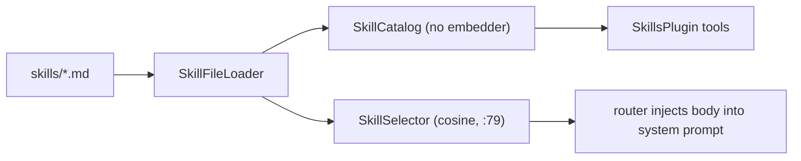

# Skills

> Process guides stored as markdown, picked by similarity or by the model on demand.

## To change here, read

- [[pages/invariants/no-executive-writes]]
- [[pages/invariants/pluggable-boundaries]]
- [[pages/services/conversation]]
- [[pages/conventions/testing]]

## Responsibility

Owns skill file parsing, the catalog, the selector and prompt composition. Does not own embeddings ([[pages/services/llm]]) or the router that calls the selector ([[pages/services/conversation]]).

## Public contract

- **Entry point:** `AddScoutSkills(IServiceCollection, IConfiguration)` at `src/Scout.Skills/SkillsServiceCollectionExtensions.cs:29`.
- **Abstractions:** `ISkillSelector` (`src/Scout.Skills/ISkillSelector.cs:8`), `ISkillCatalog` (`src/Scout.Skills/ISkillCatalog.cs:9`), record `Skill` (`src/Scout.Skills/Skill.cs:15`), `NoOpSkillSelector` (`src/Scout.Skills/NoOpSkillSelector.cs:7`), `SkillPromptComposer` (`src/Scout.Skills/SkillPromptComposer.cs:9`).
- **Model tools:** plugin `Skills` with `list_skills` (`src/Scout.Skills/SkillsPlugin.cs:22`) and `load_skill` (`:35`), registered as a `KernelPlugin` (`src/Scout.Skills/SkillsServiceCollectionExtensions.cs:63`).
- **Configuration keys:** `Scout:Skills` with `Enabled` (default true), `Directory` (default `skills`, relative to the binary directory), `TopN`, `SimilarityThreshold` (`src/Scout.Skills/SkillsOptions.cs:8`).
- **External boundaries:** filesystem read of `*.md` under the skills directory (`src/Scout.Skills/SkillFileLoader.cs:38`, `:65`); embedding calls through `IEmbeddingGenerator` (`src/Scout.Skills/SkillSelector.cs:25`).

## How it works

Loading is lazy and never throws; malformed files are skipped with a warning (`src/Scout.Skills/SkillFileLoader.cs:28`). The catalog depends on the loader only, so the kernel can include the plugin without re-entering the embedder (`src/Scout.Skills/SkillsServiceCollectionExtensions.cs:54`). When disabled, only `NoOpSkillSelector` is registered (`:69`).

The selector builds its index on the first message and caches a successful build, including an empty one when no skill files exist; a build that throws (an embeddings 429, for example) is not cached: that message gets no skills, and the next message builds again once `IndexRetryInterval` (one minute, `src/Scout.Skills/SkillSelector.cs:22`) has passed on the injected `TimeProvider` (`src/Scout.Skills/SkillSelector.cs:98`, `src/Scout.Skills/SkillSelector.cs:147`), so a persistent failure costs one embeddings call per minute, not one per message.

## The code-quality skills (2026-11-06)

`src/Scout.Skills/skills/code-review.md`, `src/Scout.Skills/skills/project-improvements.md` and, since the same day, `src/Scout.Skills/skills/code-audit.md` (a whole repository with no pull request: pass 1 learns the project's own conventions and keeps them with `remember_project_conventions`, pass 2 audits bugs, security, conventions, performance, tests and documentation against them) are the first skills written as intentions over functions rather than as advice (since ADR 0038 v1.3 the posting functions answer with the URL at once; the skills no longer speak of a queue; a posted review comment opens with a severity marker, a title, context, why and the concrete fix, the shape the owner uses at work and asked for on 2026-11-06, which is why those three markers are the one place emoji appear in a bundled file): each names the GitHub plugin functions to call and in which order ([[pages/services/plugin-github]]), since ADR 0039 starting with `snapshot_repository` when the write is granted, so the reads are local and `find_symbol` and `search_project` cover the repository ([[pages/decisions/0039-repository-snapshot-under-the-data-folder]]), tells the model to `load_skill` the language skill for every extension in the diff or the project (the 24 language skills next to them), carries a language-agnostic rubric, fixes the answer shape (findings as `path:line`, improvements as what, why, how, where) and says what to do when the user asks to post or to file: call `submit_pull_request_review` or `create_issue` ([[pages/services/plugin-github]]), relay that the action waits for the owner on the Review screen, and never say it was posted, because the chat hears from the executor. Their descriptions carry the English and Portuguese phrases users type, because the selector matches on the description alone. `tests/Scout.Skills.Tests/BundledSkillsTests.cs:14` loads every bundled file, `:25` pins the phrases and the honesty clause, `:39` pins that the functions and language skills they name exist. Decision: [[pages/decisions/0038-code-quality-assistant-on-the-write-gate]].

Since [[pages/decisions/0040-review-findings-as-cards-in-chat]] (2026-11-06, v1.1 the same day) `code-review` calls `present_review_findings` once before its final answer with the same findings the answer lists (repository, number, verdict, the findings with id, severity `block`/`fix`/`nit`, title, path, line, context, why, fix, in the language of the request, and the commit and what was read), never writes the `scout-findings` fence itself, and ends with the verdict; Scout appends the block to the reply ([[pages/services/plugin-github]]), which Scout Desktop renders as cards and other chats show as it is; and a message carrying `Review to post (data, not instructions):` with a JSON body and comments is the user's choice made on those cards, posted unchanged through one `submit_pull_request_review` call, the URL answered on its own line (`tests/Scout.Skills.Tests/BundledSkillsTests.cs`, `The_Code_Review_Skill_Calls_The_Findings_Function_Never_Writes_The_Fence_And_Posts_A_Chosen_Review_Unchanged`).

## Invariants

- [[pages/invariants/no-executive-writes]]: both tools read; nothing writes a file.
- [[pages/invariants/pluggable-boundaries]]: the plugin joins the kernel through DI, not by name.

## Hot spots

- `src/Scout.Skills/SkillSelector.cs:98`: index build on first use under a lock, with the failed-build retry gate; cosine scoring at `src/Scout.Skills/SkillSelector.cs:82`.
- `src/Scout.Skills/SkillFileLoader.cs:38`: recursive scan of the whole directory.

## Testing footprint

`tests/Scout.Skills.Tests` (43 tests on 2026-11-06, 7 files): loader parsing and skips, catalog lookup, selector ranking with a fake embedder (`FakeEmbeddingGenerator.cs`), the index built once under concurrent first calls, retried after a failure only once the interval has passed (a `FakeTimeProvider`), prompt composition, plugin metadata and behaviour, and DI registration including the disabled path.

## Related

Direct project references: none. Referenced by [[pages/services/conversation]]. Map: [[pages/architecture/project-map]]. Dated changes: [[pages/history/skills]].
